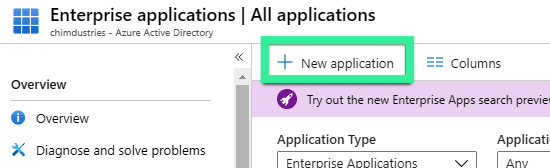
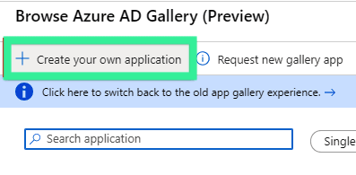
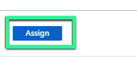

# Azure-SSO

### SAML-SSO aanmaken in Azure AD

Voer de volgende stappen uit om SAML-SSO toe te voegen in Azure AD:

*   Open in Azure de console \`Azure Active Directory\`.

    
* Klik in het linkerpaneel op \`Enterprise applications\`.

* Klik op \`+ New application\`.

<figure><figcaption></figcaption></figure>

* Klik op \`+ Create your own application\`.

<figure><figcaption></figcaption></figure>

* Voer een naam voor uw toepassing in. Behoud de overige standaardkeuzes.

<figure><figcaption></figcaption></figure>

* Klik op \`Create\`.

### Gebruikers toewijzen aan de SSO-configuratie

Wijs vervolgens gebruikers of groepen toe aan de SSO-configuratie.

**Belangrijk**: maak eerst gebruikers en groepen aan in Azure AD. Als die nog ontbreken, maakt u ze aan voordat u doorgaat.

* Klik onder \`Getting Started\` op \`Assign Users and Groups\`.
* Klik op \`+ Add user\`.

<figure><figcaption></figcaption></figure>

* Selecteer de gebruikers en groepen die u aan deze SSO-configuratie wilt toewijzen. Deze gebruikers kunnen zich met SSO aanmelden bij DocBits.

<figure><figcaption></figcaption></figure>

* Klik op \`Select\`.
* Klik op \`Assign\` wanneer de selectie klopt.

<figure><figcaption></figcaption></figure>

* Open de lijstweergave \`Groups\` en zoek de toegewezen groepen.

### SSO instellen in Azure

Voltooi vervolgens de configuratie voor eenmalige aanmelding in Azure.\\

* Klik in het linkerpaneel op \`Single sign-on\`.

* Klik op \`SAML\`.

* Klik op \`Upload metadata file\`.

* Upload het DocBits-bestand **metadata.xml**. U vindt dit in uw DocBits-account in het instellingenmenu **Integration**, onder **SSO Service Provider Settings**.

<figure><figcaption></figcaption></figure>

* Bewerk \`Basic SAML Configuration\`.

<figure><figcaption></figcaption></figure>

* Controleer of \`Entity ID\`, \`ACS URL\`, \`Sign on URL\` en \`Logout URL\` correct zijn ingevuld.

<figure><figcaption></figcaption></figure>

* Download het nieuw gegenereerde bestand **Federation Metadata XML**.

<figure><figcaption></figcaption></figure>

* Upload FederationMetadata.xml naar **Identity Service Provider Settings** in uw DocBits-account, in het instellingenmenu **Integration**.

\\

<figure><figcaption></figcaption></figure>
