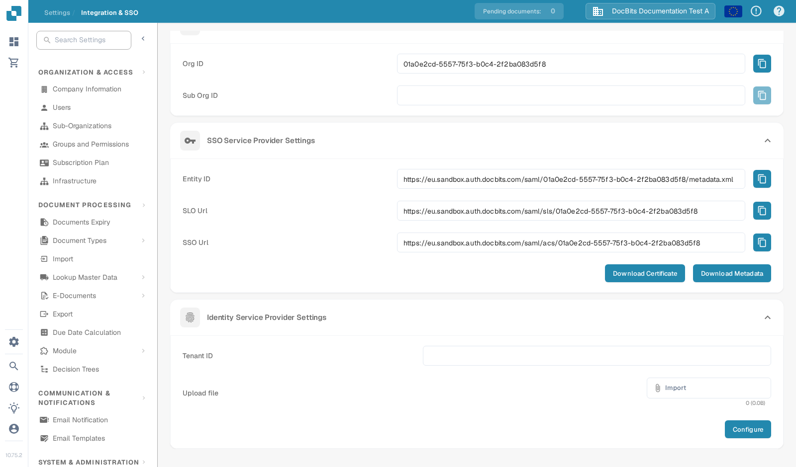

# V1

Deze handleiding is bedoeld voor **Infor Ming.le Portal V1** met LN of een oudere M3-interface. Als uw tenant een nieuwere Infor OS Portal gebruikt, vraag dan aan uw Infor-beheerder welke federatieprocedure van toepassing is voordat u deze stappen gebruikt. U hebt beheerderstoegang nodig tot zowel uw Infor-tenant als uw DocBits-organisatie. Houd een bestaande beheerdersaanmelding beschikbaar totdat een testgebruiker zich via SSO kan aanmelden.

## 1. De service provider-waarden van DocBits ophalen

Meld u aan bij de juiste DocBits-omgeving en -organisatie. Open **Settings → Integration & SSO → SSO Service Provider Settings**. Kopieer de **Entity ID**, **SSO Url** en **SLO Url** met de knoppen naast elke waarde. Gebruik **Download Certificate** als Infor het ondertekeningscertificaat van DocBits vereist. **Download Metadata** exporteert de metadata van de DocBits-_service provider_. De Sandbox-URL's in dit voorbeeld zijn specifiek voor de testorganisatie; kopieer ze niet naar een andere tenant.

## 2. DocBits registreren in Infor

Open in uw **Infor Ming.le Portal V1**-tenant **User Management → Security Administration → Service Provider** en voeg een SAML-service provider voor DocBits toe. Uw Infor-beheerder moet bevestigen dat dit het juiste scherm en het juiste toepassingstype voor uw tenant is. Wijs de waarden als volgt toe:

| Veld van de Infor-service provider | Waarde uit DocBits                                                                                        |
| ---------------------------------- | --------------------------------------------------------------------------------------------------------- |
| Entity ID                          | Entity ID                                                                                                 |
| SSO Endpoint                       | SSO Url (assertion consumer-endpoint)                                                                     |
| SLO Endpoint                       | SLO Url (uitlog-endpoint)                                                                                 |
| Signing Certificate                | Certificaat uit Download Certificate, indien vereist                                                      |
| Name ID Format / Mapping           | E-mailadres, nadat is bevestigd dat de Infor-gebruikersidentificatie overeenkomt met de DocBits-gebruiker |

**Plak de SLO Url niet in SSO Endpoint.** Dit zijn verschillende endpoints. Sla de service provider op. De [handleiding voor de configuratie van service providers](https://docs.infor.com/inforos/2026.09/en-us/useradminlib_cloud/minceag_cloud_osm/vxs1562872848076.html) van Infor beschrijft de rol van de velden en de actie **Export SAML Metadata**. Infor-menu's en -machtigingen kunnen per tenant en release verschillen.

## 3. De metadata van de Infor identity provider importeren in DocBits

Open in Infor de opgeslagen DocBits-service provider, kies **View** bij **Identity Provider Information** en vervolgens **Export SAML Metadata**. Dit bestand bevat de gegevens van de _Infor identity provider_. Het verschilt van de metadata van de DocBits-service provider die u in stap 1 hebt gedownload.

Ga in DocBits terug naar **Settings → Integration & SSO → Identity Service Provider Settings**. Voer de Infor **Tenant ID** in, kies de XML-metadata van Infor onder **Upload file** en selecteer **Configure**. Laat de tenant-ID en de XML door uw Infor-beheerder bevestigen voordat u opslaat; de Sandbox-schermafbeelding is niet representatief voor uw productietenant.

## 4. Aanmelding controleren

Wijs een geschikte Infor-gebruiker toe aan de DocBits-toepassing in Ming.le en test de aanmelding met die gebruiker. Controleer of de e-mailidentificatie van de gebruiker overeenkomt met een DocBits-gebruiker. Houd de oorspronkelijke beheerderssessie open tijdens het testen. Als aanmelden of afmelden mislukt, vergelijk dan de endpoints van de service provider, de Infor-metadata, het certificaat en de Name ID-mapping samen met beide beheerders.

**Reikwijdte van de verificatie:** Het DocBits-scherm en de navigatie hierboven zijn gecontroleerd in de Engelse Sandbox-testorganisatie. Voor deze update was geen Infor-tenant beschikbaar, dus de Infor-schermen, de uitwisseling van metadata en de live aanmelding zijn niet getest. De eerdere Infor-schermafbeeldingen zijn verwijderd omdat hun huidige status niet kon worden geverifieerd; gebruik de gekoppelde Infor-documentatie en de beheerder van uw tenant voor de actuele interface.
