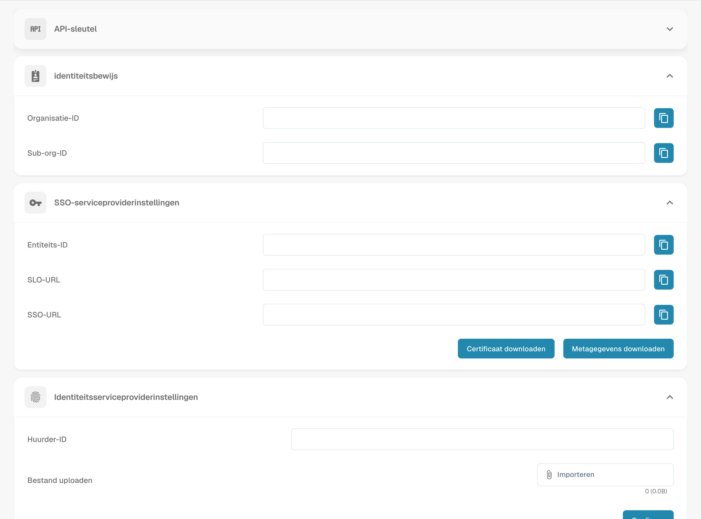

# V2: Infor OS Portal SSO

Gebruik deze handleiding als uw organisatie DocBits start vanuit **Infor OS Portal V2**. Een beheerder voor zowel Infor als DocBits is vereist. Houd een bestaande DocBits-beheerderssessie open tijdens het testen van SSO. De menu- en veldnamen in Infor zijn afhankelijk van de release van de tenant; bevestig ze bij uw Infor-beheerder.

## 1. De SAML-waarden van DocBits ophalen

Open in de juiste DocBits-organisatie **Instellingen → Integratie en SSO → Instellingen van de SSO-serviceprovider**. Kopieer **Entiteits-ID**, **SSO-URL** en **SLO-URL**. Gebruik **Certificaat downloaden** als het formulier van de Infor-service provider het ondertekeningscertificaat vereist. **Metagegevens downloaden** is de XML van de DocBits-*service provider*; het is niet de metadata van de Infor identity provider die in stap 3 wordt gebruikt. De URL's in de Sandbox-afbeelding horen alleen bij deze testorganisatie.

<figure><figcaption>
SSO-configuratie met afgeschermde organisatiegegevens. De sectie identiteitsbewijs bevat organisatie-ID’s; het gaat niet om een identiteitsdocument.
</figcaption></figure>

## 2. DocBits toevoegen als service provider in Infor

Open in Infor OS Portal **OS → Security → Security Administration → Service Provider**, als dit de route in uw tenant is. Voeg een SAML-service provider toe en gebruik de volgende mapping:

| Infor-veld | DocBits-waarde |
| --- | --- |
| Entity ID | Entity ID |
| SSO Endpoint | SSO Url, het assertion consumer-endpoint |
| SLO Endpoint | SLO Url, het uitlog-endpoint |
| Signing Certificate | Download Certificate, indien vereist |
| Name ID Format / Mapping | E-mailadres, nadat is gecontroleerd dat het overeenkomt met de DocBits-gebruiker |

De vorige handleiding gaf gebruikers de instructie om de **SLO-URL** in **SSO-eindpunt** te plaatsen. Dat is onjuist: elke URL hoort in het bijbehorende veld. Sla de service provider op. De [handleiding voor service providers](https://docs.infor.com/inforos/latest/en-us/useradminlib_cloud/inforos_security/jho1449385888462.html) van Infor legt de navigatie en de vereiste rol uit; de [SAML-veldhandleiding](https://docs.infor.com/inforos/2026.09/en-us/useradminlib_cloud/mineeag/min1772650388038.html) legt de rol van de endpoints uit.

## 3. De metadata van de identity provider van Infor importeren

Open de opgeslagen service provider in Infor en kies **Weergave → Export SAML Metadata** voor de Infor identity provider. Open terug in DocBits **Instellingen → Integratie en SSO → Instellingen van de identiteitsprovider**. Voer de Infor **Tenant-ID** in, kies de Infor-XML onder **Bestand uploaden** en selecteer **Configureren**. Laat de tenant-ID en de metadata door uw Infor-beheerder bevestigen. Upload hier niet de XML van de DocBits-service provider uit stap 1.

## 4. Een DocBits-tegel toevoegen in Infor OS Portal

Open in Infor OS Portal **Portal → Applications → Add Application**. Registreer DocBits als niet-Infor-toepassing voor uw tenant, geef een weergavenaam, pictogram en unieke Logical ID op en stel de **application URL** in op uw gebruikelijke DocBits-aanmeld- of startadres. De application URL van het portaal opent de gebruikersinterface; het is **niet** het SAML SSO/ACS-endpoint uit stap 2. Volg de [handleiding voor niet-Infor-toepassingen](https://docs.infor.com/inforos/latest/en-us/useradminlib_cloud/inforospag/lsm1436532874794.html) van Infor voor het actuele formulier, de navigatieopties en de machtigingen. Verleen de testgebruiker toegang tot de portaaltoepassing.

## 5. Verifiëren met één gebruiker

Meld u af in een afzonderlijke browsersessie, open de DocBits-tegel vanuit Infor en controleer of het e-mailadres van de toegewezen gebruiker wordt herleid tot het juiste DocBits-account en de juiste organisatie. Controleer ook het afmelden. Als een van beide mislukt, vergelijk dan de Infor-metadata, de SSO/SLO-URL's, het certificaat, de Name ID en de URL van de portaaltegel samen met de twee beheerders. Houd de oorspronkelijke beheerderssessie aan totdat de test is afgerond.

**Reikwijdte van de verificatie:** Het DocBits-scherm hierboven is vastgelegd in de Engelse Sandbox-testorganisatie. Er was geen Infor-tenant beschikbaar, dus de menu's van het Infor-portaal, de import van metadata, het aanmaken van de tegel en de live SSO zijn voor deze update niet getest. Oude extern gehoste Infor-afbeeldingen, waaronder privé-e-mailbijlagen, zijn verwijderd; gebruik de gekoppelde Infor-documentatie en de beheerder van uw tenant voor die interface.
