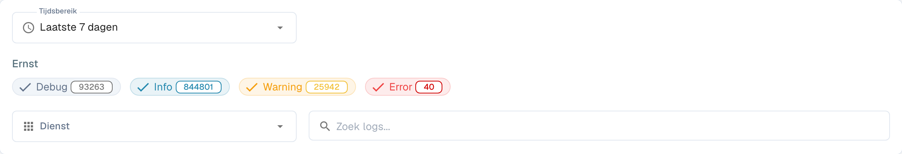

# Activiteitenlogboek

<figure><figcaption>
Filters van het activiteitenlogboek; vermeldingen zijn afgeschermd.
</figcaption></figure>

Activity Logging biedt een realtime overzicht van systeemgebeurtenissen in alle DocBits-services. Gebruik het om verwerkingsactiviteit te bewaken, fouten op te sporen en systeemgedrag te auditen.

## Analytics-banner

Bovenaan de pagina verwijst een banner naar het **Analysedashboard** voor grafieken, metrics en realtime monitoring.

## Filters

| Filter | Beschrijving |
|--------|-------------|
| **Tijdsbereik** | Selecteer een tijdvenster (bijv. Today, Last 7 Days, Last 30 Days). |
| **Ernst** | Schakel ernstniveaus in of uit om ze op te nemen of uit te sluiten: **Foutopsporing**, **Informatie**, **Waarschuwing**, **Fout**. Elke chip toont het huidige aantal. |
| **Dienst** | Filter logboeken op service (bijv. api, auth, api-service). |
| **Search logs** | Vrije tekst zoeken in logberichten. |

## Logtabel

| Kolom | Beschrijving |
|--------|-------------|
| **Tijdstempel** | Datum en tijdstip waarop de gebeurtenis plaatsvond. Sorteerbaar. |
| **Ernst** | Kleurgecodeerde badge: Info (blauw), Warning (geel), Error (rood), Debug (grijs). |
| **Onderdeel** | De service of module die het logbericht heeft gegenereerd (bijv. api, auth, api-service). |
| **Bericht** | Het volledige logbericht met details van de gebeurtenis. |

De resultaten zijn gepagineerd — gebruik de bedieningselementen onderaan om door de pagina's te navigeren.

## Acties in de voettekst

| Actie | Beschrijving |
|--------|-------------|
| **Auto-refresh** | Schakelaar om de logweergave met regelmatige tussenpozen automatisch te vernieuwen. |
| **Refresh Now** | Ververs de loggegevens handmatig. |
| **Export JSON** | Exporteer de huidige gefilterde logboeken als JSON-bestand. |
| **Download Logs** | Download de volledige loggegevens. |
