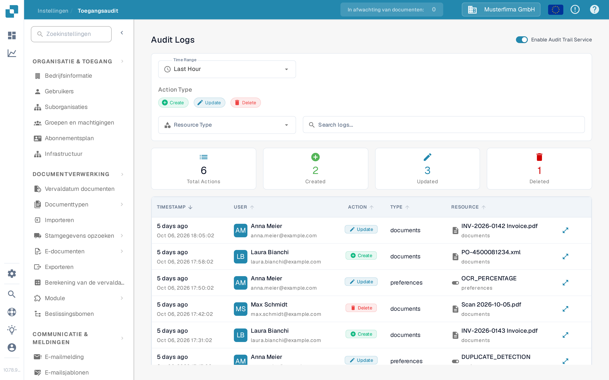
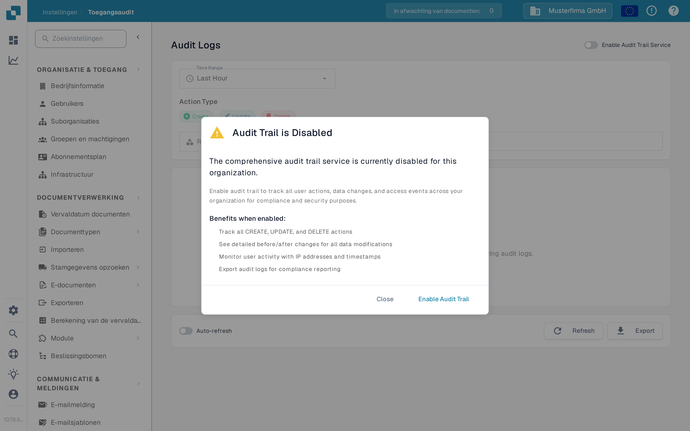

# Toegangsaudit

<figure><figcaption>
De Nederlandse Sandbox-pagina voordat auditregistratie is ingeschakeld.
</figcaption></figure>

Toegangsaudit registreert wie een bron heeft aangemaakt, gewijzigd of verwijderd, en wanneer. Open **Instellingen → Activiteitenlogboek → Toegangsaudit** om het logboek te bekijken. Schakel de dienst voor een organisatie alleen in wanneer u auditgebeurtenissen wilt verzamelen.

## Wanneer auditregistratie uit staat

<figure><figcaption>
Het dialoogvenster legt uit wat er wordt vastgelegd voordat u de dienst inschakelt.
</figcaption></figure>

Het eerste bezoek binnen een browsersessie kan **Audit Trail is Disabled** tonen. **Close** sluit het dialoogvenster en laat auditregistratie uitgeschakeld. **Enable Audit Trail** schakelt het in voor de huidige organisatie. Op de pagina achter het dialoogvenster schakelen **Enable Now** en de schakelaar **Enable Audit Trail Service** het ook in. Deze bedieningselementen wijzigen de organisatie-instelling; ze tonen de functie niet alleen als voorbeeld.

Zolang de dienst uit staat, kunnen de filters en de logtabel geen gebeurtenissen tonen. De lege status legt uit hoe u registratie inschakelt. Gebruik na het inschakelen de schakelaar om de dienst indien nodig weer uit te schakelen. Gebeurtenissen zijn alleen beschikbaar wanneer de dienst is ingeschakeld en gegevens heeft verzameld.

## Een gebeurtenis vinden

| Bediening                          | Wat deze doet                                                           |
| ---------------------------------- | ----------------------------------------------------------------------- |
| **Time Range**                     | Beperkt de lijst tot een periode zoals Last Hour, Today of Last 7 Days. |
| **Create**, **Update**, **Delete** | Neemt die soorten acties op of sluit ze uit.                            |
| **Resource Type**                  | Beperkt de resultaten tot een brontype, zoals documents of settings.    |
| **Search logs**                    | Doorzoekt de zichtbare auditregels op tekst.                            |
| **Refresh**                        | Laadt de nieuwste overeenkomende regels eenmalig.                       |
| **Auto-refresh**                   | Houdt de lijst automatisch bijgewerkt zolang de pagina open is.         |
| **Export**                         | Downloadt de huidige auditloggegevens als een JSON-bestand.             |

De samenvattingskaarten tonen het totaal en het aantal aangemaakte, bijgewerkte en verwijderde acties voor de gekozen filters. In de tabel toont **Timestamp** wanneer een gebeurtenis plaatsvond, identificeert **User** de actor, benoemt **Action** de wijziging en identificeert **Resource** het betrokken item. Open de detailbediening van een rij om de vastgelegde wijziging te bekijken. Als er geen gebeurtenissen verschijnen, controleer dan of de dienst is ingeschakeld en verruim het tijdsbereik voordat u de andere filters wijzigt.
