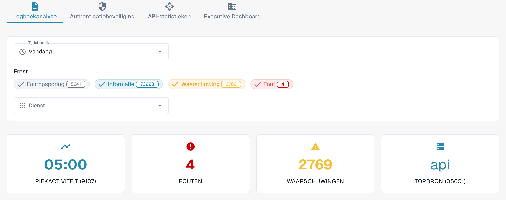

# Analyse

Open **Instellingen → Activiteitenlogboek → Analyse** met een account van een organisatiebeheerder. Deze pagina bundelt logactiviteit, authenticatiegebeurtenissen, API-gebruik en een managementoverzicht. Begin met **Logboekanalyse**. Kies **Bekijk gebeurtenislogboeken** om de gebeurtenissenlijst te openen en een afzonderlijke vermelding te onderzoeken.

<figure><figcaption>
Huidige Nederlandse Dev-weergave. De aantallen horen bij de testomgeving en zullen in uw organisatie anders zijn.
</figcaption></figure>

## Tabbladen

| Tabblad | Beschrijving |
|---------|--------------|
| **Logboekanalyse** | Verdeling van logniveaus, tijdsverloop en uitsplitsing per dienst. |
| **Authenticatiebeveiliging** | Authenticatiegebeurtenissen, inlogpogingen en beveiligingsstatistieken. |
| **API-statistieken** | Aantallen API-aanvragen, responstijden en foutpercentages. |
| **Executive Dashboard** | Overzicht voor organisatiebeheerders; de beschikbaarheid hangt af van uw rol. |

Elk tabblad heeft eigen periode-instellingen. Controleer de geselecteerde periode opnieuw wanneer u van tabblad wisselt.

## Logfilters

| Filter | Beschrijving |
|--------|--------------|
| **Tijdsbereik** | Kies **Laatste uur**, **Vandaag**, **Laatste 7 dagen**, **Laatste 30 dagen** of **Aangepast**. De aangepaste keuze toont velden voor de begin- en einddatum met tijd. |
| **Ernst** | Klik op **Foutopsporing** (Debug), **Informatie**, **Waarschuwing** of **Fout** om dat niveau op te nemen of uit te sluiten. Het getal op elk filter toont het huidige aantal. |
| **Dienst** | Selecteer een of meer diensten waarvan u de gebeurtenissen wilt bekijken. |

## Samenvattingskaarten

Onder de filters staan vier kaarten:

| Kaart | Beschrijving |
|-------|--------------|
| **Piekactiviteit** | Tijdstip met het hoogste logvolume en het bijbehorende aantal. |
| **Fouten** | Aantal fouten in de geselecteerde periode. |
| **Waarschuwingen** | Aantal waarschuwingen in de geselecteerde periode. |
| **Topbron** | Dienst die de meeste logs produceert, met het aantal. |

## Monitoring van echte gebruikers (RUM)

Als browsertelemetrie beschikbaar is, toont de RUM-sectie prestatiestatistieken van de frontend. De beschikbare gegevens hangen af van de omgeving en de periode. Een leeg diagram, een melding dat gegevens ontbreken of een laadindicator is geen meetresultaat.

## Logdiagrammen en downloads

Kies in **Logboekanalyse** een van deze weergaven:

| Weergave | Beschrijving |
|----------|--------------|
| **Ernst** | Cirkeldiagram met de verdeling van logniveaus. |
| **Tijdlijn** | Lijndiagram met het logvolume door de tijd. |
| **Dienst** | Staafdiagram met de uitsplitsing per dienst. |

Open in het diagram **Tijdlijn** het menu rechtsboven en kies **Download SVG**, **Download PNG** of **Download CSV**. Deze opties gaan over het getoonde diagram; andere diagrammen bieden mogelijk niet dezelfde werkbalk.

Als er geen gegevens beschikbaar zijn, probeer dan een ruimer **Tijdsbereik** of minder filters voor **Ernst**.

## JavaScript-fouten met stacktraces

Als deze kaart beschikbaar is, geeft het omgevingslabel aan op welke omgeving de fouten betrekking hebben, bijvoorbeeld **dev alleen**. De kaart bevat recente browseruitzonderingen, begrensd tot 24 uur. **Kopieer alle JSON-bestanden** kopieert de vermeldingen die momenteel in deze kaart zijn geladen, niet het volledige gebeurtenissenlog. De actie plaatst JSON-tekst op het klembord. De knop is uitgeschakeld als de lijst leeg is.

Klik bij een beschikbare vermelding op het bericht om de stacktrace uit te klappen. Met de rijacties kopieert u die vermelding als JSON of kopieert u de stacktrace. Een tracelink verschijnt alleen als de vermelding een trace-ID heeft.
