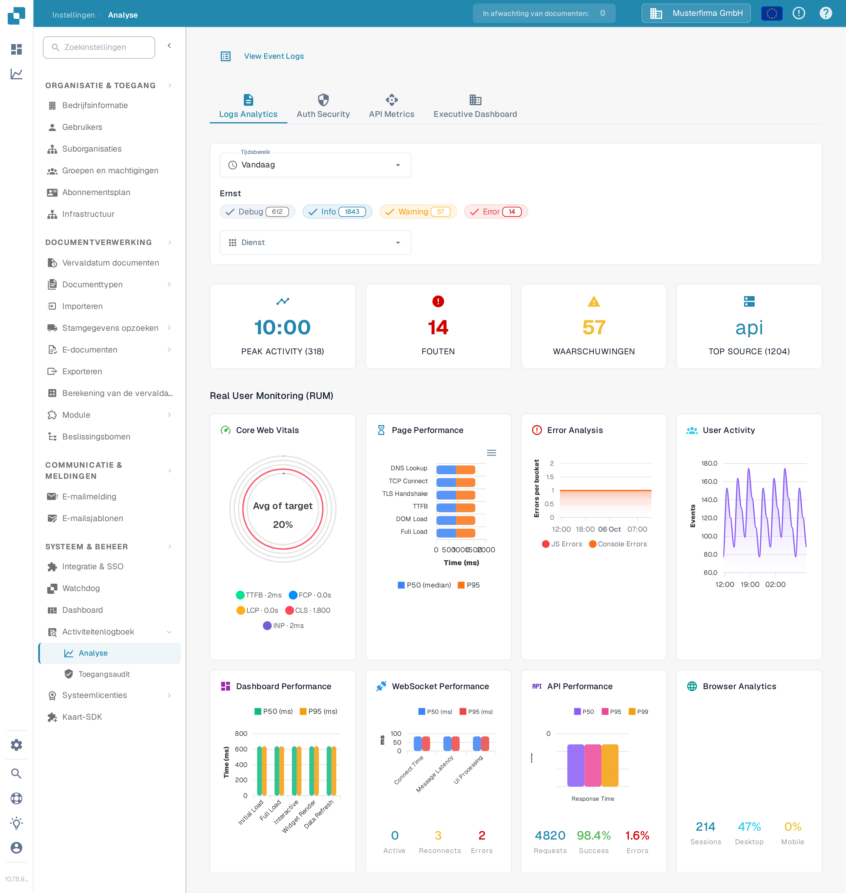

# Analyse

<figure><figcaption>
Gebruik de tabbladen en filters om de statistieken te beperken die u wilt bekijken.
</figcaption></figure>

De pagina Analyse helpt u om logpatronen, authenticatiegebeurtenissen, API-gebruik en een overkoepelend overzicht te onderzoeken. Begin met **Logs Analytics**. Kies **View Event Logs** om de onderliggende gebeurtenissenlijst te openen wanneer u één afzonderlijke vermelding wilt onderzoeken.

## Tabbladen

| Tabblad | Beschrijving |
|---------|--------------|
| **Logs Analytics** | Verdeling van de ernst van de logs, tijdlijndiagrammen en uitsplitsing per dienst. |
| **Auth Security** | Authenticatiegebeurtenissen, inlogpogingen en beveiligingsgerelateerde statistieken. |
| **API Metrics** | API-aanvraagvolumes, responstijden en foutpercentages. |
| **Executive Dashboard** | Overkoepelend overzicht voor organisatiebeheerders; andere rollen zien dit tabblad mogelijk niet. |

## Filters

| Filter | Beschrijving |
|--------|--------------|
| **Tijdsbereik** | Kies een tijdvenster (bijv. Vandaag, Afgelopen 7 dagen) voor de weergegeven statistieken. |
| **Ernst** | Klik op Debug, Info, Warning of Error om dat niveau op te nemen of uit te sluiten. Een getal op een chip toont de huidige telling. |
| **Dienst** | Kies de dienst waarvan u de gebeurtenissen wilt onderzoeken. |

## Samenvattingskaarten

Onder de filters verschijnen vier samenvattingskaarten:

| Kaart | Beschrijving |
|-------|--------------|
| **PEAK ACTIVITY** | Tijdstip van de dag met het hoogste logvolume en het totale aantal. |
| **FOUTEN** | Totaal aantal fouten in de geselecteerde periode. |
| **WAARSCHUWINGEN** | Totaal aantal waarschuwingen in de geselecteerde periode. |
| **TOP SOURCE** | De dienst die de meeste logs produceert, met het aantal. |

## Real User Monitoring (RUM)

Onder de samenvattingskaarten tonen RUM-statistieken frontend-prestatiegegevens die zijn verzameld uit echte browsersessies van gebruikers.

## Analyse-diagrammen

Kies in **Logs Analytics** een van de drie diagramknoppen om te wijzigen hoe dezelfde gefilterde logs worden weergegeven:

| Weergave | Beschrijving |
|----------|--------------|
| **Severity** | Cirkeldiagram met de verdeling van de logniveaus (Debug, Info, Warning, Error). |
| **Timeline** | Lijndiagram met het logvolume in de loop van de tijd. |
| **Service** | Staafdiagram met de uitsplitsing van de logs per dienst. |

Als een diagram meldt dat er geen gegevens beschikbaar zijn, probeer dan een breder **Tijdsbereik** of minder **Ernst**-filters. De cijfers in de schermafbeelding horen bij de synthetische Sandbox-organisatie en wijken af in uw organisatie.
