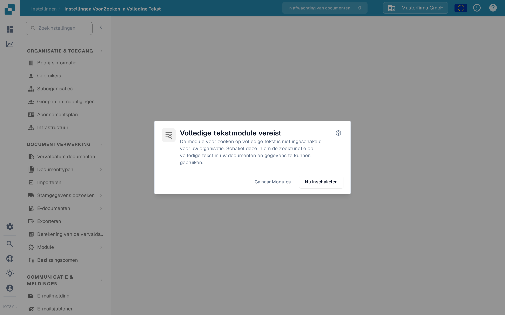

# Instellingen voor zoeken in volledige tekst

<figure><figcaption>
Wanneer zoeken in volledige tekst is uitgeschakeld, legt dit dialoogvenster de volgende stappen uit.
</figcaption></figure>

De instellingen voor zoeken in volledige tekst bepalen wat DocBits indexeert en hoe die inhoud doorzoekbaar wordt in documenten, ERP-stamgegevens en sjablonen. De instellingenpagina toont een vereiste-dialoogvenster totdat de **module voor zoeken in volledige tekst** is ingeschakeld — zie [Volledige tekstzoekopdracht](../document-processing/module/fulltext-search.md) voor de zoektaal voor gebruikers.

## Vereisten

De module voor zoeken in volledige tekst moet worden ingeschakeld in **Instellingen → Module → Dashboards En Analyses → Volledige tekst zoeken**. Als de module niet is ingeschakeld, biedt het dialoogvenster drie acties:

* **Help (?)** — Opent de documentatie van zoeken in volledige tekst in een nieuw tabblad voordat u een instelling wijzigt.
* **Ga naar Modules** — Opent de module-instellingen onder Dashboards En Analyses om de configuratie te bekijken.
* **Nu inschakelen** — Opent het abonnementsvenster. Controleer en bevestig dat venster voordat de module wordt ingeschakeld; alleen op deze knop klikken schakelt de module nog niet in.

De instellingenpagina zelf wordt beschikbaar zodra de module actief is.

## Indeling van de pagina

De instellingenpagina is ingedeeld in drie tabbladen, die elk een ander inhoudstype bestrijken dat zoeken in volledige tekst kan indexeren.

### Tabblad "Documenten"

Het tabblad Documenten omvat alles wat te maken heeft met het indexeren van verwerkte documenten:

* **Indexeringsstatistieken** — totalen voor geïndexeerde en wachtende documenten, op verzoek vernieuwd.
* **Vectorvoorkeuren** — drie schakelaars op organisatieniveau die bepalen of vectorindexering naast de tekstindex voor documenten loopt. Vectorindexering voedt de `vector:`-zoekmodus en de functie "Vergelijkbare zoeken".
* **Herindex-acties** — start een volledige of incrementele herindexering. Tijdens een herindexering ziet u live voortgang (documenten per minuut, verwachte resterende tijd), de huidige streamstatus en de laatste fout (indien aanwezig).
* **Synchronisatiediagnostiek** — diagnostiek op aanvraag voor gevallen waarin de index niet synchroon lijkt met de onderliggende documentopslag.

<mark>Herindexering is niet-destructief — de bestaande zoekfunctie blijft werken terwijl de nieuwe index wordt opgebouwd.</mark>

### Tabblad "ERP"

Het tabblad ERP regelt de indexering van ERP-stamgegevens — leveranciers, klanten, artikelen en vergelijkbare entiteiten. Elke entiteit heeft een eigen schakelaar:

* **Indexering** — indexeert de entiteit tekstueel, zodat deze vanuit het dashboard doorzoekbaar is.
* **Vector** — indexeert de entiteit vectorieel, zodat deze door semantische queries kan worden gevonden.

Gebruik de actie **Alles schakelen** bovenaan de lijst om dezelfde aan/uit-status op alle entiteiten tegelijk toe te passen. De indexering start op de achtergrond; een indicator op elke rij toont wanneer deze bezig is.

### Tabblad "Sjablonen"

Het tabblad Sjablonen toont de sjabloonversies die bekend zijn bij de index voor zoeken in volledige tekst. Gebruik deze weergave om na een nieuwe uitrol te bevestigen dat de sjabloonversies waarvan u afhankelijk bent aanwezig zijn in de index.

## Wat wordt geïndexeerd

Eenmaal ingeschakeld en geconfigureerd, biedt zoeken in volledige tekst gebruikers:

* Zoeken in de volledige inhoud van documenten (niet alleen de metadatavelden).
* Documenten vinden op tekst in geüploade bestanden.
* Geavanceerde zoekoperatoren gebruiken voor precieze queries.
* Rechtstreeks vanuit het dashboard toegang tot de zoekresultaten.
* Semantisch zoeken (prefix `vector:`) wanneer vectorindexering voor dat inhoudstype is ingeschakeld.

Zie de modulepagina [Volledige tekstzoekopdracht](../document-processing/module/fulltext-search.md) voor de volledige naslag van de zoektaal, inclusief bereikqueries, slimme filters en de AI-zoekmodus.
