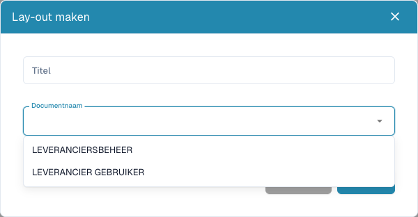

# Leveranciersformulieren configureren

<figure><figcaption>
Kies de externe of interne doelgroep voordat u een indeling opslaat.
</figcaption></figure>

Leveranciersindelingen bepalen formulieren voor leveranciers en interne medewerkers. Ze veranderen geen afgedrukte factuur en trainen geen extractie. U hebt beheerdersrechten en afgesproken informatiebehoeften per doelgroep nodig.

## De doelgroep kiezen

1. Open **Instellingen → Leveranciersinstellingen → Leveranciersindeling**.
2. Bekijk bestaande indelingen en open de juiste voordat u een nieuwe maakt.
3. Kies voor een nieuwe **Nieuw**, een herkenbare titel en het documenttype: leveranciersgebruiker voor extern of leveranciersbeheer voor intern.
4. Sla de definitie op, open de indeling vanuit de lijst en controleer de doelgroep.

## Velden en opbouw instellen

1. Open leveranciersvelden. Controleer titel, ERP-veldnaam, waardenlijst en verplicht, alleen-lezen en verborgen.
2. Maak een veld met naam, titel en type. Selectie/zoeken/keuzerondjes vereisen de juiste waardenlijst. Bestanden vereisen een documenttype; controleer voor andere velden de ERP-naam.
3. Sla correcte veldinstellingen op. Definitie en formulieropbouw zijn aparte stappen.
4. Orden groepen en velden via **Elementen** en **Velden** in de juiste indeling. Selecteer een element en bekijk de beschikbare eigenschappen.
5. Geef groepen geldige namen en titels. Verberg of blokkeer geen verplicht veld zonder geschikte bestaande waarde of proces.
6. Sla op en open de indeling opnieuw. **Annuleren** verlaat de editor. De standaardsjabloon kan de huidige opbouw vervangen; gebruik deze bewust.

## Beide weergaven testen

Controleer met fictieve leverancier en testaccount afzonderlijk registratie en interne leveranciersdetails: verplichte meldingen, keuzes, uploads en verborgen/alleen-lezen gedrag. Opslaan in de editor bewijst geen geslaagde registratie, goedkeuring of export.

Controleer bij ontbrekende velden definitie, zichtbaarheid, indeling en doelgroep. Onderzoek bij ontbrekende ERP-waarden ook de exportmapping.

Zie [Leveranciersportaal](../../setup/supplier-portal/README.md), [Algemene instellingen](supplier-general-settings.md) en [Rechten](supplier-permissions.md).
