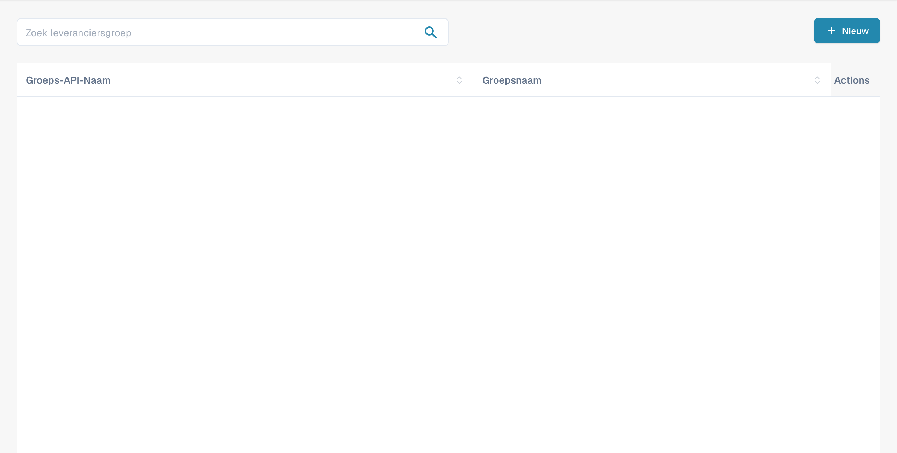
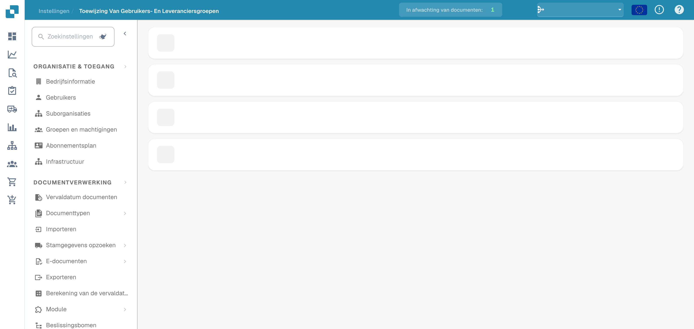

# Leveranciersmachtigingen

### Leveranciersgroep

<figure><figcaption>
Leveranciersgroepen met afgeschermde namen.
</figcaption></figure>

Beheer leveranciersgroepen om leveranciers te categoriseren op type, regio of rol. Elke groep heeft een **Groeps-API-naam** (gebruikt voor integraties) en een **Groepsnaam** (weergavenaam).

Klik op **+ New** om een groep te maken. Gebruik het menu met drie puntjes op elke rij om te bewerken of te verwijderen.

### Koppeling tussen gebruikers en leveranciersgroepen

<figure><figcaption>
Gebruikers aan leveranciersgroepen koppelen.
</figcaption></figure>

Wijs gebruikers toe aan leveranciersgroepen om te bepalen welke medewerkers toegang hebben tot specifieke sets leveranciers en deze mogen beheren. Elke groep wordt weergegeven als een uitklapbaar gedeelte met de toegewezen gebruikers en het aantal leden.

Klik binnen een groep op **+ New** om een gebruikerskoppeling toe te voegen. Gebruik het menu met drie puntjes om een koppeling te verwijderen.
