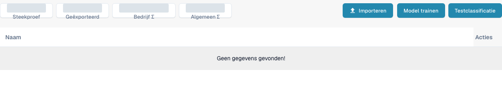

# Documenttraining

Met documenttraining leert DocBits waar waarden staan in documenten die nog niet goed worden gelezen. Train kopvelden en regelvelden afzonderlijk.

Open **Instellingen** → **Documenttypen** en kies **Modeltraining** op een bestaande documenttypekaart om de classificatietraining te bekijken. De weergave toont trainingsvoorbeelden en de knoppen **Importeren**, **Model trainen** en **Testclassificatie**. Bekijk bestaande voorbeelden voordat u wijzigingen aanbrengt en gebruik goedgekeurde testbestanden voor latere training of classificatietests.

<figure><figcaption>
Nederlandse weergave voor modeltraining van een bestaand factuurtype. Er staan geen voorbeelddocumenten in de lijst; totaaltellers zijn afgedekt. Importeren, trainen en classificatietests zijn niet uitgevoerd.
</figcaption></figure>

* [Kopvelden trainen](training-header-fields.md): markeer waar een kopwaarde, zoals een datum of totaalbedrag, in het document staat.
* [Regelvelden en tabellen trainen](training-line-fields-table-training/README.md): definieer de structuur van de regeltabel voor een specifieke leverancier.

Trainingsresultaten hangen af van de gebruikte documenten. Controleer de geëxtraheerde waarden in een volgend testdocument voordat u erop vertrouwt.
