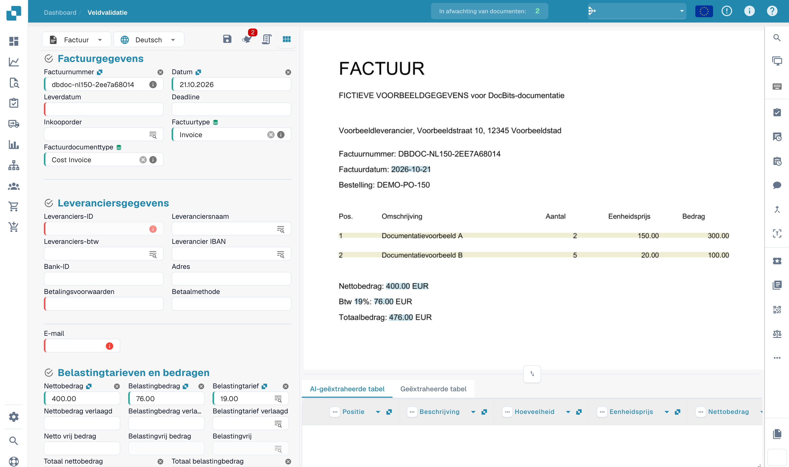
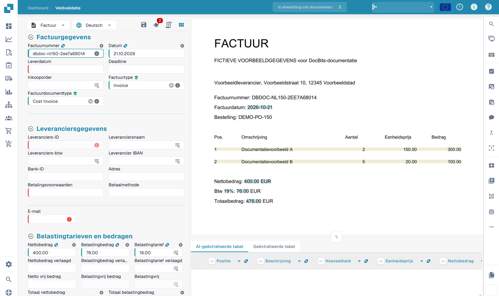

# Kopvelden trainen

Na het uploaden van uw document wordt u naar het validatiescherm geleid.\
Sommige velden kunnen al zijn ingevuld - dit is te danken aan de zwermintelligentie van DocBits. Andere velden kunnen echter leeg blijven. Dit betekent meestal dat het documenttype nog niet volledig is getraind, dus DocBits weet nog niet waaruit die informatie moet worden gehaald.

U kunt DocBits helpen om deze velden te herkennen door handmatig de juiste gegevens te identificeren.\
**Let op:** als een veld leeg blijft, kan dit eenvoudigweg betekenen dat de informatie niet aanwezig is in het geüploade document.

<figure><figcaption>
Validatie van een fictieve factuur vóór het trainen van kopvelden.
</figcaption></figure>

### Om een veld te trainen:

1. Klik op het veld dat u wilt trainen.
2. Klik vervolgens op:
   * **Dubbelklik** op de relevante gegevens in het document, of
   * **Trek een selectievak** rond de gegevens met uw cursor.

<figure><figcaption>
Het factuurnummer selecteren als startpunt voor training.
</figcaption></figure>

Herhaal dit proces voor alle vereiste velden.\
Zodra alle noodzakelijke velden zijn ingevuld, **klik op "Regels opslaan"** om de training op te slaan. Hiermee leert DocBits waar elk stuk informatie te vinden is voor vergelijkbare documenten in de toekomst.

Na het opslaan is uw document klaar om te worden geëxporteerd - en de volgende keer zal DocBits automatisch de getrainde velden extraheren.

Test na het bedoelde opslaan van de training andere documenten van dezelfde leverancier. Export hangt ook af van validatie en de geconfigureerde workflow.
