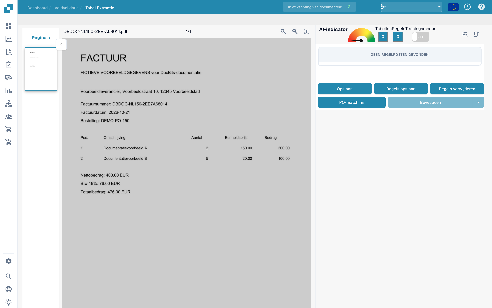
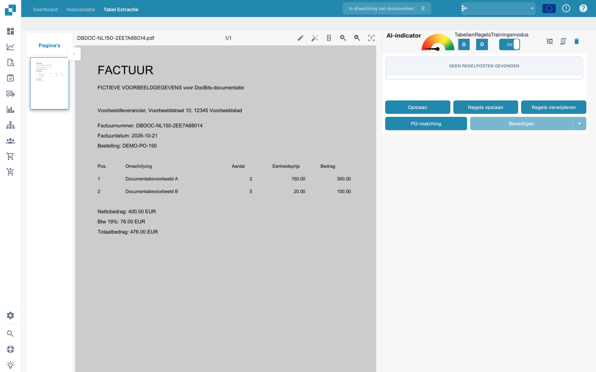
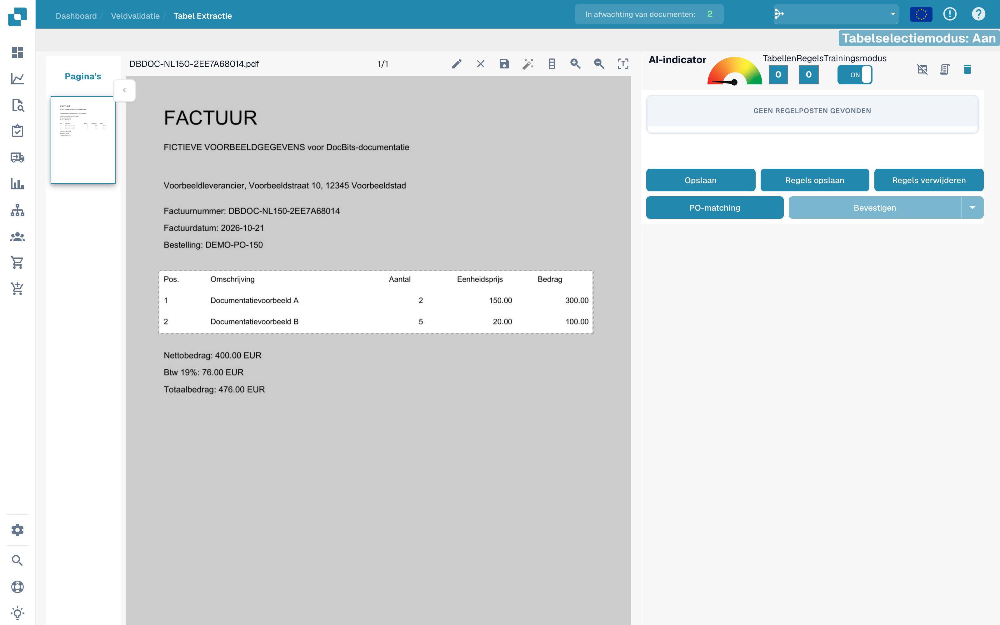
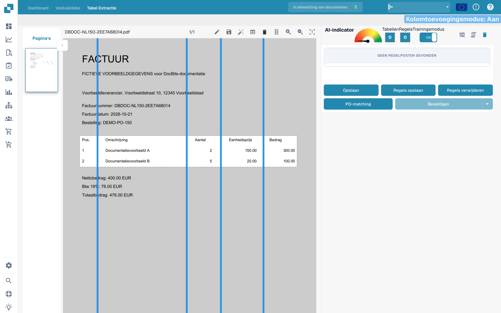
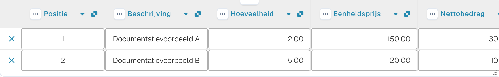

# Tabellen en kolommen definiëren

Als een tabel niet volledig wordt herkend, kunt u met tabeltraining het gebied en de kolommen aangeven. De voorbeelden gebruiken een fictieve factuur en een niet-opgeslagen concept.

## Training openen

Open het document in veldvalidatie en ga naar tabelextractie.

<figure><figcaption>
Interface om tabellen en kolommen te definiëren.
</figcaption></figure>

Schakel de trainingsmodus in om de selectie- en kolomhulpmiddelen te tonen.

<figure><figcaption>
Tabeltraining met ingeschakelde trainingsmodus.
</figcaption></figure>

De werkbalk biedt ook automatische detectie. Vergelijk het resultaat met het document: de afbeelding toont de beschikbare hulpmiddelen en bewijst geen voltooide detectie.

<figure><figcaption>
Hulpmiddelen voor tabeltraining, waaronder automatische detectie.
</figcaption></figure>

## Het gebied en de kolommen aangeven

Teken met het potlood een rechthoek rond de kolomkoppen en factuurregels. Laat de totalen eronder buiten het gebied.

<figure><figcaption>
Niet-opgeslagen tabelgebied rond de regels van de fictieve factuur.
</figcaption></figure>

Kies het kolomhulpmiddel en plaats verticale scheidingen tussen de daadwerkelijke kolommen.

<figure><figcaption>
Tabelgebied met verticale kolomscheidingen.
</figcaption></figure>

Controleer positie, omschrijving, aantal, eenheidsprijs en bedrag.

<figure><figcaption>
Scheidingen tussen de kolommen van de fictieve factuur.
</figcaption></figure>

Controleer het volledige gebied en alle scheidingen voordat u het document of de regels opslaat.

<figure><figcaption>
Gebied en scheidingen in een niet-opgeslagen trainingsconcept.
</figcaption></figure>

## De extractie controleren

Vergelijk de uitgelezen regels met de factuur. De volgende afbeelding toont regels die al automatisch waren uitgelezen in de validatie. Ze zijn niet het resultaat van het hierboven getoonde trainingsconcept.

<figure><figcaption>
Automatisch uitgelezen factuurregels van de fictieve factuur in de validatie.
</figcaption></figure>

Test na het bedoelde opslaan andere documenten van dezelfde leverancier. Eén factuur bewijst geen betrouwbare extractie voor alle lay-outs.
