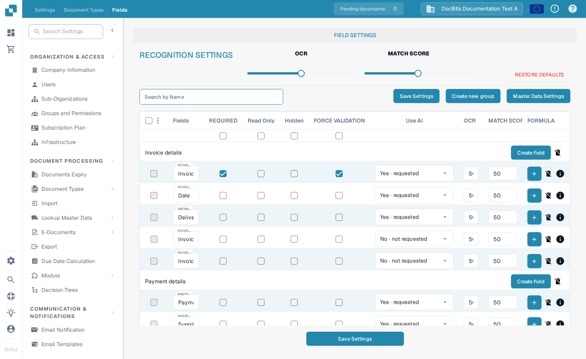
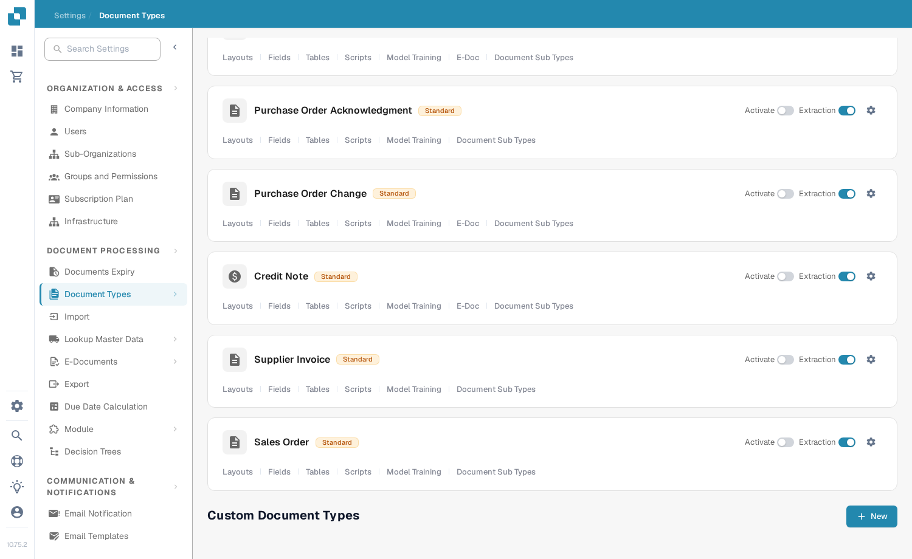

# Documenttypen

Documenttypen geven DocBits aan met welke soorten documenten uw organisatie werkt. Een beheerder vindt ze onder **Settings → Document Types** in het gedeelte **Document Processing** van het instellingenmenu.

De pagina toont eerst de **Default Document Types**, die DocBits levert en die u niet kunt verwijderen, gevolgd door de **Custom Document Types** die voor uw organisatie zijn gemaakt. Elk type heeft een eigen kaart.

<figure><figcaption>
Kies de kaart van een documenttype om dat type te configureren.
</figcaption></figure>

## Wat u op een kaart kunt doen

| Bedieningselement | Wat het doet |
| --- | --- |
| **Activate** | Maakt dit documenttype beschikbaar of niet beschikbaar in uw organisatie. Een blauwe schakelaar staat aan; een grijze schakelaar staat uit. |
| **Extraction** | Kiest de extractiemodus: **Flex** wanneer aan of **Fix** wanneer uit. Het schakelt extractie niet simpelweg in of uit. Beweeg de muisaanwijzer over de schakelaar om de huidige modus te zien. |
| **Settings** (tandwiel) | Opent **More Settings** voor dit type. Vouw daar een categorie uit om de opties te bekijken. De categorieën zijn afhankelijk van het documenttype. |
| **Layouts** | Opent de layoutconfiguratie. Zie [Layout Builder](layout-builder.md) voor de vervolgstappen. |
| **Fields** | Opent de veld- en herkenningsinstellingen voor dit type. Zie [Velden](../../settings/global-settings/document-types/fields/README.md) voor de configuratie. |
| **Tables** | Opent de configuratie van de tabelkolommen voor dit type. |
| **Scripts** | Opent verwerkingsscripts wanneer deze functie beschikbaar is. |
| **Model Training** | Opent de modeltraining voor dit type. |
| **E-Doc** | Opent de instellingen voor elektronische documenten wanneer het type die ondersteunt. |
| **Document Sub Types** | Opent de subtypen van dit documenttype. |

Afhankelijk van de functies van uw organisatie ziet u mogelijk meer links, zoals validatie- of transformatieregels. Kies de link op de kaart van het type dat u wilt wijzigen.

## Velden en herkenningsinstellingen bewerken

Klik op een kaart op **Fields** om de veldgroepen te bekijken. Bovenaan die pagina stellen **OCR** en **Match Score** de herkenningsdrempels in, zet **Restore Defaults** die drempels terug en zoekt **Search by Name** een veld. Gebruik **Create new group** om velden te ordenen en **Create field** binnen een groep om een veld toe te voegen. **Master Data Settings** opent de bijbehorende configuratie van stamgegevens.

Elke veldrij heeft bedieningselementen zoals **Required**, **Read Only**, **Hidden**, **Force Validation**, **Use AI**, OCR, Match Score en Formula. Raadpleeg de [handleiding Velden](../../settings/global-settings/document-types/fields/README.md) voordat u afzonderlijke waarden wijzigt. Klik op de pagina Fields op **Save Settings** om uw wijzigingen te bewaren.

<figure><figcaption>
De pagina Fields heeft een eigen knop Save Settings.
</figcaption></figure>

## Een eigen documenttype maken

Scrol naar **Custom Document Types** en klik op **+ New**. Volg [Documenttypen toevoegen/bewerken](../../settings/global-settings/document-types/adding-editing-document-types.md) om het nieuwe type in te stellen.

<figure><figcaption>
Gebruik New onder Custom Document Types om een type aan te maken.
</figcaption></figure>
