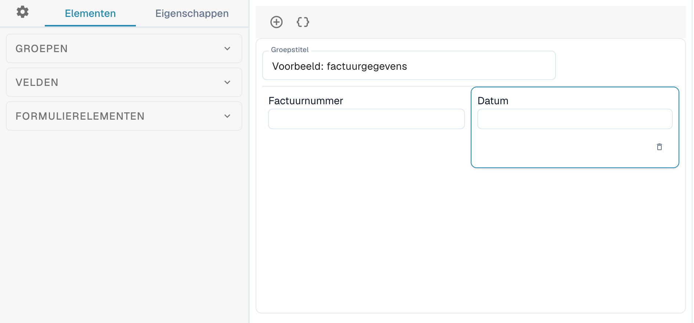
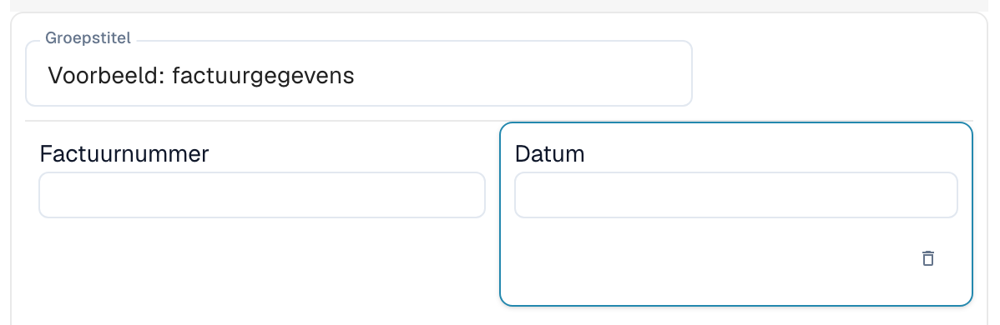
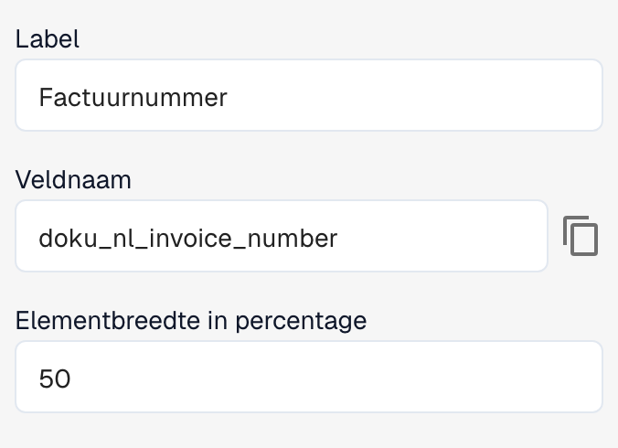

# Lay-outeditor

Gebruik de Lay-outbouwer om de velden en besturingselementen te ordenen die worden weergegeven wanneer u een document valideert of goedkeurt. Elke lay-out hoort bij een documenttype, een oorsprong en een lay-outtype. Controleer welke lay-out geopend is voordat u wijzigingen opslaat.

## De lay-out openen

1. Open **Instellingen → Documenttypen**.
2. Open de Lay-outbouwer van het gewenste documenttype of subtype. Als deze niet beschikbaar is, moet een beheerder de module mogelijk inschakelen voor uw organisatie.
3. Controleer de geselecteerde oorsprong in de actiebalk en het type editor ernaast.

<figure><figcaption>
Uitsnede van de editor: de secties Groepen, Velden en Formulierelementen links en een vereenvoudigde voorbeeldlay-out voor factuurgegevens in het midden.
</figcaption></figure>

Wanneer u **Oorsprong** wijzigt, kan DocBits een afzonderlijke lay-out voor die oorsprong aanmaken. Controleer de oorsprong voordat u begint met bewerken.

## De onderdelen van de editor

Links kunt u wisselen tussen **Elementen**, **Eigenschappen** en de algemene instellingen, weergegeven met een tandwiel.

* Het tabblad **Elementen** bevat de secties **Groepen**, **Velden** en **Formulierelementen**. Open een sectie om de beschikbare groepen, velden en besturingselementen te bekijken.
* In het midden staan de groepen en velden van de lay-out. Met groepen ordent u velden die bij elkaar horen.
* Rechts staat het voorbeelddocument. Hier kunt u het document bekijken en in- of uitzoomen.

Sleep een element uit de betreffende sectie links naar de lay-out om een groep, een veld of een besturingselement toe te voegen.

<figure><figcaption>
De velden Factuurnummer en Datum in de voorbeeldgroep. In deze lay-out beslaat elk veld 50 % van de groepsbreedte.
</figcaption></figure>

Configureer herbruikbare velden bij [Documenttypen](README.md). Welke velden beschikbaar zijn, hangt af van het geselecteerde documenttype en de configuratie daarvan.

## De eigenschappen van een element wijzigen

Selecteer een groep of veld in de lay-out en open **Eigenschappen** links. De beschikbare opties hangen af van het geselecteerde element. Voorbeelden zijn het label, de technische naam, de breedte en het gedrag.

<figure><figcaption>
Eigenschappen van het geselecteerde veld: het label, de technische naam en de elementbreedte als percentage.
</figcaption></figure>

Bij standaardvelden zijn het label en de technische naam mogelijk niet bewerkbaar. Afhankelijk van het type element kunt u ook de alleen-lezenmodus, de zichtbaarheid, de tabvolgorde, waardenlijsten en de uitvoering van een workflow of script bij een waardewijziging instellen. Groepen en velden hebben verschillende opties.

Controleer het resultaat in de lay-out nadat u de eigenschappen hebt gewijzigd. De breedte wordt als percentage ingevoerd met een numeriek invoerveld. Groepen en de velden daarin kunnen verschillende breedtes hebben. Zie [Veldeigenschappen configureren](../../settings/global-settings/document-types/layout-manager/configuring-field-properties.md).

## Sjablonen en JSON

Naast het opslaan van de lay-out biedt de actiebalk functies om een sjabloon te genereren, de standaardlay-out op oorspronglay-outs toe te passen, het standaardsjabloon te gebruiken en JSON te bewerken. Welke functies beschikbaar zijn, hangt af van de geopende editor.

Het genereren of toepassen van een sjabloon kan een aangepaste lay-out vervangen. Controleer eerst het documenttype, de oorsprong en de huidige lay-out. **JSON bewerken** is bedoeld voor geavanceerde configuratie en vereist kennis van de sjabloonindeling. In het JSON-dialoogvenster kunt u de configuratie kopiëren.

## Controleren en opslaan

Orden de groepen en velden en controleer het resultaat in de lay-out. Gebruik **Opslaan** in de actiebalk wanneer alles klopt. Zie [Oorsprongindelingen](origin-layouts.md) voor lay-outs die bij een specifieke oorsprong horen.


De afbeeldingen gebruiken een vereenvoudigde voorbeeldlay-out voor een factuur. Veldnamen en beschikbare opties hangen af van uw configuratie.

