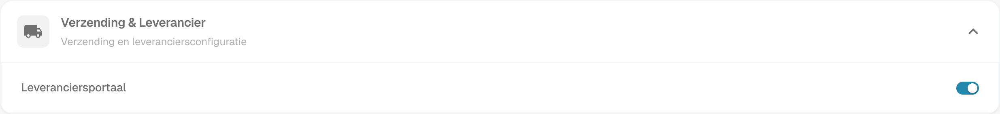
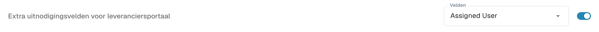
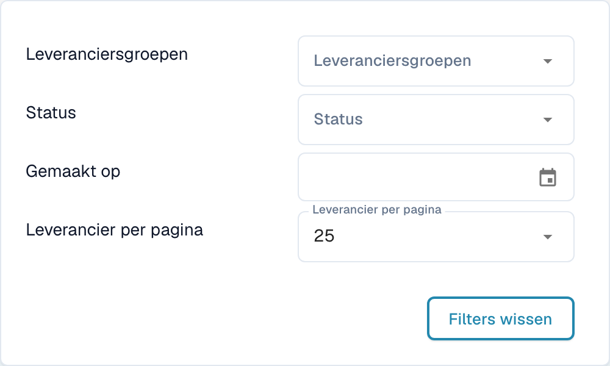
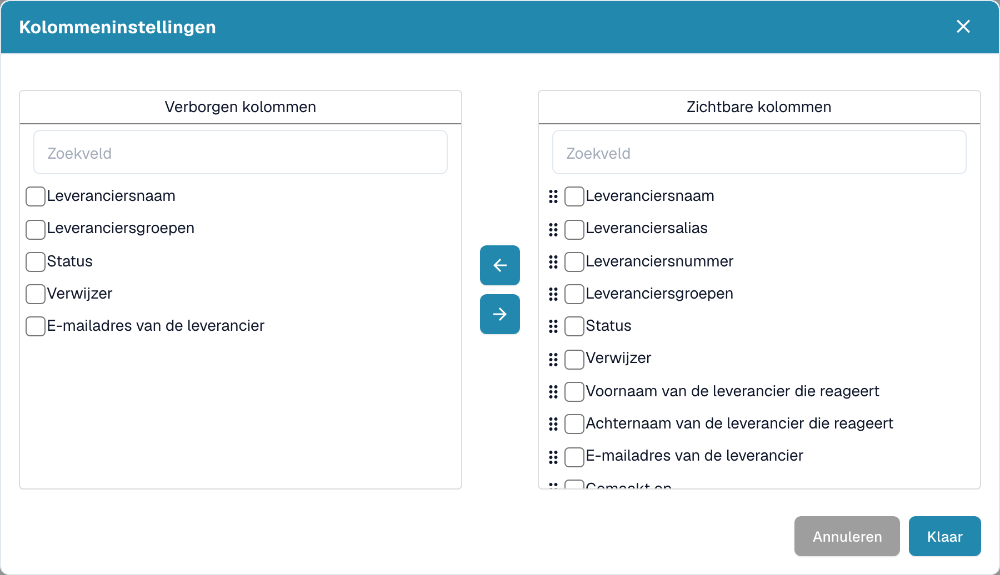
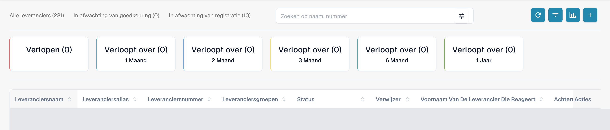
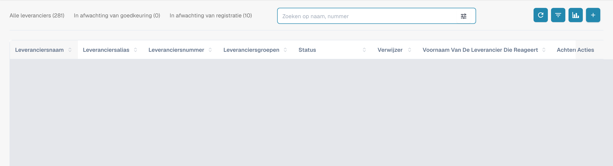
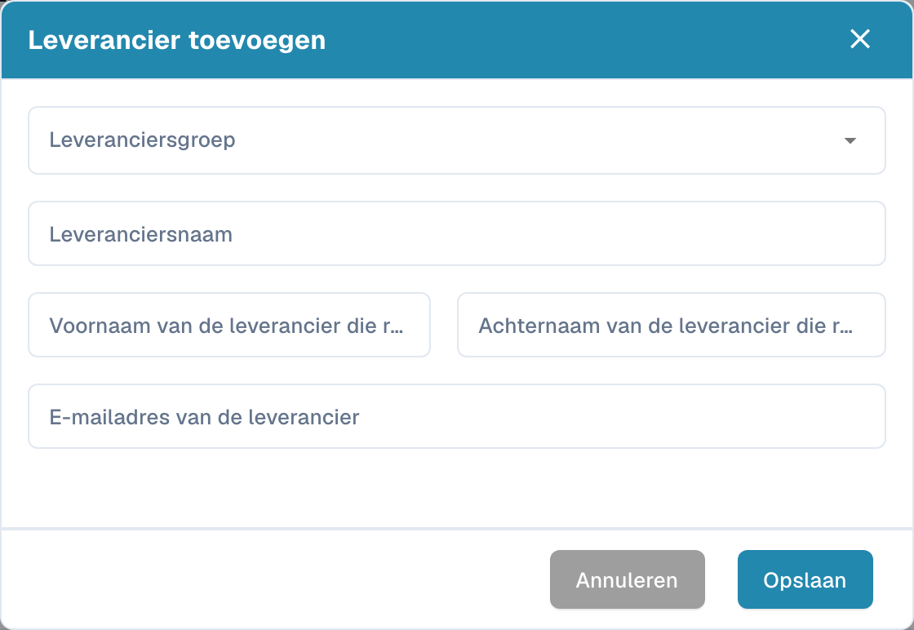

# Leveranciersportaal

Met het **leveranciersportaal** geeft een beheerder de leveranciers van zijn bedrijf toegang tot **DocBits**. De beheerder activeert het portaal en stelt in welke leveranciers het mogen gebruiken en welke informatie zij mogen bekijken.

Een uitgenodigde leverancier registreert zich en meldt zich aan met een eigen account. Vervolgens kan de leverancier de beschikbaar gestelde informatie bekijken, zoals de status van de eigen inkooporders en facturen. De configuratie van de organisatie bepaalt welke functies beschikbaar zijn.

## Video: het leveranciersportaal en toegang voorbereiden

Een beheerder legt de portaaloptie en abonnementkeuze uit, bereidt een uitnodiging voor en toont de registratiepagina. Activering, verzending, registratie en goedkeuring worden als afzonderlijke stappen uitgelegd.



[Open de video met Nederlandse ondertiteling en hoofdstukselectie](https://docbits-videos.fra1.cdn.digitaloceanspaces.com/settings-assistant/supplier-portal-access-admin/v1/nl.html)

## Admin: het portaal activeren

1. Open in de instellingen de modules en selecteer **Documentintegratie**.
2. Open **Verzending & Leverancier** en schakel **Leveranciersportaal** in.
3. Verschijnt er een activeringsvenster? Controleer het getoonde abonnement en bevestig de gewenste activering.

<figure><figcaption>
Echte Nederlandse Dev-weergave van Verzending &amp; Leverancier: Leveranciersportaal is al ingeschakeld in deze testorganisatie. De schakelaar is voor de opname niet gewijzigd.
</figcaption></figure>

## Admin: het portaal inrichten

Richt het portaal voor uw organisatie in voordat u de eerste uitnodigingen verstuurt:

- [Algemene leveranciersinstellingen](../../settings/supplier-setting/supplier-general-settings.md): Extra uitnodigingsvelden, statussen, logo en privacyinformatie.
- [E-mailsjablonen](../../settings/supplier-setting/editing-email-templates.md): Inhoud en vormgeving van uitnodigingsberichten.
- [Leverancierslayout](../../settings/supplier-setting/supplier-layout.md): Velden voor leveranciersregistratie en intern leveranciersbeheer. Selecteer het juiste layouttype.
- [Leveranciersrechten](../../settings/supplier-setting/supplier-permissions.md): Interne medewerkers aan leveranciersgroepen koppelen. Deze interne verantwoordelijkheden staan los van de eigen portaaltoegang van een leverancier.

<figure><figcaption>
Echte weergave van extra uitnodigingsvelden: de optie is al ingeschakeld en Velden behoudt de ingestelde waarde Assigned User. Er is niets opgeslagen.
</figcaption></figure>

## Admin: leveranciers zoeken en filteren

Open het **leveranciersdashboard** voor intern beheer. Met de totalen **Alle leveranciers**, **In afwachting van goedkeuring** en **In afwachting van registratie** beperkt u de getoonde lijst. Gebruik **Zoeken op naam, nummer** om een leverancier op naam of nummer te zoeken.

Open de filterknop in het zoekveld voor **Leveranciersgroepen**, **Status** en **Gemaakt op**. **Leverancier per pagina** bepaalt de paginagrootte; **Filters wissen** verwijdert de actieve zoekfilters. Deze bedieningselementen horen bij de leverancierslijst.

<figure><figcaption>
Filtermenu met Leveranciersgroepen, Status, Gemaakt op, Leverancier per pagina en Filters wissen. De opname toont de beschikbare bedieningselementen en bewijst geen functionele test van het filterresultaat.
</figcaption></figure>

## Admin: zichtbare kolommen kiezen

Open naast de vernieuwknop de kolominstellingen. De knopinfo luidt **Tabelkolommen instellen voor organisatie**. Selecteer velden in **Verborgen kolommen** of **Zichtbare kolommen** en verplaats ze met de pijlen tussen de lijsten. Gebruik de sleepgrepen om de zichtbare kolommen te ordenen. **Klaar** past de selectie toe voor de organisatie; **Annuleren** sluit het venster zonder de selectie toe te passen. Gebruik horizontaal scrollen om kolommen te bereiken als de tabel breder is dan het scherm.

<figure><figcaption>
Kolominstellingen met Verborgen kolommen, Zichtbare kolommen, pijlen, Annuleren en Klaar. Het venster is met Annuleren gesloten zonder de selectie te wijzigen.
</figcaption></figure>

## Admin: vervalanalyse bekijken

Gebruik **Analyse**, het grafiekpictogram naast de kolominstellingen, om het vervaloverzicht te tonen of te verbergen. De kaarten tonen **Verlopen** en **Verloopt over**, met de perioden **1 Maand**, **2 Maand**, **3 Maand**, **6 Maand** en **1 Jaar**, zoals ze in de toepassing staan. Als u een kaart selecteert, wordt de lijst beperkt tot de bijbehorende vervalperiode. De aantallen hebben betrekking op de vervaldatums van leveranciers.

<figure><figcaption>
Analyse toont Verlopen en Verloopt over voor één, twee, drie of zes maanden en één jaar. De rijen zijn afgedekt en er is geen kaart geselecteerd.
</figcaption></figure>

## Admin: leveranciers uitnodigen

Open het leveranciersbeheer. Controleer vóór een uitnodiging het bedrijf, de leveranciersgroep, de contactpersoon en het e-mailadres. Bij het aanmaken van een leverancier vraagt Opslaan om de registratie-uitnodiging te versturen; het bewaart meer dan alleen een concept. Gebruik voor een bestaande leverancier de bijbehorende uitnodigingsactie. Een verzendbevestiging bewijst niet dat de e-mail is bezorgd of de registratie is voltooid.

<figure><figcaption>
Intern dashboard met Alle leveranciers, In afwachting van goedkeuring, In afwachting van registratie, zoeken en werkbalk. De rijen met bestaande leveranciers zijn afgedekt.
</figcaption></figure>

<figure><figcaption>
Leeg formulier Leverancier toevoegen met Leveranciersgroep, Leveranciersnaam, twee naamvelden voor de contactpersoon, E-mailadres van de leverancier, Annuleren en Opslaan. Het linker naamveld is voor de voornaam, het rechter voor de achternaam; de toepassing kort de lange labels hier af. Opslaan vraagt om een registratie-uitnodiging; voor deze opname is alleen Annuleren gebruikt.
</figcaption></figure>

## Admin: details vanuit het leveranciersdashboard openen

Interne medewerkers kunnen via een leveranciersrij in het dashboard de detailweergave openen. Deze bevat dezelfde zes onderdelen die de leverancier invult en toont de status. Hier kunnen medewerkers de ingediende informatie controleren, bijhouden en de bijbehorende goedkeuring uitvoeren. Voor deze opnamen is geen rij van een bestaande leverancier geopend.

## Leverancier: registreren en DocBits openen

De leverancier opent de uitnodiging, maakt het bedoelde eigen account aan of gebruikt dit en volgt de ingestelde registratiestappen. Daarna kan de leverancier de beschikbaar gestelde informatie in DocBits bekijken. Het precieze proces en de beschikbare functies hangen af van de organisatie.

[Registratiehandleiding voor leveranciers](supplier-registration.md).

## Toegang en status begrijpen

Portaal geactiveerd, uitnodiging verstuurd, registratie voltooid en goedkeuring verleend zijn verschillende toestanden. Een leveranciersrecord of opgeslagen stamgegevens bewijzen niet dat de portaaltoegang gereed is. De leveranciersweergave volgt de toegewezen rechten en verschilt van de interne adminweergave.

De opnamen zijn gemaakt met het geautoriseerde Dev-testaccount en de Nederlandse interface. De leesverzoeken van de interface en lijsten, de zichtbare bedieningselementen en de ongewijzigd geannuleerde formulieren zijn gecontroleerd. Portaalinstellingen en kolomselecties zijn niet opgeslagen; er zijn geen leveranciers aangemaakt of gewijzigd en geen uitnodigingen, registraties of goedkeuringen uitgevoerd. Zoek- en filterresultaten en e-mailbezorging zijn hiermee niet functioneel getest. De bestaande video blijft behouden; er is geen nieuwe beoordeling van audio, taal of synchronisatie uitgevoerd.
