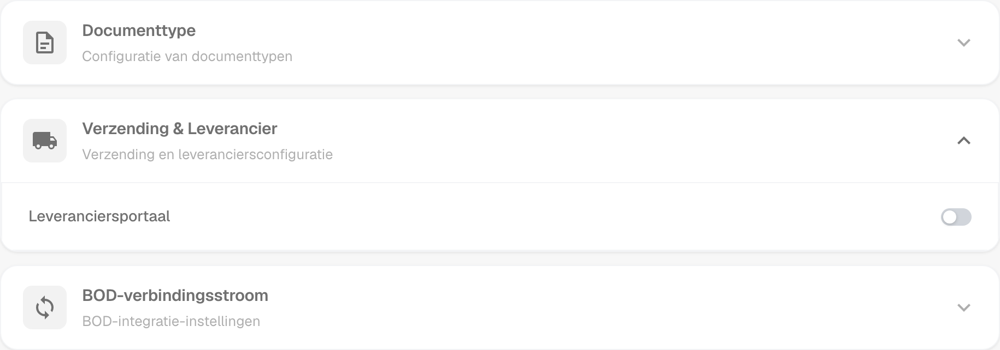
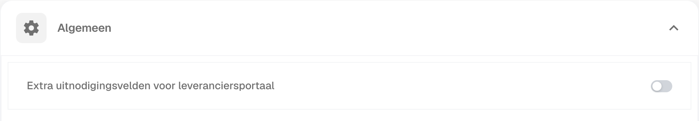
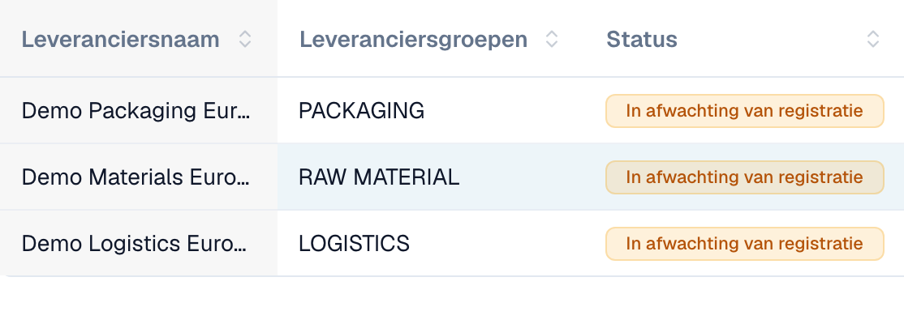
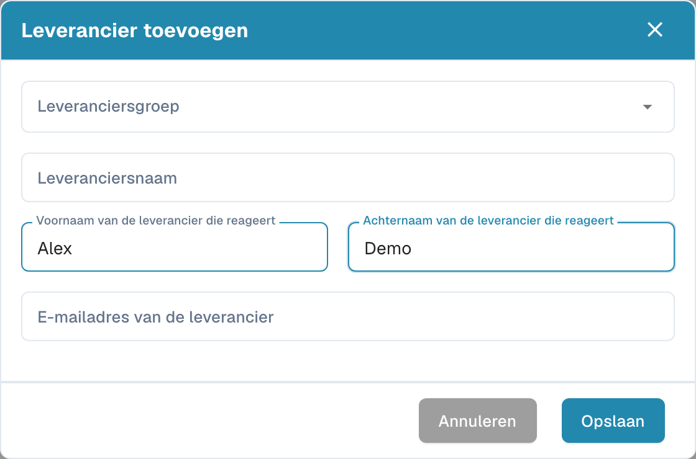

# Leveranciersportaal

Met het **leveranciersportaal** geeft een beheerder de leveranciers van zijn bedrijf toegang tot **DocBits**. De beheerder activeert het portaal en stelt in welke leveranciers het mogen gebruiken en welke informatie zij mogen bekijken.

Een uitgenodigde leverancier registreert zich en meldt zich aan met een eigen account. Vervolgens kan de leverancier de beschikbaar gestelde informatie bekijken, zoals de status van de eigen inkooporders en facturen. De configuratie van de organisatie bepaalt welke functies beschikbaar zijn.

## Admin: het portaal activeren

1. Open in de instellingen de modules en selecteer **Documentintegratie**.
2. Open **Verzending & Leverancier** en schakel **Leveranciersportaal** in.
3. Verschijnt er een activeringsvenster? Controleer het getoonde abonnement en bevestig de gewenste activering.

<figure><figcaption>
Portaaloptie in de module voor verzending en leveranciers. Deze schakelaar activeert de functie voor de organisatie.
</figcaption></figure>

## Admin: het portaal inrichten

Richt het portaal voor uw organisatie in voordat u de eerste uitnodigingen verstuurt:

- [Algemene leveranciersinstellingen](../../settings/supplier-setting/supplier-general-settings.md): Extra uitnodigingsvelden, statussen, logo en privacyinformatie.
- [E-mailsjablonen](../../settings/supplier-setting/editing-email-templates.md): Inhoud en vormgeving van uitnodigingsberichten.
- [Leverancierslayout](../../settings/supplier-setting/supplier-layout.md): Velden voor leveranciersregistratie en intern leveranciersbeheer. Selecteer het juiste layouttype.
- [Leveranciersrechten](../../settings/supplier-setting/supplier-permissions.md): Interne medewerkers aan leveranciersgroepen koppelen. Deze interne verantwoordelijkheden staan los van de eigen portaaltoegang van een leverancier.

<figure><figcaption>
Algemene leveranciersinstellingen met de optie voor extra uitnodigingsvelden.
</figcaption></figure>

## Admin: leveranciers uitnodigen

Open het leveranciersbeheer. Controleer vóór een uitnodiging het bedrijf, de leveranciersgroep, de contactpersoon en het e-mailadres. Bij het aanmaken van een leverancier vraagt Opslaan om de registratie-uitnodiging te versturen; het bewaart meer dan alleen een concept. Gebruik voor een bestaande leverancier de bijbehorende uitnodigingsactie. Een verzendbevestiging bewijst niet dat de e-mail is bezorgd of de registratie is voltooid.

<figure><figcaption>
Intern leveranciersbeheer met drie fictieve bedrijven. Alle drie de statussen geven hier een wachtende registratie aan.
</figcaption></figure>

<figure><figcaption>
Formulier om een leverancier aan te maken en uit te nodigen. Controleer bedrijf, contactpersoon en e-mailadres vóór het opslaan.
</figcaption></figure>

## Leverancier: registreren en DocBits openen

De leverancier opent de uitnodiging, maakt het bedoelde eigen account aan of gebruikt dit en volgt de ingestelde registratiestappen. Daarna kan de leverancier de beschikbaar gestelde informatie in DocBits bekijken. Het precieze proces en de beschikbare functies hangen af van de organisatie.

[Registratiehandleiding voor leveranciers](supplier-registration.md).

## Toegang en status begrijpen

Portaal geactiveerd, uitnodiging verstuurd, registratie voltooid en goedkeuring verleend zijn verschillende toestanden. Een leveranciersrecord of opgeslagen stamgegevens bewijzen niet dat de portaaltoegang gereed is. De leveranciersweergave volgt de toegewezen rechten en verschilt van de interne adminweergave.
