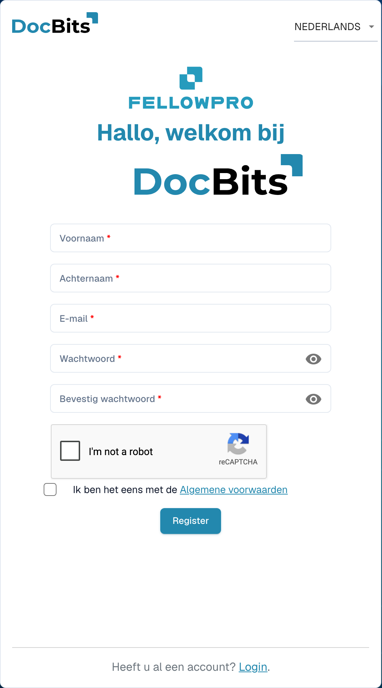

# Leveranciersregistratie

Deze handleiding is voor leveranciers die zijn uitgenodigd voor het DocBits-portaal van een organisatie. Gebruik de link in uw uitnodiging. U hebt een eigen leveranciersaccount; de uitnodigende organisatie bepaalt welke informatie beschikbaar is en welke registratiestappen nodig zijn.

## 1. De uitnodiging openen

Controleer welke organisatie de uitnodiging heeft verstuurd en voor welk e-mailadres deze is bedoeld. Open de registratielink uit die uitnodiging. Is de link verlopen of voor iemand anders bedoeld? Vraag de organisatie om een nieuwe uitnodiging.

## 2. Uw eigen account instellen

Controleer de vooraf ingevulde naam en het e-mailadres. Vul de gevraagde accountgegevens in en volg de getoonde wachtwoordregels. Lees de voorwaarden en privacyinformatie. Voltooi het aanmaken van uw account met de registratiefunctie. Een bestaand account en een nieuwe registratie zijn verschillende gevallen; volg de procedure die bij uw uitnodiging hoort.

<figure><figcaption>
Registratieformulier voor een leveranciersaccount. Dit voorbeeld is leeg; een uitnodiging kan gegevens vooraf invullen.
</figcaption></figure>

## 3. Leveranciersgegevens aanvullen

Vul de gevraagde gegevens en eventuele bewijsstukken aan. De velden en onderdelen hangen af van de ingestelde leverancierslayout. Verplichte markeringen en validatiemeldingen tonen wat nodig is. Sla uw voortgang op als de pagina deze mogelijkheid biedt; opslaan is niet automatisch de definitieve indiening.

## 4. Registratie en goedkeuring controleren

Dien de gegevens in via de daarvoor bedoelde afrondingsactie. Is een controle of goedkeuring ingesteld? Wacht dan op het resultaat. Meld u daarna aan met uw eigen account. De organisatie bepaalt welke bestellingen, facturen en andere informatie u kunt bekijken.

## Als u geen toegang krijgt

Neem contact op met de uitnodigende organisatie bij een ongeldige link, ontbrekende rechten of onduidelijke verplichte gegevens. Een intern leveranciersrecord vervangt uw registratie of de noodzakelijke toegangsgoedkeuring niet.

[Het leveranciersportaal instellen](README.md).
