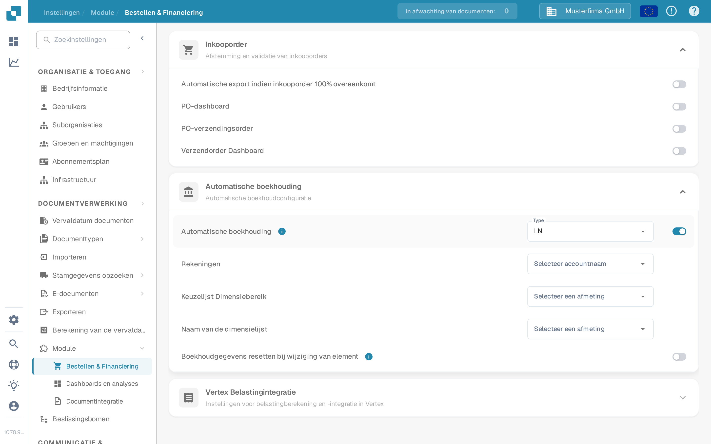

# Test Automatische boekhouding

Automatische boekhouding vereist een ingeschakelde module, boekhoudstamgegevens en een factuur met bruikbare bedragen of regels. Deze gids maakt onderscheid tussen de instellingen die u kunt controleren voordat u een factuur opent en de controles die een geconfigureerde LN- of M3-verbinding vereisen.

## Controleer de module-instellingen

1. Open **Instellingen → Module → Bestellen & Financiering** en vouw **Automatische boekhouding** uit. Het oudere pad **Documentverwerking → Module → Inkooporder / Automatische boekhouding** is niet langer de route die in de huidige toepassing wordt getoond.
2. Kies het **Type** voor uw gekoppelde systeem (**LN** of **M3**). Schakel **Automatische boekhouding** alleen in wanneer de vereiste stamgegevens en de verbinding gereed zijn.
3. Wanneer de functie is ingeschakeld, selecteert u de lijst **Rekeningen** en de dimensielijsten die bij uw systeem passen. Voor LN zijn de zichtbare velden **Keuzelijst Dimensiebereik** en **Naam van de dimensielijst**. M3 heeft andere velden. Gebruik **Boekhoudgegevens resetten bij wijziging van element** alleen als een herberekening na een gewijzigd element bedoeld is.

<figure><figcaption>
Automatische boekhouding staat uit in de Nederlandse Sandbox-testorganisatie.
</figcaption></figure>

<figure><figcaption>
De velden die worden getoond wanneer de instelling is ingeschakeld. De instelling is na deze opname weer uitgeschakeld; er zijn geen rekeningen of dimensies geconfigureerd.
</figcaption></figure>

## Testen met een geconfigureerde factuur

Gebruik een factuur waarvan de regels en de boekhoudstamgegevens beschikbaar zijn. Open de factuur in het validatiescherm en selecteer **Automatische boekhouding**. Als de actie ontbreekt, controleer dan de module-instelling en of deze factuur in aanmerking komt. Valideer de factuur voordat u verder navigeert; de toepassing slaat op en valideert zodra de actie wordt geselecteerd.

Controleer in het boekhoudscherm het volgende met uw eigen LN- of M3-gegevens:

1. Voer **Validate Setup** uit waar beschikbaar en los ontbrekende rekening- of dimensieconfiguratie op voordat u verdergaat. Een groen resultaat beschrijft alleen de controles in uw omgeving.
2. Controleer of de factuur op **totaal** of per **afzonderlijke regel** moet worden toegewezen. Vergelijk de boekhoudbedragen met de oorspronkelijke factuur.
3. Als u een bedrag splitst, selecteert u de beoogde rekening voor elke gesplitste regel. Voer bedragen of percentages in en controleer of de toegewezen waarden samen het hoofdbedrag vormen. Voeg een regel alleen toe of verwijder een regel alleen wanneer dat nodig is.
4. Beoordeel eventuele **Unsettled amount** of validatiewaarschuwing en corrigeer deze voordat u opslaat of exporteert. Bevestig het resultaat apart in het gekoppelde systeem.

De Sandbox-testorganisatie die voor de bovenstaande schermafbeeldingen is gebruikt, heeft geen geconfigureerde rekening- en dimensielijsten of factuurregels voor deze flow. Het boekhoudscherm, het splitsen en de export zijn daarom **hier niet getest of afgebeeld**. Gebruik de instellingen-schermafbeeldingen niet als bewijs dat boekhouding of export is geslaagd.

Voor systeemspecifieke instellingen gaat u verder met de [LN-gids](ln.md) of de [M3-gids](m3.md).
