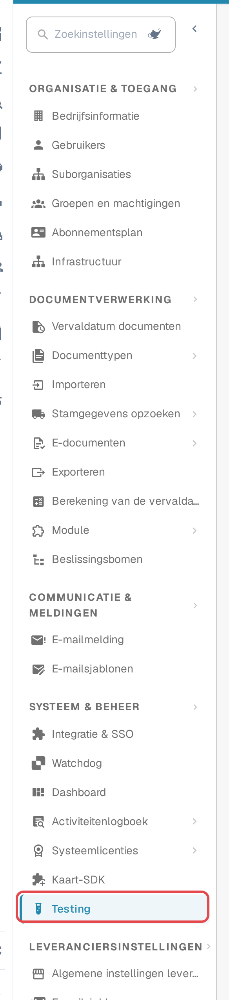
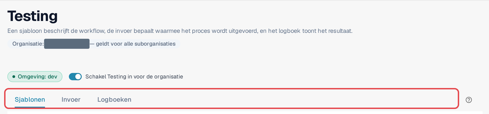
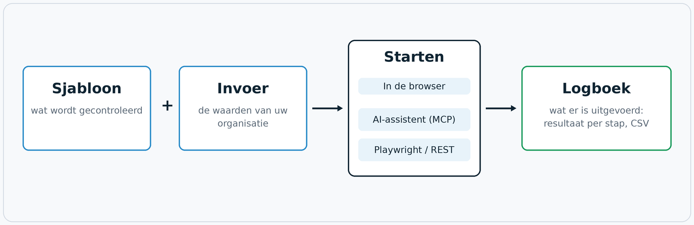
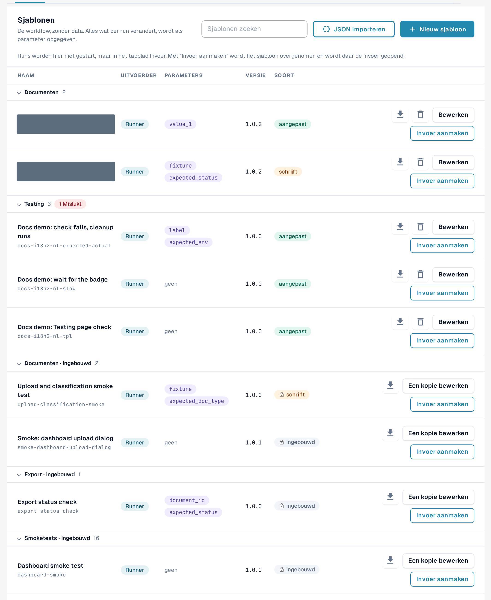

# Testing-module

## Waar de Testing-module voor dient

De module **Testing** voert browsertests uit binnen uw eigen aangemelde DocBits-sessie. Een test bedient de echte
schermen in plaats van een nabootsing: hij opent het dashboard, uploadt een voorbeeldfactuur, controleert of een nieuw
document in de validatie terechtkomt of bevestigt dat een export de verwachte status meldt. Hij controleert of DocBits
zich correct gedraagt **in uw organisatie** en legt het resultaat van elke stap vast.

U vindt de module onder **Instellingen → Testing**. De module is bedoeld voor beheerders die de testsuites van een
organisatie beheren.

Gebruik de module wanneer u het volgende wilt:

* bevestigen dat alles nog werkt na een release, een configuratiewijziging of een import van instellingen;
* dezelfde acceptatiecontrole herhalen voor meerdere organisaties tijdens een implementatie;
* QA een lijst met controles geven die iedereen kan starten en waarvan iedereen de resultaten kan lezen;
* uw testautomatisering of een AI-assistent dezelfde controles laten starten en de resultaten laten lezen.

## Wie de module kan gebruiken

De module is beschikbaar voor **organisatiebeheerders** (zie [Beheerdersrechten](https://docs.docbits.com/administration-and-setup/settings/global-settings/groups-users-and-permissions/users/admin-privileges)).
De module staat voor elke organisatie uit totdat een organisatiebeheerder deze inschakelt.

1. Open **Instellingen**. Selecteer in de zijbalk onder **Systeem & Beheer** de optie **Testing**.
2. Schakel **Schakel Testing in voor de organisatie** in.

<figure><figcaption>
Zijbalk van Instellingen met het item Testing gemarkeerd.
</figcaption></figure>

<figure><figcaption>
Koptekst van de Testing-pagina met de omgevingsbadge, de schakelaar en de drie tabbladen.
</figcaption></figure>

Onder de titel toont **Organisatie: … — geldt voor alle suborganisaties** voor welke organisatie deze pagina werkt. Wat u hier instelt, geldt voor die organisatie en al haar suborganisaties.

Zolang de schakelaar uitstaat, toont de pagina alleen *Testing is uitgeschakeld. Er wordt niets uitgevoerd totdat een organisatiebeheerder het inschakelt.* Als u de schakelaar weer uitzet, worden ook alle browsertabbladen beëindigd die waren geregistreerd voor starts van buitenaf.

De badge **Omgeving** laat zien waar u zich bevindt. In een klantomgeving (sandbox of productie) is de badge rood
en past DocBits extra bescherming toe: tests die gegevens wijzigen vereisen een expliciete bevestiging, en
exporteer-, verwijder- of goedkeurstappen worden geblokkeerd, tenzij het sjabloon aangeeft dat het gegevens schrijft.

## Hoe het werkt: sjabloon, invoer, start, logboek

De pagina heeft drie tabbladen: **Sjablonen**, **Invoer** en **Logboek**. Een sjabloon beschrijft de workflow, een invoer bepaalt
waarmee het wordt uitgevoerd, en het logboek toont het resultaat.

<figure><figcaption>
Diagram: sjabloon plus invoer vormt een test; die wordt gestart in de browser, door een AI-assistent of van buitenaf; elke run eindigt in het logboek.
</figcaption></figure>

| Onderdeel | Tabblad | Wat het is |
|---|---|---|
| **Sjabloon** | **Sjablonen** | Een herbruikbare testdefinitie: *wat* wordt gecontroleerd, stap voor stap. Een sjabloon bevat geen gegevens van uw organisatie. Alles wat per organisatie verschilt, is een **parameter**. |
| **Invoer** | **Invoer** | De opgeslagen waarden van uw organisatie voor de parameters van één sjabloon, bijvoorbeeld het document dat moet worden geopend. **Sjabloon + invoer = een test die u kunt starten.** |
| **Starten** | **Invoer** | De module voert de test uit en stuurt hem aan. Er zijn drie gelijkwaardige manieren om te starten: in de browser, vanuit een AI-assistent via MCP, of van buitenaf met Playwright of een REST-aanroep. |
| **Logboek** | **Logboek** | Wat er daadwerkelijk is uitgevoerd, ongeacht hoe het is gestart: het resultaat, elke stap, de gebruikte parameters. Een geschiedenisgrafiek toont de resultaten in de tijd; u kunt logboeken exporteren als CSV. |

DocBits levert **standaardsjablonen** mee (hun ID's beginnen met `default-smoke-`) en enkele ingebouwde sjablonen. Ze zijn
voor elke organisatie hetzelfde en kunnen niet worden gewijzigd of verwijderd. Een standaardsjabloon kan in elke organisatie worden uitgevoerd; de
invoer levert wat specifiek is voor die van u. U kunt ook uw eigen sjablonen maken en ze weer verwijderen.

## Snel aan de slag: een standaardtest uitvoeren

1. Open **Instellingen → Testing**, tabblad **Sjablonen**.
2. Zoek in de groep **Smoke-checks** een standaardsjabloon zonder parameters (de kolom **Parameters** toont *geen*), bijvoorbeeld *Default smoke: log metrics*.
3. Selecteer **Invoer maken**. Het tabblad **Invoer** wordt geopend met een nieuwe invoer voor dit sjabloon.
4. Voer een **Naam van de invoer** in en selecteer **Invoer opslaan**.
5. Selecteer **Starten**. De test wordt uitgevoerd in dit browsertabblad; laad het tabblad niet opnieuw en sluit het niet terwijl de test loopt.
6. Open het tabblad **Logboek**. De nieuwste rij toont het resultaat: **Geslaagd**, **Mislukt** of **Geblokkeerd**.

<figure><figcaption>
Tabblad Sjablonen met de groep Smoke-checks.
</figcaption></figure>

Lees verder:

* [Sjablonen](templates.md): standaardsjablonen, eigen sjablonen, importeren en verwijderen
* [Stappen en kant-en-klare blokken](steps-and-blocks.md): stapgroepen, geavanceerde instellingen, opruimen, onthouden waarden
* [Een element in de app kiezen](pick-in-app.md): een element kiezen door ernaar te wijzen
* [Opnieuw laden en hervatten](reload-and-resume.md): de pagina opnieuw laden midden in een test
* [Invoer](inputs.md): de waarden van uw organisatie opslaan
* [Een test starten](start-a-test.md): in de browser, vanuit een AI-assistent of vanuit Playwright
* [Logboek en geschiedenis](logs.md): resultaten, grafiek en CSV-export
* [Probleemoplossing](troubleshooting.md)
* [Voor ontwikkelaars](for-developers.md)
