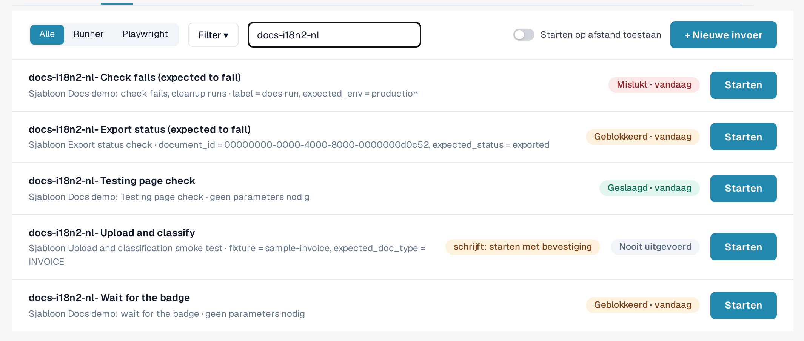
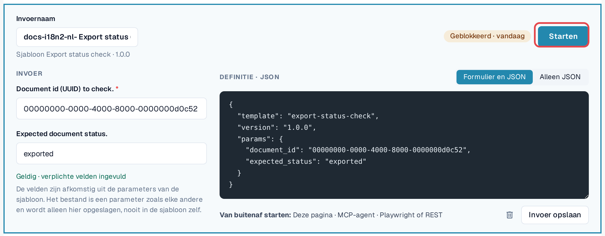
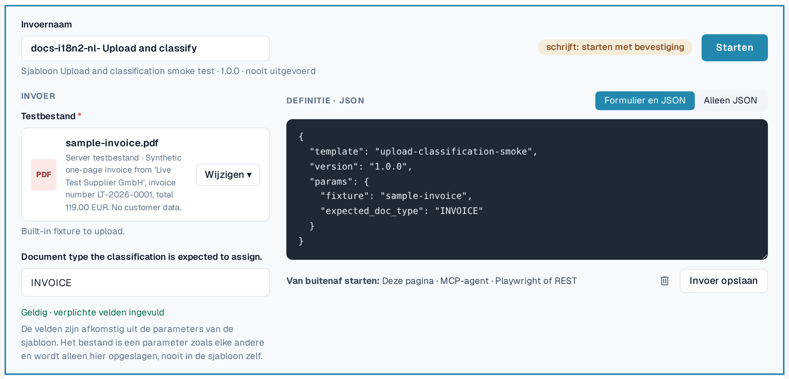

# Invoer

Een invoer slaat **de waarden van uw organisatie** op voor de parameters van één sjabloon, onder een naam naar keuze.
Een sjabloon plus een invoer is een test die u steeds opnieuw kunt starten, handmatig of automatisch.

Voorbeeld: het standaardsjabloon *Default smoke: validation contract* opent een document en controleert de status en het
documenttype. Het heeft een document-ID nodig. Uw invoer *Factuur LT-2026-0001 gereed voor validatie* slaat de ID op van een
document in uw organisatie en de status die u verwacht.

Open **Instellingen → Testing**, tabblad **Invoer**.

<figure><figcaption>
Tabblad Invoer met opgeslagen invoer en de laatste resultaten ervan.
</figcaption></figure>

Elke rij toont de naam van de invoer, het bijbehorende sjabloon en de versie, het laatste resultaat en **Starten**. **Update beschikbaar**
betekent dat het sjabloon een nieuwere versie heeft dan die waarvoor deze invoer is opgeslagen. Een chip **schrijft: starten met bevestiging**
markeert invoer waarvan het sjabloon gegevens wijzigt.

## Een invoer maken

1. Selecteer in het tabblad **Sjablonen** bij het sjabloon **Invoer maken**. (Of selecteer in het tabblad **Invoer**
   **+ Nieuwe invoer** en kies het sjabloon.)
2. Voer een **Naam van de invoer** in, bijvoorbeeld het doel en de organisatie.
3. Vul de parameters in. Verplichte velden zijn gemarkeerd met een sterretje. U kunt wisselen tussen **Formulier en JSON**
   en **Alleen JSON**; beide blijven gelijk lopen.
4. Controleer de regel onder het formulier: *Geldig · verplichte velden ingevuld* betekent dat de invoer kan worden gestart.
5. Selecteer **Invoer opslaan**.

<figure><figcaption>
Invoereditor met naam, parameters en geldigheidsregel.
</figcaption></figure>

### Bestanden als parameters

Sommige sjablonen uploaden een document. Hun bestandsparameter biedt **Organisatiebestanden** (PDF, PNG of JPEG tot 10 MB
die uw organisatie voor testdoeleinden heeft geüpload) en **Server-testbestanden** (synthetische testbestanden van DocBits).
Het bestand wordt opgeslagen in uw organisatie, nooit in het sjabloon.

<figure><figcaption>
Bestandsparameter met organisatiebestanden en server-testbestanden.
</figcaption></figure>

### Waarden die nooit worden opgeslagen

Parameters die als gevoelig zijn gemarkeerd (bijvoorbeeld een wachtwoord voor een extern systeem) worden nooit opgeslagen. De invoer
onthoudt alleen dat de waarde nodig is; u voert deze bij elke start opnieuw in (*Alleen verzonden bij de start; nooit opgeslagen.*).
Logboeken tonen zulke waarden als *Opgegeven bij de start*.

## Een invoer wijzigen of verwijderen

Open de invoer in de lijst, wijzig hem en selecteer **Invoer opslaan**. Om hem te verwijderen, selecteert u het prullenbakpictogram in de
editor en bevestigt u. Als u een invoer verwijdert, worden de bijbehorende logboeken niet verwijderd.


Als uw organisatie **testcases** bijhoudt, toont de link **Testcases** in het filtermenu van het tabblad Invoer hun
cases en laat zien welke een sjabloon hebben. Een case zonder sjabloon kan handmatig worden bevestigd door een bevoegd persoon.

