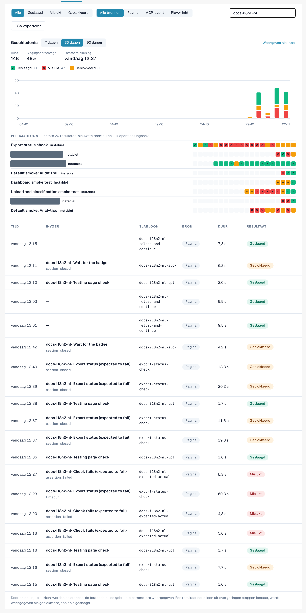
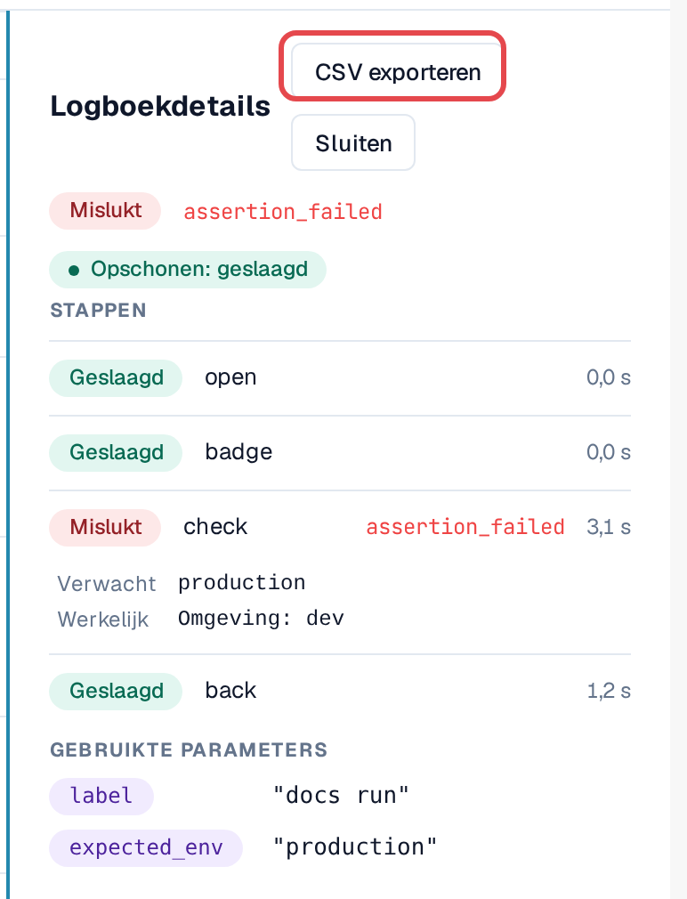
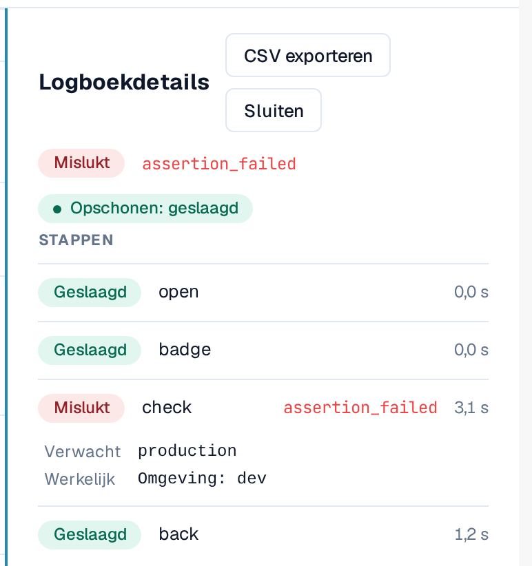
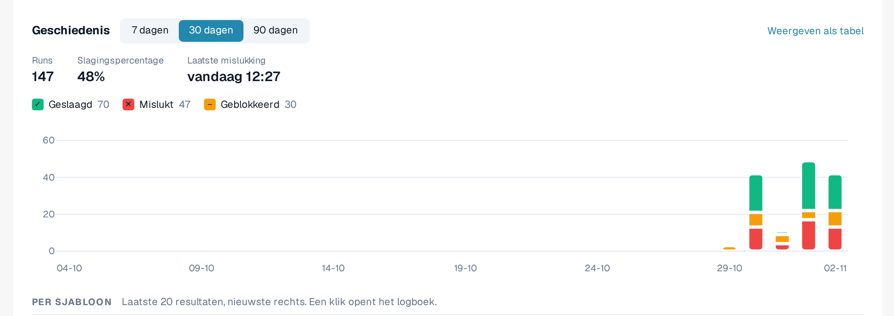
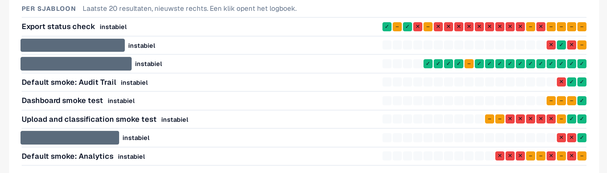

# Logboek en geschiedenis

Elke run, ongeacht hoe die is gestart, komt terecht in het tabblad **Logboek**: het resultaat, de stappen, de foutcode van een mislukte
stap en de gebruikte parameters. Logboeken bevatten geen pagina-inhoud en geen screenshots.

Open **Instellingen → Testing**, tabblad **Logboek**.

<figure><figcaption>
Tabblad Logboek met gemengde resultaten en bronnen.
</figcaption></figure>

## De lijst lezen

| Kolom | Betekenis |
|---|---|
| **Tijd** | Het moment waarop de run is gestart. |
| **Invoer** | De invoer die is gestart (of de case uit het testplan). |
| **Sjabloon** | De sjabloon-ID. |
| **Bron** | **Pagina** (gestart in de browser), **MCP-agent**, **Playwright**, **Handmatig** (een case die handmatig is bevestigd). |
| **Duur** | Hoe lang de run duurde. |
| **Resultaat** | **Geslaagd**: elke stap is geslaagd. **Mislukt**: een stap is mislukt. **Geblokkeerd**: de run kon niet worden beoordeeld, bijvoorbeeld omdat stappen zijn overgeslagen; een run die alleen uit overgeslagen stappen bestaat, wordt nooit als geslaagd getoond. |

Filter met **Alle / Geslaagd / Mislukt / Geblokkeerd**, met **Alle bronnen / Pagina / MCP-agent / Playwright**, of met
**Logboek doorzoeken**.

## Een logboekregel openen

Selecteer een rij. **Logboekdetails** toont elke stap met het resultaat ervan, de foutcode van een mislukte stap en de
**Gebruikte parameters** (gevoelige waarden alleen als *Opgegeven bij de start*). **Case openen** springt naar de case uit het testplan, als die
er is.

<figure><figcaption>
Logboekdetails van een mislukte run.
</figcaption></figure>

### Verwachte en werkelijke waarde

Onder een controle die is mislukt, toont **Logboekdetails** wat de controle verwachtte en wat zij aantrof:

* **Verwacht**: de waarde die het sjabloon vraagt.
* **Werkelijk**: de waarde die op de pagina stond.

Beide verschijnen alleen in **ontwikkel- en testomgevingen**, worden ingekort tot 120 tekens en blijven weg wanneer de
stap een gevoelige waarde gebruikt. In een klantomgeving (sandbox, productie) bewaart het logboek alleen de foutcode.

### Opruimen

Als het sjabloon [opruimstappen](steps-and-blocks.md) heeft, laat de chip naast het resultaat zien hoe die zijn afgelopen:
**Opruimen: geslaagd**, **Opruimen: mislukt** of **Opruimen: overgeslagen** (bijvoorbeeld omdat de run is gestopt). Opruimstappen
worden ook na een mislukte controle uitgevoerd. Een mislukte opruiming verandert het resultaat van de run niet, maar testgegevens, bijvoorbeeld een
geüpload document, kunnen achterblijven. Open het logboek om te zien welke opruimstap is mislukt.

<figure><figcaption>
Logboekdetails: de mislukte controle met Verwacht en Werkelijk, en de chip Opruimen: geslaagd.
</figcaption></figure>

## Geschiedenisgrafiek

Boven de lijst toont **Geschiedenis** hoe tests in de loop van de tijd zijn verlopen. Wissel tussen **Weergeven als grafiek** en **Weergeven als tabel**.

* **Resultaten per dag**: hoeveel runs per dag zijn geslaagd, mislukt of geblokkeerd, in uw tijdzone. Kies het
  **Tijdsbereik** (7 tot 90 dagen, standaard 30). Selecteer een dag om de lijst tot die dag te filteren; met **Alle dagen weer tonen** verwijdert u het filter.
* **Slagingspercentage** en **Laatste mislukking** vatten het bereik samen. Runs die nog bezig zijn, tellen als *nog zonder resultaat*.
* **Per sjabloon**: de laatste 20 resultaten van elk sjabloon, het nieuwste rechts, met een label: **stabiel** (alleen
  geslaagd), **instabiel** (gemengde resultaten) of **niet geslaagd** (alleen mislukt of geblokkeerd). Selecteer een resultaat om het logboek te openen.
  Instabiele sjablonen staan bovenaan.

<figure><figcaption>
Geschiedenis: resultaten per dag.
</figcaption></figure>

<figure><figcaption>
Per sjabloon: laatste 20 resultaten en stabiliteit.
</figcaption></figure>

## Exporteren als CSV

Selecteer **CSV exporteren** in de werkbalk om de logboeken te downloaden die overeenkomen met het gekozen resultaat en de gekozen bron (maximaal 5.000;
de zoektekst wordt niet toegepast). In **Logboekdetails** downloadt **CSV exporteren** één logboek met al zijn stappen.

Het bestand opent rechtstreeks in Excel (UTF-8). Tijden zijn in UTC. Het bevat dezelfde informatie als de pagina: geen
gevoelige waarden, geen pagina-inhoud.

<figure><figcaption>
CSV exporteren in de werkbalk van het Logboek.
</figcaption></figure>
