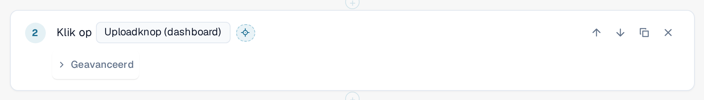
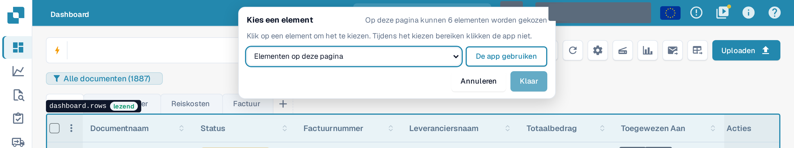
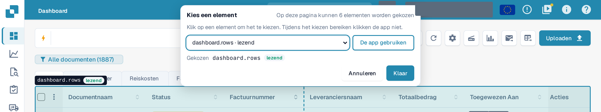
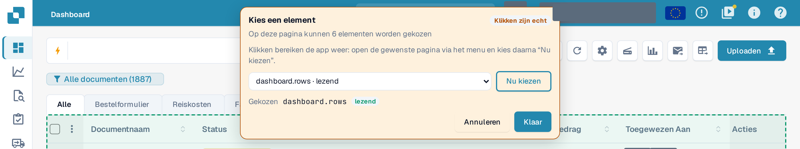

# Een element in de app kiezen

Elke stap moet weten op **welk element** van de pagina hij van toepassing is: een knop, een veld, een tabel. In plaats van het
in een lange lijst te zoeken, kunt u ernaar wijzen in de echte applicatie.

## Een element kiezen

1. Selecteer in de sjablooneditor de kruisdraadknop **Kiezen in app** naast het element van een stap.

<figure><figcaption>
De knop Kiezen in app naast het element van een stap Klik
</figcaption></figure>

2. DocBits opent de pagina waarop de test zich bij deze stap bevindt: de pagina van de dichtstbijzijnde eerdere stap **Open pagina**.
   Als die stap een invoerwaarde gebruikt, vraagt DocBits welke pagina moet worden geopend. Uw concept blijft bewaard, niet opgeslagen, en de
   applicatie blijft in dit browsertabblad.
3. Bovenaan verschijnt een balk **Kies een element**. Die geeft aan hoeveel elementen op deze pagina kunnen worden gekozen. Beweeg de
   muis over de pagina: DocBits omlijnt het element onder de aanwijzer en noemt het, samen met de klasse ervan:
   **leest** (leest alleen), **wijzigt gegevens**, **onomkeerbaar** of **onbekend**.

<figure><figcaption>
De muis boven de documentenlijst: de omlijning noemt het element dashboard.rows en de klasse leest
</figcaption></figure>

4. Klik op het element. De balk toont het onder **Geselecteerd**. U kunt ook een element kiezen uit de lijst
   **Elementen op deze pagina** in de balk, wat werkt met het toetsenbord en met een schermlezer.

<figure><figcaption>
De balk na een klik: dashboard.rows is geselecteerd, Gereed is ingeschakeld
</figcaption></figure>

5. Selecteer **Gereed**. De editor wordt opnieuw geopend met uw concept en het element in de stap. Selecteer **Annuleren** om terug te keren
   zonder wijziging. In beide gevallen blijft het concept niet opgeslagen: selecteer **Opslaan** in de editor wanneer u tevreden bent.

Terwijl u kiest, **ziet de applicatie uw klikken niet.** Als u een knop **Verwijderen** kiest, wordt er niets verwijderd. Verlaat de
kiezer met **Gereed** of **Annuleren**; geen enkele toets (ook Esc niet) sluit hem. De knop is uitgeschakeld terwijl een test
in dit tabblad wordt uitgevoerd.

## Een tabel, een kolom of een rijactie kiezen

Stappen uit de groep **Tabel** (**Controleer tabelrij**, **Klik op tabelrij**, **Onthoud waarde** uit een tabelcel) accepteren
alleen tabellen. Klik op een cel van de tabel: DocBits neemt de tabel over en stelt de kolom van die cel en de andere
kolommen van de rij voor als suggesties voor de kolomvelden van de stap. Klik bij **Klik op tabelrij** op de knop
in de rij om die rijactie over te nemen. **Controleer aantal** accepteert elk element, ook een tabel.

## De app gebruiken tijdens het kiezen

Het element dat u nodig hebt, kan op een andere pagina staan. Selecteer **De app gebruiken**. De balk wordt oranje en toont **Klikken zijn echt**:
vanaf nu bereiken uw klikken de applicatie weer, zodat u de andere pagina via het normale menu kunt openen.
De balk blijft staan en de lijst ervan volgt de pagina. Selecteer **Nu kiezen** om opnieuw te kiezen.

<figure><figcaption>
Modus De app gebruiken: klikken zijn echt, Nu kiezen keert terug naar kiezen
</figcaption></figure>


In de modus **De app gebruiken** is een klik een echte klik: hij kan gegevens in uw organisatie opslaan, verwijderen of verzenden.
Schakel terug met **Nu kiezen** voordat u op iets klikt wat u niet wilt uitvoeren.

