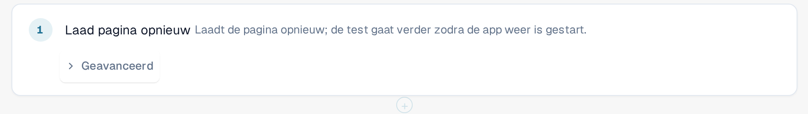

# Opnieuw laden en hervatten

Sommige dingen kunt u pas controleren nadat de pagina opnieuw is geladen, bijvoorbeeld dat een instelling na een herlading nog
aanwezig is. De stap **Laad pagina opnieuw** laadt de browserpagina midden in een test opnieuw, en de test gaat daarna verder.

## Een herlaadstap toevoegen

1. Selecteer in de sjablooneditor **+ Stap toevoegen**, dan de groep **Pagina** en vervolgens **Laad pagina opnieuw**.
2. Plaats de stap op de plek waar de herlading moet plaatsvinden. Stappen daarna worden uitgevoerd in de opnieuw geladen pagina.

<figure><figcaption>
De stap Laad pagina opnieuw in de sjablooneditor
</figcaption></figure>

## Wat er tijdens een run gebeurt

1. Het tabblad slaat de voortgang van de test op en laadt de pagina daarna opnieuw.
2. Terwijl de applicatie weer start, meldt een banner bovenaan **Pagina opnieuw geladen, de test gaat verder**, gevolgd door
   de naam van de test. Sluit het tabblad niet.
3. De opnieuw geladen pagina neemt de run weer over en gaat verder met de volgende stap. De stappen vóór de herlading behouden hun
   resultaten, de stap **Laad pagina opnieuw** wordt als geslaagd getoond en de klok van de test loopt tijdens de herlading door.

<figure><figcaption>
Banner na een herlading: Pagina opnieuw geladen, de test gaat verder
</figcaption></figure>

Onthouden waarden blijven behouden over de herlading heen, behalve waarden die u als geheim hebt gemarkeerd (zie
[Stappen en kant-en-klare blokken](steps-and-blocks.md)). Zorg ervoor dat geen enkele stap na de herlading een geheime waarde nodig heeft.

## Goed om te weten

* Alleen deze stap laadt de pagina opnieuw zonder de test te beëindigen. Als u het tabblad zelf opnieuw laadt of sluit, eindigt de run
  als **Geannuleerd**.
* De pagina moet binnen ongeveer twee minuten terugkomen. Anders eindigt de run als **Geannuleerd** of **Niet afleverbaar**.
* Een test kan maximaal vijf herlaadstappen bevatten.
* De test gaat verder in hetzelfde browsertabblad en met dezelfde gebruiker. Als de browser het tabblad de voortgang niet laat opslaan
  (bijvoorbeeld omdat opslag is geblokkeerd), mislukt de herlaadstap voordat de pagina opnieuw wordt geladen.
* De test vereist sjabloonschema 1.3, dat de editor instelt wanneer u de stap toevoegt.
