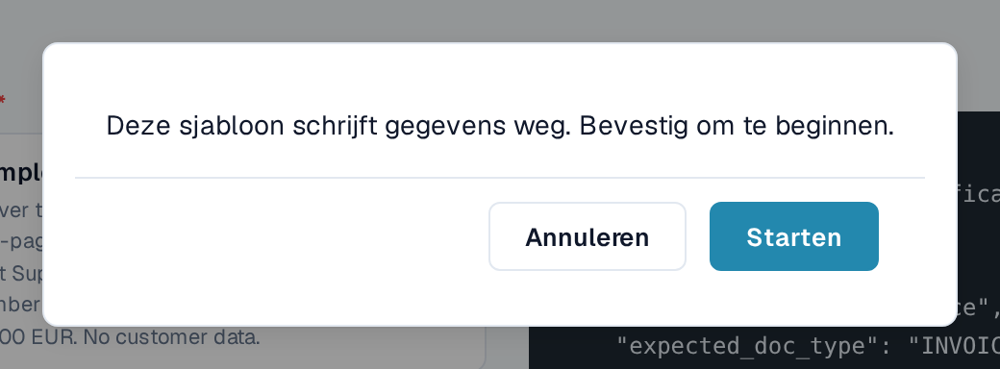
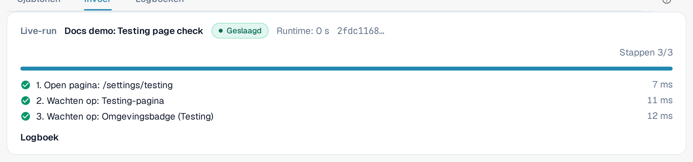
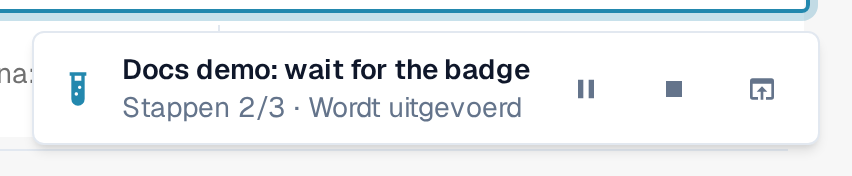
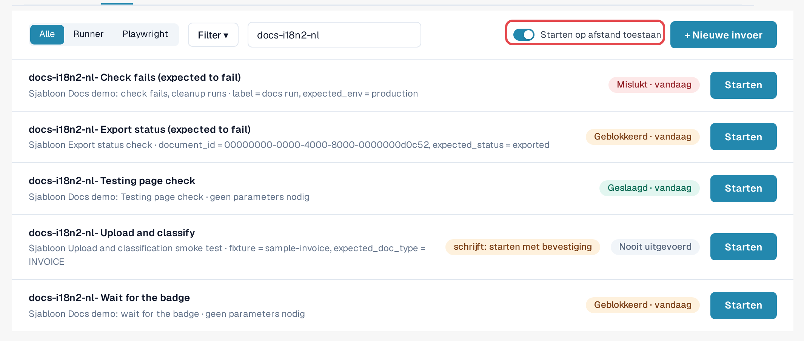
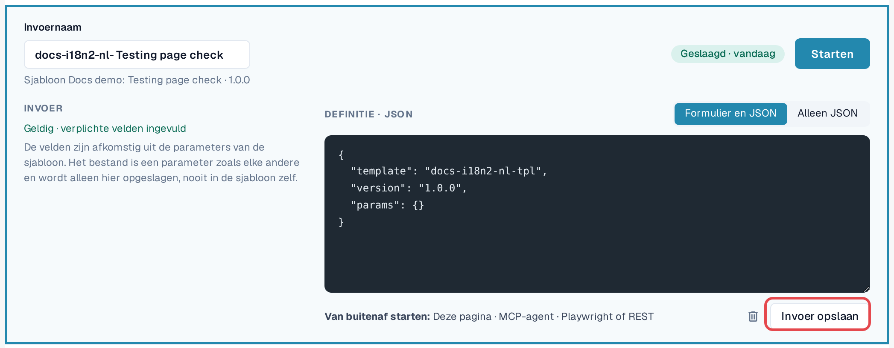

# Een test starten

Een test is een sjabloon plus een invoer. De Testing-module voert hem uit en stuurt hem aan; u kiest hoe u hem start. Alle drie
manieren zijn gelijkwaardig en elke run eindigt in het [logboek](logs.md).

| Manier | Wanneer te gebruiken | In het logboek getoond als |
|---|---|---|
| **In de browser** | U wilt nu een controle uitvoeren en die volgen. | **Pagina** |
| **AI-assistent (MCP)** | U werkt met een AI-assistent die met DocBits is verbonden en wilt dat die controles uitvoert en beoordeelt. | **MCP-agent** |
| **Van buitenaf (Playwright of REST)** | Uw testautomatisering of CI-pipeline start controles, bijvoorbeeld na een deployment. | **Playwright** |

In elk geval vinden de klikken plaats in een **DocBits-browsertabblad van een organisatiebeheerder**, met de rechten van die
persoon. Het tabblad moet open blijven; opnieuw laden of sluiten beëindigt de run. De enige uitzondering is een stap **Laad pagina opnieuw** van
de test zelf (zie [Opnieuw laden en hervatten](reload-and-resume.md)).

## Starten in de browser

1. Open **Instellingen → Testing**, tabblad **Invoer**.
2. Selecteer **Starten** bij de invoer (of open de invoer en selecteer **Starten**).
3. Als het sjabloon gegevens wijzigt, vraagt DocBits: *Dit sjabloon schrijft gegevens. Bevestig om te starten.* Selecteer **Starten** om door te gaan.
4. De test wordt uitgevoerd in dit tabblad. Op de Testing-pagina toont het paneel **Live-run** de status, de **Huidige actie**,
   de voortgang van de stappen en **Pauzeren**, **Hervatten** en **Stop**. Wanneer de test een andere pagina opent, toont een kleine indicator in
   de rechterbenedenhoek de voortgang daar. Wanneer de test eindigt, toont de indicator het resultaat met
   **Logboek openen** en **Sluiten**.
5. Open na afloop van de test het tabblad **Logboek** om het resultaat te lezen.

<figure><figcaption>
Bevestiging vóór een test die gegevens schrijft.
</figcaption></figure>

<figure><figcaption>
Paneel Live-run nadat de test is geslaagd.
</figcaption></figure>

<figure><figcaption>
Run-indicator in de rechterbenedenhoek op een andere pagina.
</figcaption></figure>


**Uploads tijdens een test:** als uw organisatie suborganisaties heeft en het dashboard ze allemaal toont, vraagt het uploaddialoogvenster
normaal gesproken bij welke suborganisatie het document hoort. Terwijl een test loopt, gaat de upload zonder te vragen naar de
**eerste suborganisatie die het dialoogvenster aanbiedt**. Om in een bepaalde suborganisatie te uploaden, start u de
test vanuit de weergave van die suborganisatie.


## Starten van buitenaf toestaan

Een AI-assistent of een Playwright-script kan niet zelf klikken; het vraagt DocBits om een test uit te voeren **in een browsertabblad dat
u hebt geregistreerd**:

1. Open **Instellingen → Testing**, tabblad **Invoer**, in het browsertabblad dat de tests moet uitvoeren.
2. Schakel **Starten op afstand toestaan** in. Het tabblad accepteert nu starts en toont zijn sessie-ID.
3. Laat het tabblad open. De registratie eindigt wanneer het tabblad opnieuw wordt geladen of gesloten.

<figure><figcaption>
Starten op afstand toestaan ingeschakeld, met het sessie-ID.
</figcaption></figure>

De invoereditor herinnert u aan de drie manieren onder **Van buitenaf starten:** **Deze pagina**, **MCP-agent**,
**Playwright of REST**.

<figure><figcaption>
Regel Van buitenaf starten in de invoereditor.
</figcaption></figure>

## Starten vanuit een AI-assistent (MCP)

Als uw AI-assistent met DocBits is verbonden (zie [DocBits MCP](https://docs.docbits.com/advanced-functions-and-tools/docbits-mcp)
en [DocBits configureren met Claude of Codex](https://docs.docbits.com/advanced-functions-and-tools/docbits-mcp/configuration-with-claude-or-codex)):

1. Sta starten van buitenaf toe in een browsertabblad (zie hierboven).
2. Vraag de assistent bijvoorbeeld: *"Toon mijn DocBits-testinvoer en start 'Factuur LT-2026-0001 gereed voor validatie'
   in mijn geregistreerde browsertabblad. Vertel me daarna het resultaat."*
3. De assistent vraagt welk tabblad moet worden gebruikt als er meer dan één is geregistreerd, en vraagt u om bevestiging voordat hij een test start die
   gegevens wijzigt. Daarna leest hij het logboek en rapporteert het resultaat.

## Starten vanuit Playwright of een ander hulpmiddel (REST)

Uw testautomatisering start een invoer met één API-aanroep en leest daarna het logboek. Daarvoor zijn nodig:

* een token van een organisatiebeheerder van de organisatie (zie [API-sleutel](https://docs.docbits.com/administration-and-setup/settings/global-settings/integration/api-key));
* de ID van de invoer;
* het sessie-ID van een browsertabblad waarop **Starten op afstand toestaan** is ingeschakeld.

De aanroep en een voorbeeld staan op [Voor ontwikkelaars](for-developers.md).

## Klantomgevingen

In sandbox en productie is de badge **Omgeving** rood. Tests die gegevens wijzigen vereisen bij elke start een expliciete bevestiging, en
exporteer-, verwijder- of goedkeurstappen worden geblokkeerd, tenzij het sjabloon aangeeft dat het gegevens schrijft. Voer
schrijvende tests waar mogelijk uit in een testomgeving.
