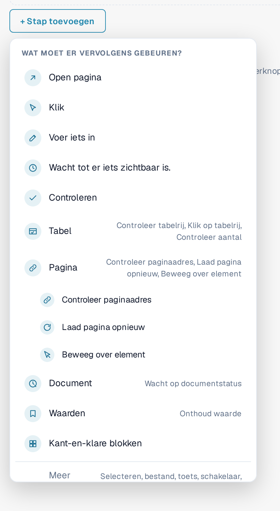
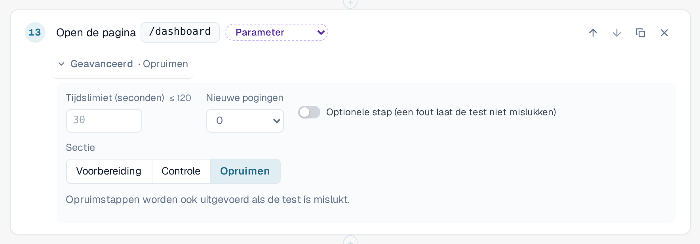
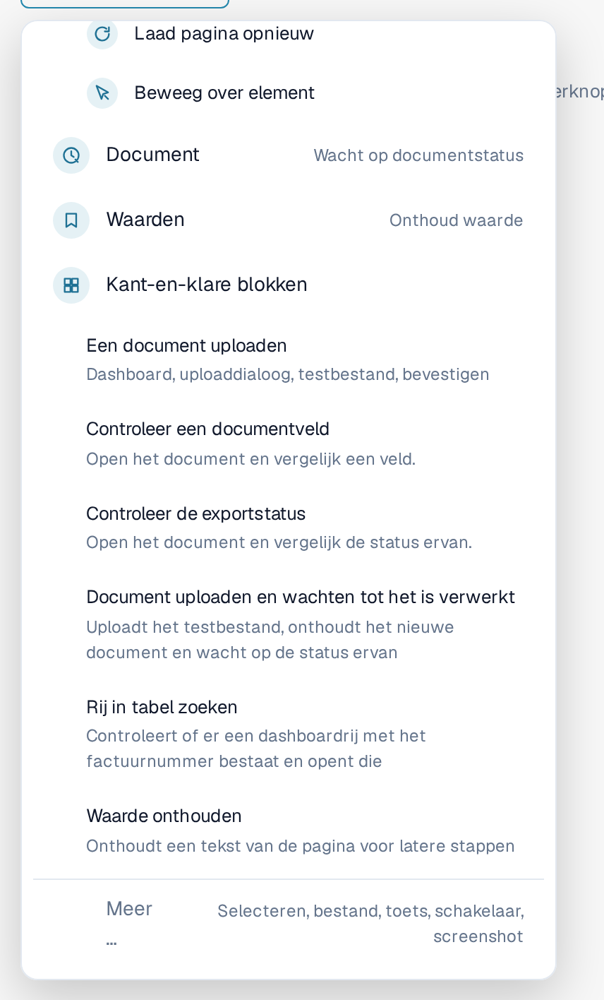
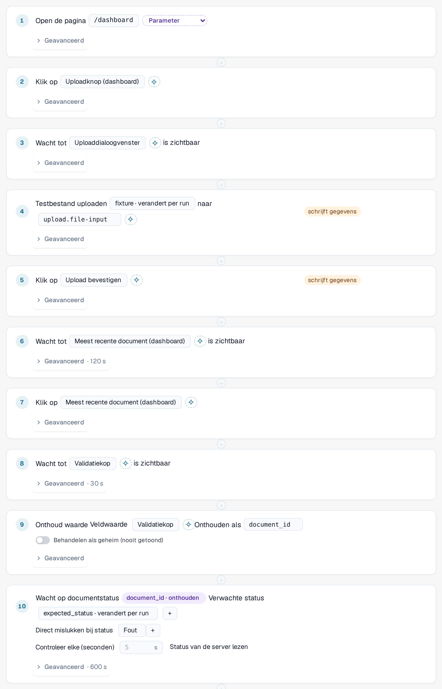
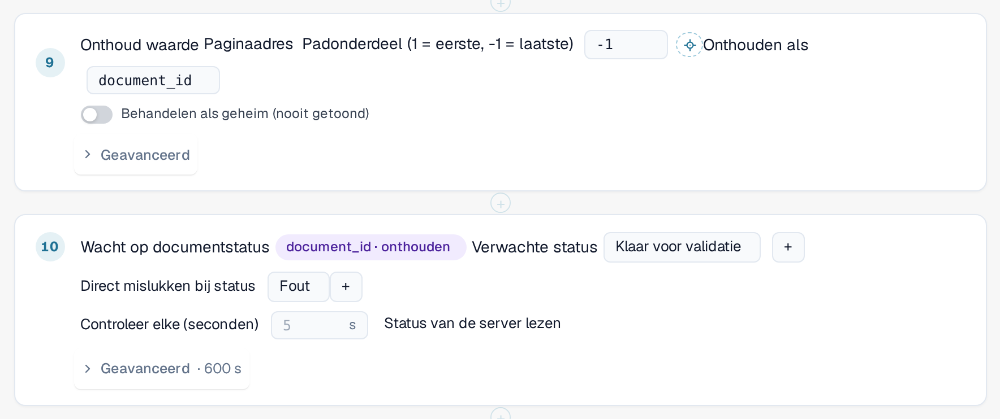
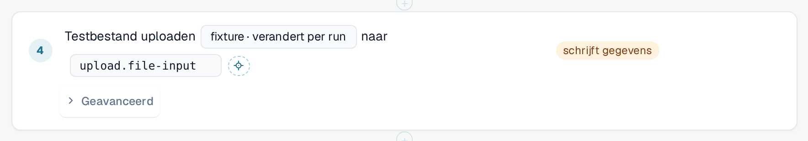

# Stappen en kant-en-klare blokken

Deze pagina legt uit hoe u een sjabloon bouwt in de editor ([Sjablonen](templates.md)): de stapgroepen, de
**Geavanceerd**-instellingen van een stap, de kant-en-klare blokken en hoe een test waarden van de ene stap aan de volgende doorgeeft.

## Een stap toevoegen

Selecteer in de sjablooneditor **+ Stap toevoegen**. Het menu **Wat moet er vervolgens gebeuren?** toont de stappen. De vijf
basisstappen zijn **Open pagina**, **Klik**, **Voer iets in**, **Wacht tot er iets zichtbaar is** en **Controleren**.
Vier **groepen** bevatten de meer gespecialiseerde stappen. Selecteer een groep om de stappen ervan te zien:

| Groep | Stappen |
|---|---|
| **Tabel** | **Controleer tabelrij**, **Klik op tabelrij**, **Controleer aantal**. Voor lijsten zoals de documentenlijst op het dashboard. |
| **Pagina** | **Controleer paginaadres**, **Laad pagina opnieuw** (zie [Opnieuw laden en hervatten](reload-and-resume.md)), **Beweeg over element**. |
| **Document** | **Wacht op documentstatus**: wacht tot een document een status bereikt, bijvoorbeeld *Gereed voor validatie*. |
| **Waarden** | **Onthoud waarde**: bewaart een tekst van de pagina voor latere stappen. |

**Kant-en-klare blokken** voegen meerdere stappen tegelijk toe (zie hieronder). **Meer …** biedt nog meer stappen: een optie selecteren, een bestand uploaden, een toets indrukken,
een schakelaar omzetten en een screenshot maken (screenshotstappen worden door de runner in de browser overgeslagen).

<figure><figcaption>
Menu Stap toevoegen met de groepen Tabel, Pagina, Document en Waarden; de groep Pagina is geopend
</figcaption></figure>

Om een stap naar een element van de pagina te laten verwijzen, selecteert u het in de lijst of gebruikt u **Kiezen in app**
([Een element in de app kiezen](pick-in-app.md)).

## Geavanceerde instellingen van een stap

Elke stap heeft een regel **Geavanceerd**. Selecteer die om de instellingen van die stap te openen. De ingeklapte regel toont wat u
hebt gewijzigd, bijvoorbeeld *Geavanceerd · 120 s* of *Geavanceerd · Opruimen*.

| Instelling | Betekenis |
|---|---|
| **Tijdslimiet (seconden)** | Hoe lang de stap mag duren, maximaal 120 seconden. Laat het veld leeg voor de standaardwaarde van 30 seconden. Stappen die op een document wachten, hebben een eigen, langere limiet. |
| **Nieuwe pogingen** | Hoe vaak DocBits de stap herhaalt als die mislukt (0 tot 3). |
| **Optionele stap (mislukking laat de test niet mislukken)** | Als de stap mislukt, toont het logboek hem als overgeslagen met de bijbehorende fout, en de test gaat door. |
| **Sectie** | **Voorbereiden**, **Controleren** of **Opruimen**. **Controleren** is de standaardwaarde. |

**Voorbereiden**-stappen zetten de test op. **Controleren**-stappen vormen de test zelf. **Opruimen**-stappen verwijderen wat de test heeft
achtergelaten, bijvoorbeeld een document dat de test heeft geüpload. **Opruimstappen worden ook uitgevoerd als de test is mislukt** of een time-out had, en
een mislukte opruimstap verandert het resultaat van de test nooit. Ze moeten de laatste stappen van het sjabloon zijn; de editor meldt een fout als een
gewone stap op een opruimstap volgt. Ze worden niet uitgevoerd als u de test stopt of het tabblad sluit.
Een sjabloon met opruimstappen wordt opgeslagen als schema 1.3 (zie [Voor ontwikkelaars](for-developers.md)).

<figure><figcaption>
Geavanceerde instellingen van een stap: tijdslimiet, nieuwe pogingen, optionele stap en sectie, met Opruimen geselecteerd
</figcaption></figure>

## Kant-en-klare blokken

Selecteer **+ Stap toevoegen** en vervolgens **Kant-en-klare blokken**. Een blok voegt de stappen van een veelvoorkomende reeks toe, samen met de
parameters die daarvoor nodig zijn. U kunt daarna elke stap wijzigen.

| Blok | Wat het toevoegt |
|---|---|
| **Een document uploaden** | Opent het dashboard, opent het uploaddialoogvenster, selecteert het testbestand en bevestigt. |
| **Controleer een documentveld** | Opent een document en vergelijkt een veld met een verwachte waarde. |
| **Controleer de exportstatus** | Opent een document en vergelijkt de status ervan. |
| **Document uploaden en wachten tot het is verwerkt** | Uploadt het testbestand, onthoudt het nieuwe document en wacht op de status ervan. |
| **Rij in tabel zoeken** | Controleert of er een rij in de dashboardlijst bestaat met een bepaald factuurnummer en opent die. |
| **Onthoud waarde** | Onthoudt een tekst van de pagina voor latere stappen. |

<figure><figcaption>
Kant-en-klare blokken in het menu Stap toevoegen
</figcaption></figure>

### Document uploaden en wachten tot het is verwerkt

Gebruik dit blok wanneer een latere stap het document nodig heeft dat de test zojuist heeft geüpload. Het herkent het nieuwe document
zelf, niet aan de bovenste rij van de lijst, zodat nooit per ongeluk een ouder document wordt gekozen. Daarna leest het de
document-ID uit het paginaadres en wacht het tot het document de verwachte status bereikt
(standaard *Gereed voor validatie*, maximaal 10 minuten; het stopt direct als het document de status *Fout* krijgt).
Het voegt de invoerwaarden **fixture** (het testbestand) en **expected_status** toe en verhoogt de tijd van de hele test tot minimaal 15 minuten.

<figure><figcaption>
Stappen van het blok Document uploaden en wachten tot het is verwerkt
</figcaption></figure>


**Waar uploads naartoe gaan:** als uw organisatie suborganisaties heeft en het dashboard ze allemaal toont, vraagt het
uploaddialoogvenster normaal gesproken bij welke suborganisatie het document hoort. Een test kan die vraag niet beantwoorden. Terwijl een
test in het tabblad loopt, gaat de upload zonder te vragen naar de **eerste suborganisatie die het dialoogvenster aanbiedt**.
Buiten een test verandert er niets. Om in een bepaalde suborganisatie te uploaden, start u de test vanuit de weergave van die
suborganisatie.


### Rij in tabel zoeken

Het blok controleert of de dashboardlijst een rij met het opgegeven factuurnummer heeft (de invoerwaarde **row_value**)
en opent die. Om op een andere kolom te zoeken, wijzigt u de kolom en de waarde in de stap. Beide stappen horen bij de
groep **Tabel**; **Controleer aantal** telt rijen of andere elementen.

## Een waarde onthouden en later gebruiken

Een test heeft vaak een waarde nodig die alleen bestaat zolang hij loopt, bijvoorbeeld de ID van een document dat hij zojuist heeft geüpload.

1. Voeg **Onthoud waarde** toe (groep **Waarden**). Kies waar de waarde vandaan komt: een tekst van de pagina, het paginaadres
   (een deel van het pad of een queryparameter) of een cel van een tabelrij. Voer onder **Onthouden als** een naam in,
   bijvoorbeeld `document_id`. Schakel **Behandelen als geheim (nooit getoond)** in voor waarden die nergens mogen verschijnen.
2. Kies in een latere stap de onthouden waarde in plaats van er een in te typen. De stap toont een chip zoals
   *document_id · onthouden*. In de sjabloon-JSON wordt dit geschreven als `{{vars.document_id}}`.

In een stap kunnen twee soorten waarden worden gebruikt:

| Soort | Geschreven als | Afkomstig van | Voorbeeld |
|---|---|---|---|
| **Invoer** | `{{params.name}}` | De opgeslagen [invoer](inputs.md): hij is bij elke run van die invoer hetzelfde. Maak hem met de parameterknop naast een waarde. | *fixture · verandert per run* |
| **Onthouden waarde** | `{{vars.name}}` | Een eerdere stap **Onthoud waarde** van dezelfde run. | *document_id · onthouden* |

<figure><figcaption>
Onthoud waarde slaat de document-ID op; de volgende stap wacht op dat document
</figcaption></figure>

<figure><figcaption>
Een stap die de invoerwaarde fixture gebruikt
</figcaption></figure>

Een onthouden waarde bestaat alleen voor de huidige run en wordt nooit opgeslagen in het sjabloon of het logboek. Onthouden
waarden blijven behouden na een [paginaherlading](reload-and-resume.md) binnen de test, tenzij ze als geheim zijn gemarkeerd.
