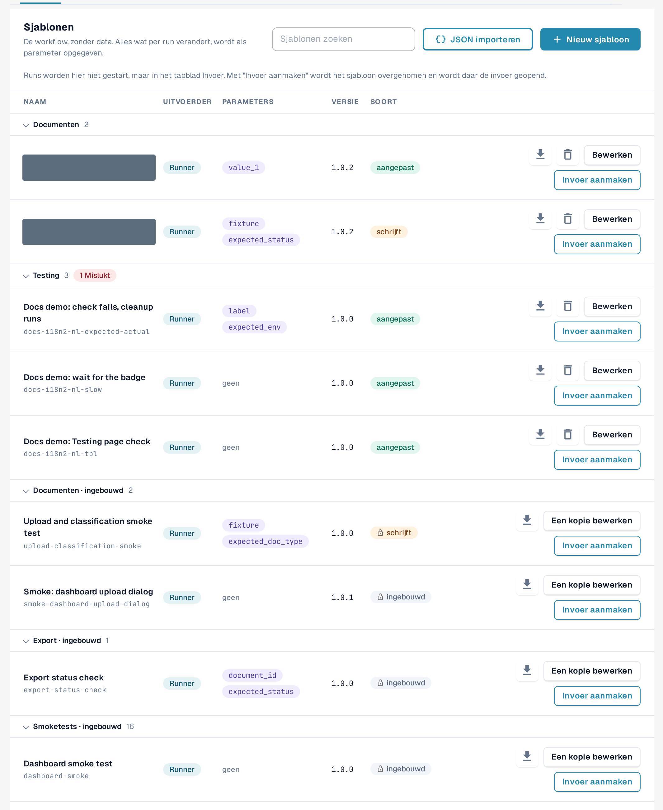
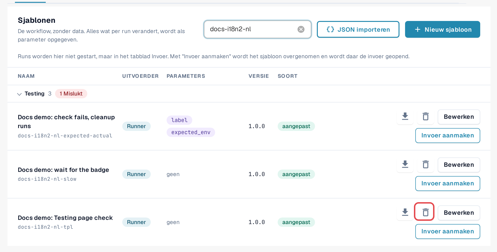
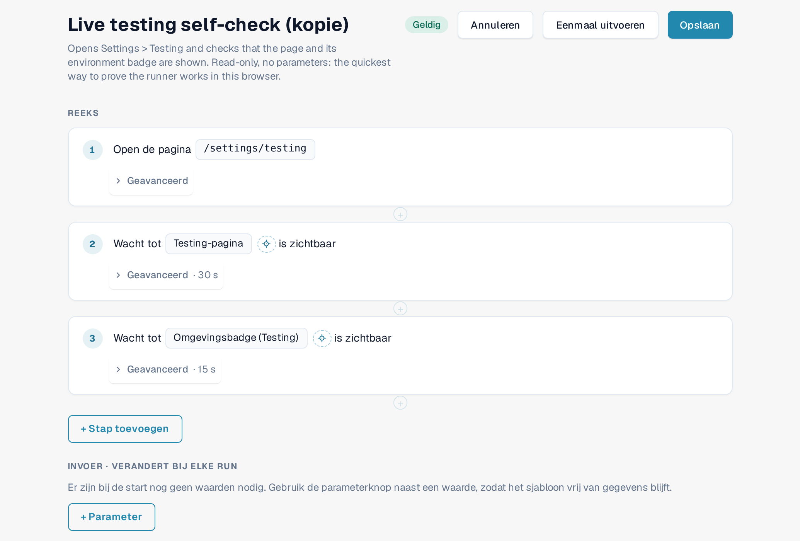
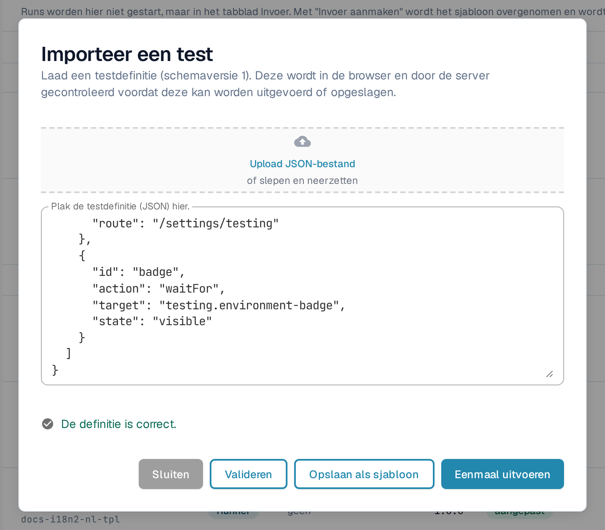
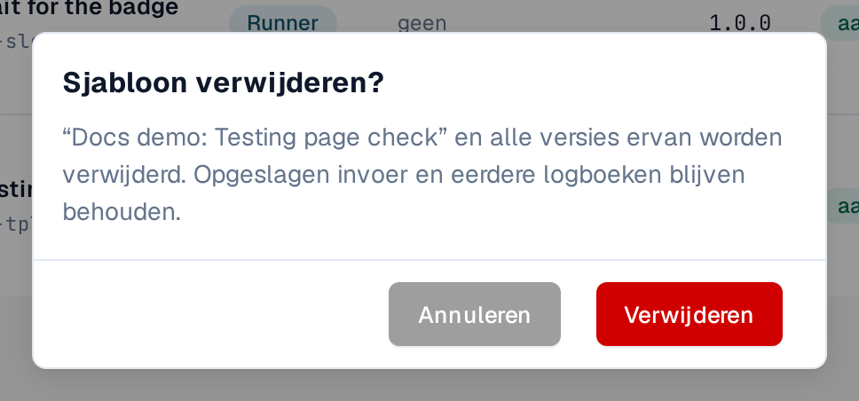

# Sjablonen

Een sjabloon beschrijft **wat** wordt gecontroleerd: welke pagina wordt geopend, waarop wordt geklikt of wat wordt ingevuld, en wat er aan het einde
zichtbaar of waar moet zijn. Een sjabloon bevat geen gegevens van uw organisatie. Waarden die per organisatie of per
run verschillen, zoals een document-ID, worden als **parameters** gedeclareerd en ingevuld door een [invoer](inputs.md).

Open **Instellingen → Testing**, tabblad **Sjablonen**.

<figure><figcaption>
Tabblad Sjablonen: groepen, kolommen en rijacties.
</figcaption></figure>

## De lijst lezen

Sjablonen zijn gegroepeerd per categorie (bijvoorbeeld **Smoke-checks**, **Validatie**, **Documenten**, **Export**).
Selecteer de naam van een groep om deze in te klappen; een rode chip bij de groep telt de sjablonen waarvan de laatste run is mislukt.
**Sjablonen zoeken** filtert op naam.

| Kolom | Betekenis |
|---|---|
| **Naam** | De naam van het sjabloon en daaronder de ID ervan. |
| **Uitgevoerd door** | **Runner**: wordt vanaf deze pagina in uw browsertabblad uitgevoerd. **Playwright**: een controle die door uw testautomatisering wordt uitgevoerd; ze kan hier worden gedocumenteerd, maar niet vanaf deze pagina worden gestart. |
| **Parameters** | De waarden die een invoer moet leveren. *geen* betekent dat het sjabloon ongewijzigd kan draaien. |
| **Versie** | Opgeslagen versies veranderen nooit. Een wijziging wordt opgeslagen als een nieuwe versie. |
| **Soort** | **ingebouwd** (slotpictogram): onderdeel van de standaardset, voor elke organisatie hetzelfde, alleen-lezen. **aangepast**: het eigen sjabloon van uw organisatie. **schrijft**: het sjabloon wijzigt gegevens (uploadt bijvoorbeeld een document) en vereist een bevestiging voordat het start. |

Rijacties:

| Actie | Wat het doet |
|---|---|
| Downloadpictogram (**Exporteren als JSON**) | Downloadt de sjabloondefinitie als JSON-bestand, bijvoorbeeld om hem te bewaren of in een andere organisatie te importeren. |
| **Een kopie bewerken** (ingebouwd) / **Bewerken** (aangepast) | Opent de sjablooneditor met een kopie die u kunt wijzigen en als uw eigen sjabloon kunt opslaan. |
| **Invoer maken** | Opent het tabblad [Invoer](inputs.md) met een nieuwe invoer voor dit sjabloon. Tests worden daar gestart, niet hier. |
| Prullenbakpictogram (**Sjabloon verwijderen**) | Alleen bij uw eigen sjablonen. Zie *Uw eigen sjabloon verwijderen* hieronder. |

<figure><figcaption>
Een standaardrij en een rij met een eigen sjabloon, met hun acties.
</figcaption></figure>

## Uw eigen sjabloon maken

U hebt een eigen sjabloon nodig wanneer geen enkel standaardsjabloon controleert wat u nodig hebt, of wanneer u een aangepaste kopie van een standaardsjabloon wilt.

**Beginnen met een standaardsjabloon:** selecteer **Een kopie bewerken** op de rij. **Leeg beginnen:** selecteer **Nieuw sjabloon**.

In de sjablooneditor:

1. Voer een **Sjabloonnaam** in en eventueel waarvoor het sjabloon dient.
2. Selecteer **+ Stap toevoegen** en kies een blok, bijvoorbeeld **Open pagina**, **Klik**, **Vul in**, **Selecteer**,
   **Wachten op**, **Controleer de tekst**, **Controleer het veld** of **Controleer de status**. **Kant-en-klare blokken** voegen in één keer een veelvoorkomende reeks toe, bijvoorbeeld
   **Een document uploaden** of **Document uploaden en wachten tot het is verwerkt**. Zie [Stappen en kant-en-klare blokken](steps-and-blocks.md)
   voor de stapgroepen, de **Geavanceerd**-instellingen en opruimstappen.
3. Gebruik voor elke waarde die per organisatie of per run verschilt de parameterknop naast de waarde. De waarde
   wordt een parameter onder **Invoer · verandert bij elke run**, met een type (**Tekst**, **Getal**, **Ja/Nee**,
   **Server testbestand**), een standaardwaarde en **Verplicht** als ze moet worden ingevuld.
4. Selecteer **Opslaan**. Om het concept eenmalig uit te proberen zonder op te slaan, selecteert u **Eenmaal uitvoeren**.

Om het element van een stap te kiezen door ernaar te wijzen in de applicatie, gebruikt u **Kiezen in app**
([Een element in de app kiezen](pick-in-app.md)).

Stappen die gegevens wijzigen (bijvoorbeeld een document uploaden) zijn gemarkeerd met **schrijft gegevens**. Een sjabloon met zulke stappen
vraagt bij elke start om een bevestiging.

<figure><figcaption>
Sjablooneditor met twee stappen en één parameter.
</figcaption></figure>

Als iemand in de tussentijd dezelfde versie van dit sjabloon heeft opgeslagen (bijvoorbeeld in een ander tabblad), bewaart DocBits uw
concept en biedt het **Opslaan als de volgende vrije versie** of **Herlaad de nieuwste versie.**

## Een sjabloon importeren uit JSON

1. Selecteer **JSON importeren**.
2. Selecteer **Upload JSON-bestand**, of plak de definitie in **Plak de testdefinitie (JSON) hier.**
3. Selecteer **Valideren**. DocBits controleert de definitie in de browser en op de server en toont eventuele problemen.
4. Selecteer **Opslaan als sjabloon** om het aan uw sjablonen toe te voegen, of **Eenmaal uitvoeren** om het uit te proberen zonder op te slaan.

<figure><figcaption>
Dialoogvenster Importeer een test met een gevalideerde definitie.
</figcaption></figure>

Het formaat wordt beschreven in [Voor ontwikkelaars](for-developers.md).

## Uw eigen sjabloon verwijderen

1. Selecteer op de rij van uw eigen sjabloon het prullenbakpictogram (**Sjabloon verwijderen**).
2. Lees de bevestiging **Sjabloon verwijderen?** en selecteer **Verwijderen**.

Het sjabloon en **al zijn versies** worden verwijderd. Opgeslagen invoer en eerdere logboeken blijven bestaan, zodat de geschiedenis leesbaar blijft.
Invoer die naar het sjabloon verwees, blijft in de lijst staan; bewerk of verwijder die. U kunt later weer een sjabloon met dezelfde
ID opslaan. Ingebouwde sjablonen en standaardsjablonen kunnen niet worden verwijderd.

<figure><figcaption>
Bevestiging Sjabloon verwijderen.
</figcaption></figure>
