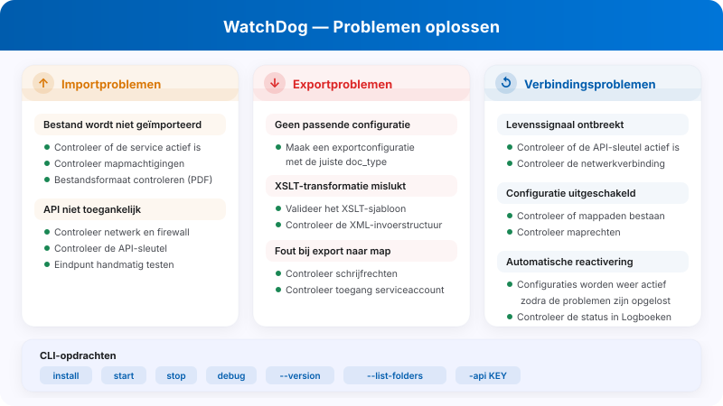
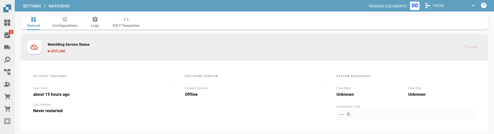

# WatchDog Admin FAQ & probleemoplossing

<figure><figcaption><p>Diagnose van import-, export- en verbindingsproblemen in WatchDog.</p></figcaption></figure>

Deze documentatie helpt beheerders om foutmeldingen van WatchDog te begrijpen en problemen op te lossen.

**Locatie in de UI:** Instellingen → Documentverwerking → WatchDog

---

## 1. WatchDog-instellingenpagina's (UI)

### 1.1 Tabblad General

<figure><figcaption></figcaption></figure>

* **Download:** Haal de nieuwste WatchDog.exe op
* **API Key:** Kopieer de configuratieopdracht
* **Auto-Update Schedule:** Stel de updatefrequentie in
* **Installation Guide:** Stapsgewijze installatie-instructies

### 1.2 Tabblad Configurations

* **Import Configurations:** Definieer bewaakte mappen en documenttypes
* **Export Configurations:** Definieer exportbestemmingen en -methoden
* **Bulk Copy:** Kopieer configuraties naar andere suborganisaties
* **Import/Export:** Importeer/exporteer configuraties als JSON

> **Belangrijk:** Exportconfiguraties **vereisen nu een documenttype** (`doc_type`). Configuraties zonder geldig documenttype worden geweigerd.

### 1.3 Tabblad Status

<figure><figcaption></figcaption></figure>

* Toont de actuele verbindingsstatus van WatchDog in realtime
* **Nieuwe velden:** `last_restart`, `version_first_seen`, `latest_version_checked_at`
* **Systeeminformatie:** installatiepad, vrij RAM-geheugen, vrije schijfruimte

### 1.4 Tabblad Logs

<figure><figcaption></figcaption></figure>

* Toont alle WatchDog-gebeurtenissen uit OpenSearch
* Filterbaar op gebeurtenistype, periode enzovoort
* **Gebeurtenistypen:**
  * `FILE_IMPORT_STARTED`: bestandsimport gestart
  * `FILE_IMPORT_COMPLETED`: import geslaagd
  * `FILE_IMPORT_FAILED`: import mislukt
  * `EXPORT_STARTED`: export gestart
  * `EXPORT_COMPLETED`: export geslaagd
  * `EXPORT_FAILED`: export mislukt
  * `FOLDER_VALIDATION_FAILED`: map niet bereikbaar
  * `CONFIG_LOADED`: configuratie geladen
  * `SERVICE_RESTART_INITIATED`: herstart van de service aangevraagd
  * `SERVICE_RESTART_COMPLETED`: service herstart

### 1.5 Tabblad XSLT Templates

<figure><figcaption></figcaption></figure>

* Upload en beheer XSLT-transformatiesjablonen
* Live validatie met veldanalyse
* Koppel sjablonen aan exportconfiguraties

---

## 2. Foutmeldingen bij mapvalidatie

| Fout | Betekenis | Oplossing |
| :--- | :--- | :--- |
| `not_found` | Map bestaat niet | Maak de map aan of corrigeer het pad |
| `no_read_access` | Geen leesrechten | Stel rechten in voor het WatchDog-serviceaccount |
| `no_write_access` | Geen schrijfrechten | Verleen schrijfrechten aan het serviceaccount |
| `not_configured` | Mappad niet geconfigureerd | Voer het pad in bij de configuratie |

**Betrokken mappen:**

* **Watch Folder (import):** Waar WatchDog naar nieuwe bestanden zoekt
* **Success Folder:** Waarheen succesvol geïmporteerde bestanden worden verplaatst
* **Export Folder:** Waar geëxporteerde XML-/PDF-bestanden worden weggeschreven

---

## 3. Foutmeldingen bij import

| Fout | Betekenis | Oplossing |
| :--- | :--- | :--- |
| `file_not_found` | Bestand is verwijderd vóór de import | Lever het bestand opnieuw aan |
| `invalid_file_type` | Alleen PDF-bestanden worden ondersteund | Verwijder andere bestandstypen |
| `api_not_accessible` | DocBits-API niet bereikbaar | Controleer netwerk/firewall, controleer de API-URL |
| `api_check_failed` | API-healthcheck mislukt | Controleer API Key en verbinding |
| `upload_failed` | Upload naar de API mislukt | Controleer API Key, netwerk en serverstatus |

---

## 4. Foutmeldingen bij export

| Fout | Betekenis | Oplossing |
| :--- | :--- | :--- |
| `transformation_error` | XSLT-transformatie mislukt | Controleer het XSLT-sjabloon, valideer de XML-structuur |
| `folder_error` | Exportmap niet bereikbaar | Maak de map aan, controleer de rechten |
| `file_write_error` | Bestand kon niet worden geschreven | Controleer schijfruimte, rechten en bestandsvergrendelingen |
| `permission_denied` | Geen schrijfrechten | Stel de rechten van het serviceaccount in |
| `creation_failed` | Map kon niet worden aangemaakt | Controleer de rechten van de bovenliggende map |
| `no_config_match` | Geen passende exportconfiguratie | Maak een exportconfiguratie met het juiste documenttype |

> **Opmerking:** Exportconfiguraties vereisen een `doc_type`. Ziet u `no_config_match`, controleer dan of er een actieve exportconfiguratie bestaat voor het type van het document.

---

## 5. Configuratie uitgeschakeld: redenen

Wanneer een configuratie wordt uitgeschakeld, verschijnt een van deze redenen:

| Reden van uitschakeling | Betekenis |
| :--- | :--- |
| `Watch folder: not_found` | Importmap bestaat niet |
| `Watch folder: no_read_access` | Importmap niet leesbaar |
| `Export folder: not_found` | Exportmap bestaat niet |
| `Export folder: no_write_access` | Exportmap niet beschrijfbaar |
| `Success folder: not_found` | Succesmap bestaat niet |
| `Success folder: no_write_access` | Succesmap niet beschrijfbaar |

**Automatische heractivering:** WatchDog controleert de mappen regelmatig (elke 60 seconden). Zodra de map weer bereikbaar is, wordt de configuratie automatisch opnieuw geactiveerd.

---

## 6. Foutmap (`_error`)

Mislukte bestanden worden verplaatst naar de map `_error`:

**Locatie:** `{import_folder}/_error/{error_type}/`

**Bestandsindeling:** `{original_name}_{YYYYMMDD_HHMMSS}.pdf`

**Sidecar-bestand:** Bij elk mislukt bestand hoort een `.error`-bestand met:

```
Error Type: transformation_error
Error Message: XSLT template not found
Timestamp: 2026-03-26 08:30:15
Original File: invoice_001.pdf
Original Path: C:\WatchDog\Import\invoice_001.pdf
```

---

## 7. Heartbeat en verbindingsstatus

WatchDog stuurt ongeveer elke 10 seconden een heartbeat naar DocBits met systeeminformatie:

| Verzonden gegevens | Beschrijving |
| :--- | :--- |
| Timestamp | Actuele tijd |
| Version | Geïnstalleerde WatchDog-versie |
| Last Restart | Tijdstip van de laatste herstart van de service |
| Auto-Update Enabled | Of automatisch updaten actief is |
| Latest Version | Nieuwste beschikbare versie |
| Installation Path | Waar WatchDog is geïnstalleerd |
| Free RAM / Disk | Beschikbare systeemresources |

### Verbindingsstatus

| Status | Betekenis |
| :--- | :--- |
| ✅ **Online** | WatchDog is verbonden en actief |
| ⚠️ **Offline** | Al 30+ seconden geen heartbeat |
| ❌ **Not Installed** | WatchDog heeft nog nooit verbinding gemaakt |

**Heartbeat-fouten:**

* `Heartbeat failed - invalid API key` → API Key is ongeldig
* `Heartbeat failed: 401` → Authenticatie mislukt
* `Heartbeat failed: 5xx` → Serverprobleem

---

## 8. Veelvoorkomende problemen en oplossingen

### Probleem: WatchDog importeert geen bestanden

1. Controleer of de service draait: `services.msc` → WatchDog
2. Controleer de logs: Instellingen → WatchDog → tabblad Logs
3. Controleer de maprechten voor het WatchDog-serviceaccount
4. Test de API-verbinding: `WatchDog.exe debug` in CMD
5. Controleer of het bestandstype PDF is

### Probleem: Export werkt niet

1. Bestaat er een exportconfiguratie met het juiste documenttype?
2. Komt het documenttype van het document overeen met dat van de configuratie?
3. Is er een XSLT-sjabloon gekoppeld (voor mapexport)?
4. Is de exportmap beschrijfbaar voor het serviceaccount?
5. Bij Infor-exports: zijn de ION-inloggegevens juist geconfigureerd?

### Probleem: Configuratie is uitgeschakeld

1. Bestaat het mappad?
2. Zijn er rechten voor `NT AUTHORITY\LOCAL SERVICE` of het serviceaccount?
3. Is de netwerkschijf bereikbaar? (Controleer UNC-paden)
4. WatchDog activeert de configuratie automatisch opnieuw zodra de mappen weer beschikbaar zijn

### Probleem: XSLT-transformatie mislukt

1. Is het XSLT-sjabloon geldig? (gebruik tabblad XSLT Templates → Validate)
2. Past het sjabloon bij het documenttype?
3. Controleer de XML-structuur van het document
4. V3 Folder Export gebruikt transformatie aan serverzijde: controleer de API-connectiviteit

### Probleem: REST API-export mislukt

1. Zijn de ION OAuth-inloggegevens geconfigureerd in de exportconfiguratie?
2. Is het doel-API-endpoint bereikbaar vanaf de WatchDog-server?
3. Controleer of het payloadformaat overeenkomt met de verwachtingen van de doel-API
4. Controleer de configuratie van de aanvraagketen op JSONPath-fouten

---

## 9. Opdrachtregelopdrachten

```bash
# Configure API connection
WatchDog.exe -api YOUR_API_KEY

# Install Service
WatchDog.exe install

# Start Service
WatchDog.exe start

# Stop Service
WatchDog.exe stop

# Run in debug mode (console output)
WatchDog.exe debug

# Uninstall Service
WatchDog.exe remove

# Show version
WatchDog.exe --version

# List watch folders
WatchDog.exe --list-folders

# Add/remove watch folder
WatchDog.exe --add-folder "C:\Import\Invoices"
WatchDog.exe --remove-folder "C:\Import\Invoices"

# Check Windows service status
sc query WatchDog
```

---

## 10. Logbestanden

**Locatie:** `C:\WatchDog\logs\{module}\`

**Logindeling:**
```
INFO  - 2026-03-26 10:00:00 - module_name - Message - function=func_name - line=42
```

**Logniveau:** DEBUG, INFO, WARNING, ERROR

**Externe logs:** WatchDog stuurt logs ook naar DocBits (zichtbaar op het tabblad Logs) en optioneel naar de cloudlogging van Logtail.
