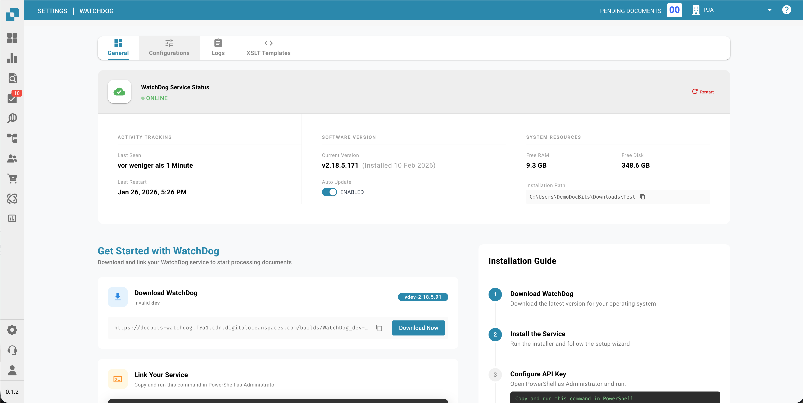

# WatchDog Installatie

<figure><figcaption></figcaption></figure>

> **Aanbevolen:** Gebruik de moderne installatie die hieronder wordt beschreven. WatchDog-configuraties worden nu rechtstreeks in de DocBits-applicatie aangemaakt, lokale configuratiebestanden zijn niet meer nodig.

## Vereisten

* Windows Server of Windows 10/11
* Beheerderstoegang (Administrator)
* Netwerkverbinding met de DocBits-API
* DocBits API Key (beschikbaar onder Instellingen → WatchDog → tabblad General)

## Installatiestappen

### 1. Maak de vereiste mappen aan

Maak een hoofdmap en submappen voor WatchDog aan:

```
C:\WatchDog\              ← WatchDog executable
C:\WatchDog\Import\       ← Watch folder for incoming documents
C:\WatchDog\Processed\    ← Success folder for processed documents
C:\WatchDog\Export\        ← Export folder for exported files
```

> **Opmerking:** Het wordt aanbevolen om lokale paden te gebruiken. UNC-netwerkpaden (bijv. `\\server\share`) worden ondersteund, maar kunnen een Polling Observer vereisen voor betrouwbare bestandsdetectie.

### 2. Download WatchDog

Download `WatchDog.exe` uit de DocBits-applicatie:

**Instellingen → Documentverwerking → WatchDog → tabblad General → Download**

Plaats het gedownloade bestand `WatchDog.exe` in `C:\WatchDog\`.

### 3. Configureer de API-verbinding

Open de **opdrachtprompt (CMD)** als **Administrator** en voer uit:

```powershell
cd C:\WatchDog
WatchDog.exe -api YOUR_API_KEY
```

Hiermee wordt WatchDog gekoppeld aan uw DocBits-organisatie en worden de configuraties automatisch opgehaald.

### 4. Installeren als Windows-service

```powershell
WatchDog.exe install
```

### 5. Start de service

```powershell
WatchDog.exe start
```

### 6. Maak configuraties aan in DocBits

Navigeer in DocBits naar **Instellingen → Documentverwerking → WatchDog → tabblad Configurations**:

* Klik op **New Import Configuration** om bewaakte mappen in te stellen
* Klik op **New Export Configuration** om exportbestemmingen in te stellen

> **Belangrijk:** Exportconfiguraties vereisen een **documenttype**. Alle configuraties worden centraal in DocBits beheerd, niet in lokale configuratiebestanden.

### 7. Automatisch opstarten instellen

1. Open **Services** (`Win + R` → `services.msc`)
2. Zoek **WatchDog** in de lijst met services
3. Dubbelklik om de eigenschappen te openen
4. Stel **Startup Type** in op **Automatic (Delayed Start)**
5. Klik op **OK**

## Installatie controleren

Controleer na de installatie de WatchDog-status in DocBits:

**Instellingen → WatchDog → tabblad General**

<figure><figcaption></figcaption></figure>

* ✅ **Online** — WatchDog is verbonden en stuurt heartbeats
* Versie, laatste herstart en systeeminformatie moeten zichtbaar zijn

## Opdrachtoverzicht

| Opdracht | Beschrijving |
| :--- | :--- |
| `WatchDog.exe -api KEY` | API Key configureren |
| `WatchDog.exe install` | Installeren als Windows-service |
| `WatchDog.exe start` | De service starten |
| `WatchDog.exe stop` | De service stoppen |
| `WatchDog.exe debug` | Uitvoeren in consolemodus (voor probleemoplossing) |
| `WatchDog.exe remove` | De service verwijderen |
| `WatchDog.exe --version` | Huidige versie tonen |
| `WatchDog.exe --list-folders` | Geconfigureerde bewaakte mappen weergeven |
| `WatchDog.exe --add-folder PATH` | Een bewaakte map toevoegen |
| `WatchDog.exe --remove-folder PATH` | Een bewaakte map verwijderen |

---

## Legacy: V1-configuratie (verouderd)

De onderstaande V1-installatiemethode met lokale configuratiebestanden is **verouderd**. Gebruik in plaats daarvan de moderne, op de API gebaseerde installatie hierboven.

<details>
<summary>V1-installatie (klik om uit te klappen)</summary>

### WatchDog configureren in DocBits (V1)

1. **Toegang tot de WatchDog-instellingen**
   * Navigeer naar **Instellingen → Documentverwerking → WatchDog**
2. **Mapinstellingen**
   * Definieer de paden: `C:/WatchDog/Read` en `C:/WatchDog/Processed`

   <figure><figcaption></figcaption></figure>

3. **Algemene instellingen**
   * Selecteer documenttypes, configureer de exportbestemming

   <figure><figcaption></figcaption></figure>

4. **Exportconfiguraties**
   * Toont geconfigureerde exports voor on-premise verwerking

   <figure><figcaption></figcaption></figure>

5. **Configuratie downloaden**
   * Download `watchdog-config.json` en plaats het in `C:\WatchDog\`

   <figure><figcaption></figcaption></figure>

</details>
