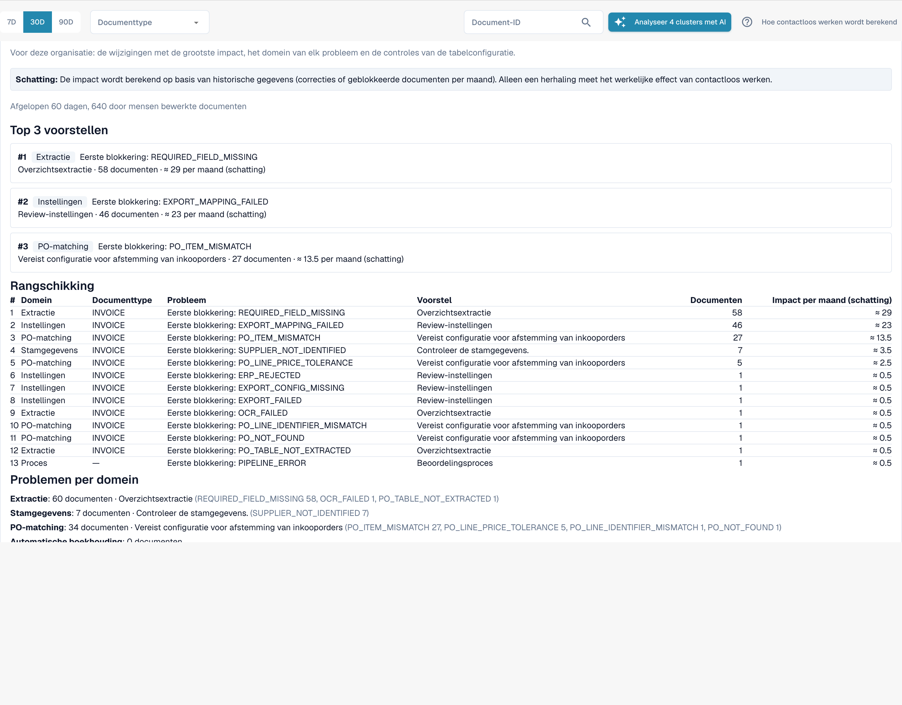

# Touchless Intelligence: Wijzigingsvoorstellen en rapporten

Een aanbeveling kan vergezeld gaan van een **wijzigingsvoorstel** (change proposal): één instellingswijziging die zou moeten helpen. Beheerders werken ermee in vier stappen:

1. **Voorbeeld bekijken** (Preview): toont de wijziging (huidige → voorgestelde waarde) en wat DocBits verwacht. Er wordt niets opgeslagen. **Toepassen** (Apply) is pas mogelijk nadat u een voorbeeld hebt bekeken.
2. **Toepassen**: slaat precies de bekeken wijziging op. Dit wordt gelogd.
3. **Meten**: DocBits vergelijkt het touchless-percentage van hetzelfde documenttype **voor en na**, over even lange periodes. In elke periode zijn minstens **20 documenten** nodig, anders meldt het *not measurable* (niet meetbaar).
4. **Ongedaan maken** (Undo): neemt de wijziging terug.


Een verschil voor/na is een **waarneming**, geen bewijs van oorzaak. Andere dingen kunnen tegelijk veranderen (een nieuwe leverancier, een seizoenspiek).


**Voorbeeld.** U past *Switch on automatic PO match and export* (automatische PO-match en export inschakelen) toe voor facturen. Twee weken later meldt de **Wijzigingsgeschiedenis**: puur percentage voor 52 % (210 documenten), na 61 % (198 documenten). Dat is +9 pp, met voldoende documenten om het te kunnen meten.

Beheerders zien ook twee secties tussen de kerncijfers en de grafieken:

* **Verbeterverzoeken** (Improvement requests): suggesties die gebruikers vanuit de validatieassistent hebben gestuurd, in twee tabbladen **Open** en **Geschiedenis** (History).
* **Voorstellen voor geleerde regels** (Learned rule proposals): regels die DocBits heeft geleerd van de correcties van uw team, bijvoorbeeld "vervang voor leverancier X de waarde in veld Y". Controleer voordat u er een aanmaakt de documenten waarbij de regel een waarde zou vervangen die uw team had geaccepteerd. De sectie **Na activering** (After activation) toont de handmatige correcties van het doelveld voor en nadat een regel live ging.

<figure><figcaption>
Het Adviesrapport: de belangrijkste voorstellen, een rangschikking van alle blokkades met documenten en geschat effect per maand, en de problemen per domein. Voorbeeldorganisatie met demogegevens; de namen van leveranciers zijn fictief.
</figcaption></figure>

Beheerders vinden het **Adviesrapport** (Consulting report) onderaan het tabblad. Klik op **Rapport maken** (Create report) om het te laden. Het combineert, voor uw organisatie:

* de **wijzigingen met het grootste effect**, gerangschikt, elk met het domein, het probleem, de aanbevolen actie, het aantal documenten en het **geschatte** effect per maand,
* **het domein van elk probleem** (extractie, stamgegevens, PO-matching, automatische boekhouding, instellingen, proces),
* **controles van de tabelconfiguratie**, bijvoorbeeld *structured table output not used* (gestructureerde tabeluitvoer niet gebruikt) of *table column type mismatch* (type van tabelkolom komt niet overeen) per documenttype en kolom.

De effectwaarden zijn **schattingen**. Als het rapport met *forbidden* (verboden) antwoordt, staat uw rol dit niet toe.

## Gerelateerde pagina's

* [Touchless Intelligence](touchless-intelligence.md)
* [Leveranciersdiagnose en probleemclusters](touchless-supplier-diagnosis.md)
* [PO-matchingdiagnose](touchless-po-matching-diagnosis.md)
