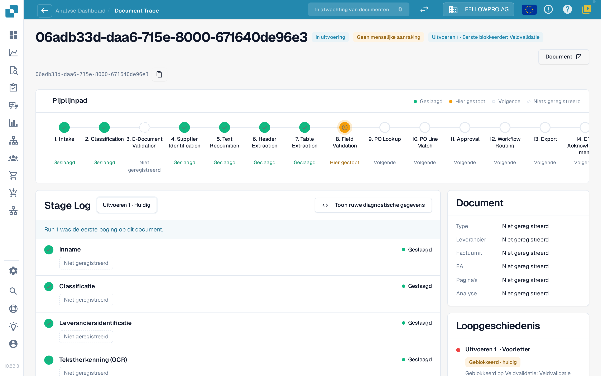
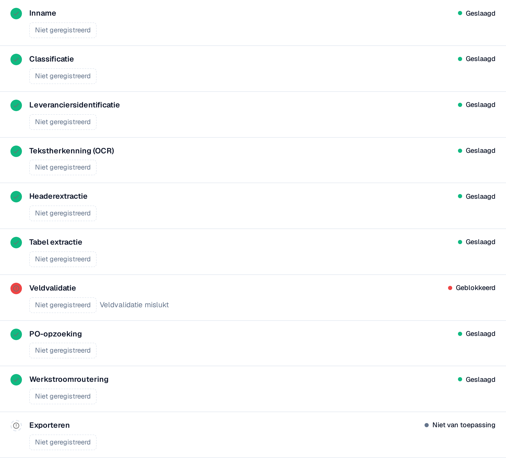

# Touchless Intelligence: Documentspoor

Voer een document-ID in bij **Document ID**, of open een voorbeelddocument uit een cluster, om te zien **wat er met dit ene document is gebeurd**.

De kop toont het bestand, de status ervan (bijvoorbeeld **In uitvoering**), de uitvoering die u bekijkt en de eerste blokkeerder daarvan, en een knop **Document** met het document-ID.

<figure><figcaption>
Het documentspoor: het pijplijnpad met alle stappen en het stappenlogboek met wat elke stap heeft geregistreerd.
</figcaption></figure>

Het **Pijplijnpad** toont 14 stappen: Intake, Classification, E-Document Validation, Supplier Identification, Text Recognition, Header Extraction, Table Extraction, Field Validation, PO Lookup, PO Line Match, Approval, Workflow Routing, Export, ERP Acknowledgement. Elke stap draagt één status:

| Status | Betekenis |
| --- | --- |
| **Geslaagd** (groen) | De stap is goed verlopen |
| **Hier gestopt** (oranje) | De stap heeft het document geblokkeerd |
| **Volgende** | Het document is nooit zo ver gekomen |
| **Niets geregistreerd** (gestippeld) | Voor deze stap zijn geen gegevens vastgelegd |
| **Niet van toepassing** | De stap geldt niet voor dit document |

### Stappenlogboek

Het **stappenlogboek** onder het pad somt dezelfde stappen op met wat elke stap heeft geregistreerd. Een statusstip en het statuswoord staan links en rechts op elke regel.

* Elke waarde is een **waardechip**: een getal met zijn eenheid, bijvoorbeeld **Betrouwbaarheid 100 %**, **Drempel 60 %**, **Mislukte regels 0**, **8 ontbrekende velden** of **0 koppelingshiaten**. Percentages worden getoond als `97 %`, nooit als `0.97`.
* **Details** opent de volledige lijst van waarden die een stap heeft vastgelegd, inclusief de alternatieven die zijn overwogen.
* De stap die het document blokkeerde, noemt de reden, bijvoorbeeld **Veldvalidatie mislukt**.
* Een waarde die geen enkele stap heeft vastgelegd, verschijnt als **Niet geregistreerd**, nooit als verzonnen waarde. Waarden zijn getallen en vaste termen, nooit documenttekst.
* **Ruwe diagnostiek tonen** zet de ruwe gegevens aan wanneer de support erom vraagt.

<figure><figcaption>
Elke stap toont wat hij heeft geregistreerd; de geblokkeerde stap noemt zijn oorzaak.
</figcaption></figure>

### Uitvoeringen en wijzigingen

De uitvoeringskiezer bovenaan het stappenlogboek (**Uitvoeren 1 · Huidig**) schakelt tussen de uitvoeringen van het document. De **uitvoeringsgeschiedenis** rechts somt elke uitvoering op met het resultaat en de plek waar die is gestopt. Als een document meer dan één keer is uitgevoerd, kiest u een uitvoering in de kiezer om die met de huidige te vergelijken: de gewijzigde waarden krijgen dan een badge met het verschil en de eenheid, bijvoorbeeld **−2 velden** of **+3 %**.

De kaart **Document** naast het stappenlogboek vermeldt het documenttype, de leverancier, het factuurnummer, de inkooporder, het aantal pagina's en of de analyse op **regels** is gebaseerd of door een AI is geschreven.

**Voorbeeld.** De documenten van één leverancier stoppen allemaal bij stap 8. In het spoor ziet u telkens dezelfde ontbrekende velden. Dat is geen extractieprobleem van losse documenten, maar een ontbrekende standaardwaarde in uw veldconfiguratie: herstel die één keer en het hele cluster is terug te winnen.

## Gerelateerde pagina's

* [Touchless Intelligence](touchless-intelligence.md)
* [Leveranciersdiagnose en probleemclusters](touchless-supplier-diagnosis.md)
* [PO-matchingdiagnose](touchless-po-matching-diagnosis.md)

De schermafbeeldingen op deze pagina tonen de interface in het Nederlands.
