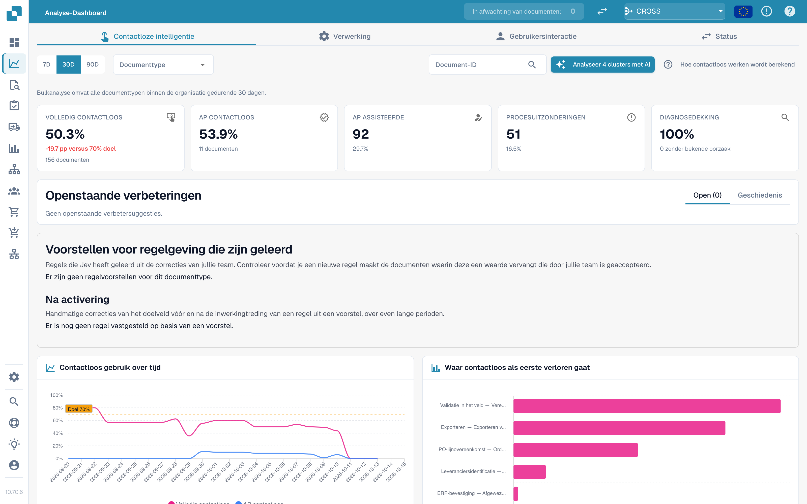
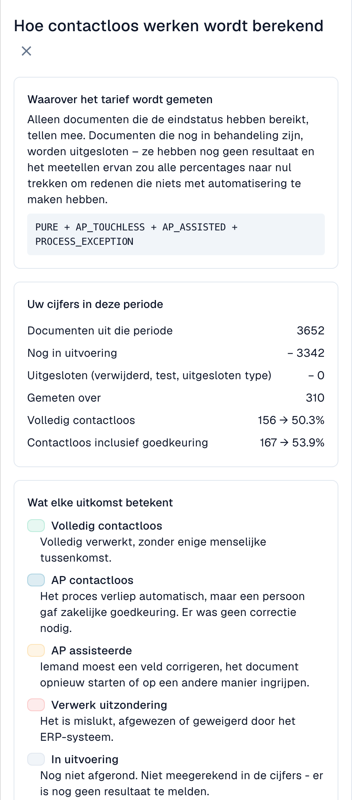
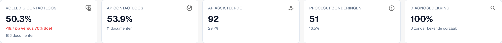
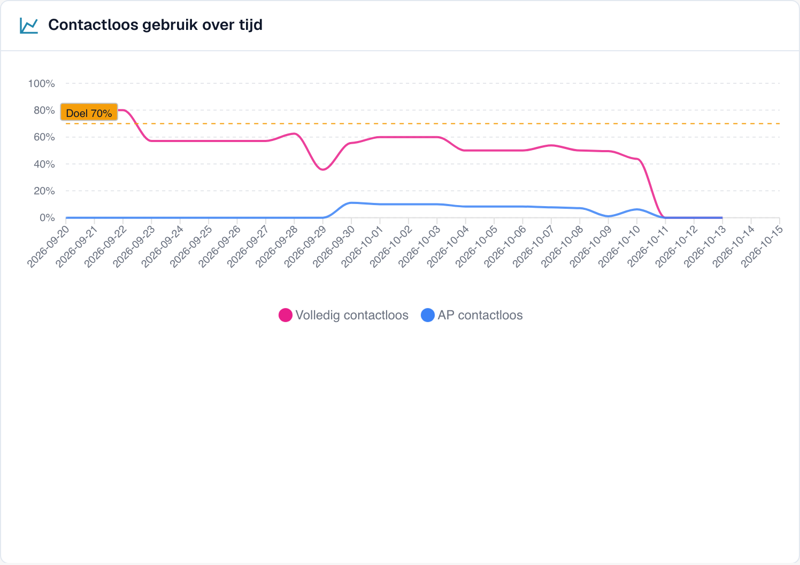
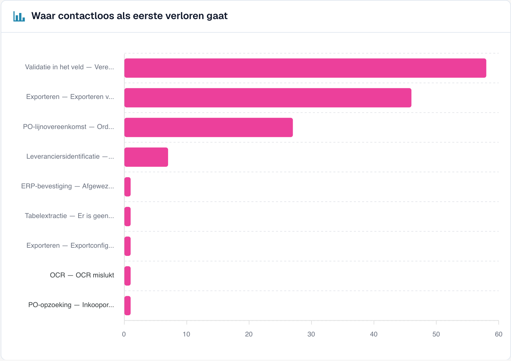
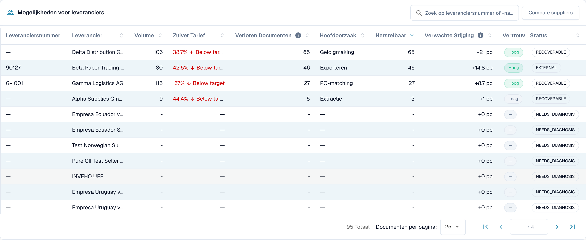
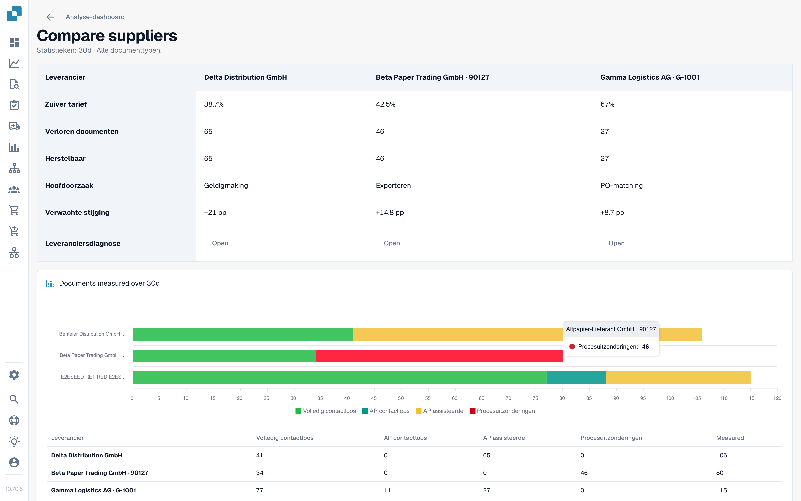

# Touchless Intelligence



## Overzicht

**Touchless Intelligence** beantwoordt twee vragen over uw documentverwerking:

1. **Hoeveel documenten lopen door DocBits zonder dat iemand ze aanraakt?** Dit is uw *touchless-percentage*.
2. **Waarom stoppen de andere documenten, en wat moeten we wijzigen zodat er minder stoppen?** Dit is de *diagnose*.

Het is een tabblad van het [Analyse-dashboard](analytics-dashboard.md). Het kost uw team geen extra werk: DocBits registreert wat er met elk document in de verwerkingspipeline gebeurt en beoordeelt het resultaat elke 15 minuten.

<figure><figcaption><p>Het tabblad Touchless Intelligence: kerncijfers, verbeteringen, het percentage in de tijd en de grafiek waar touchless het eerst verloren gaat. Voorbeeldorganisatie met demogegevens; de namen van leveranciers zijn fictief.</p></figcaption></figure>

### Wat u ermee kunt doen

| U wilt… | Gebruik | Voorbeeld |
| --- | --- | --- |
| Zien hoe geautomatiseerd u bent | De vijf **kerncijfers** bovenaan | "63,2 % van onze documenten liep vorige maand zonder persoon door" |
| De trend zien | **Touchless-percentage in de tijd** | "Het percentage steeg van 55 % naar 68 % sinds we de stamgegevens van leveranciers hebben gecorrigeerd" |
| Uitzoeken waar documenten blijven hangen | **Waar touchless het eerst verloren gaat** | "De meeste documenten stoppen bij Veldvalidatie" |
| Beslissen welke leverancier u eerst aanpakt | **Leverancierskansen** | "Leverancier A zou ons +4,0 procentpunt opleveren" |
| Eén leverancier begrijpen | Pagina **Leveranciersdiagnose** | "Hun facturen hebben geen inkoopordernummer, dus de PO-matching mislukt" |
| Eén document begrijpen | **Documentspoor** | "Deze factuur stopte bij fase 8, Veldvalidatie" |
| Leveranciers vergelijken | **Leveranciers vergelijken** | "Leverancier A en B gebruiken dezelfde sjabloon, maar alleen bij B mislukt het" |
| Een nuttige instelling wijzigen | **Wijzigingsvoorstellen** | "Schakel de automatische PO-match in: voorbeeld bekijken, toepassen, meten, ongedaan maken" |

## Wie het kan zien

* Het tabblad maakt deel uit van het Analyse-dashboard. Uw beheerder schakelt het in voor de organisatie. Als het tabblad ontbreekt, vraag het dan aan uw beheerder.
* **Organisatiebeheerders** zien het altijd.
* Andere gebruikers zien het wanneer een beheerder hun rol het tabblad **Analytics dashboard** (Analyse-dashboard) heeft toegekend (**Instellingen → Rollen**). Zonder toekenning hebben alleen beheerders toegang.
* Sommige acties zijn alleen voor beheerders: **AI-analyse**, **een wijziging toepassen en ongedaan maken**, **voorstellen voor geleerde regels** en het **Adviesrapport**.

Als u geen toegang hebt, toont de pagina *Action not allowed, please contact the administrator* (actie niet toegestaan, neem contact op met de beheerder).

## Wat "touchless" betekent

Elk document eindigt met precies **één** uitkomst:

| Uitkomst | Betekenis | Telt mee in het percentage |
| --- | --- | --- |
| **Puur touchless** (Pure touchless) | Van import tot export verwerkt **zonder enige menselijke tussenkomst** | Ja, als succes |
| **AP touchless** | Automatisch verwerkt, en een persoon gaf alleen de **zakelijke goedkeuring**. Er was geen correctie nodig | Ja, als succes |
| **AP ondersteund** (AP assisted) | Een persoon moest **een veld corrigeren, het document opnieuw starten** of anderszins ingrijpen | Ja, als misser. Het is geen mislukking, alleen automatisering die het document niet volledig heeft gedragen |
| **Procesuitzondering** (Process exception) | Eindigde in een **fout**, werd **afgewezen**, werd **geweigerd door het ERP** of **bleef steken** in de pipeline | Ja, als misser |
| **In behandeling** (In progress) | Nog niet klaar | **Nee**. Er is nog geen uitkomst |
| **Niet in aanmerking** (Not eligible) | Verwijderd, gearchiveerd, een testdocument of een uitgesloten documenttype | **Nee** |

Het **touchless-percentage** is:

```
rate = (Pure touchless + AP touchless)
       ÷ (Pure touchless + AP touchless + AP assisted + Process exception)
```

Documenten die nog **in behandeling** zijn of **niet in aanmerking komen**, zitten nooit in de berekening. Dat beschermt het percentage: een document dat vijf minuten geleden binnenkwam, kan het niet omlaag trekken.


**Eén aanraking telt voorgoed.** Zodra een persoon een document heeft aangeraakt, blijft het als aangeraakt geteld, ook als een latere automatische run niemand had nodig gehad. **Een document opnieuw starten maakt het niet weer touchless.** Het percentage weerspiegelt het werk dat is gedaan.


### Rekenvoorbeeld (illustratieve cijfers)

In 30 dagen kwamen 200 documenten binnen:

| Uitkomst | Documenten |
| --- | --- |
| Puur touchless | 120 |
| AP touchless | 30 |
| AP ondersteund | 30 |
| Procesuitzondering | 10 |
| In behandeling | 8 |
| Niet in aanmerking (testdocumenten) | 2 |

* Noemer: 120 + 30 + 30 + 10 = **190**. De 8 documenten in behandeling en de 2 niet in aanmerking komende documenten blijven buiten beschouwing.
* **Puur touchless**: 120 ÷ 190 = **63,2 %**
* **AP touchless**: 30 ÷ 190 = **15,8 %**
* **Touchless-percentage**: (120 + 30) ÷ 190 = **78,9 %**

Het tabblad toont een **doel** (70 %, tenzij uw organisatie een ander doel gebruikt). In dit voorbeeld ligt het percentage boven het doel.

Klik rechtsboven op **Hoe touchless wordt berekend** (How touchless is calculated) om deze uitleg binnen DocBits te openen, met de cijfers van uw eigen periode (documenten in de periode, nog in behandeling, uitgesloten, gemeten).

<figure><figcaption><p>Het paneel <strong>Hoe touchless wordt berekend</strong>: de formule, <strong>Uw cijfers in deze periode</strong> (hier 2.425 documenten, 2.115 nog in behandeling, 310 gemeten) en wat elke uitkomst betekent. Voorbeeldorganisatie met demogegevens; de namen van leveranciers zijn fictief.</p></figcaption></figure>

### Hoe actueel zijn de cijfers

Uitkomsten worden **elke 15 minuten opnieuw berekend**. De uitkomst van een document kan nog veranderen nadat het voor het eerst verschijnt: het ERP kan een export uren later bevestigen. De regel **Data as of …** (gegevens van) onderaan het tabblad toont wanneer de cijfers voor het laatst zijn berekend.

## Het overzichtstabblad

### Filters

| Filter | Wat het doet |
| --- | --- |
| **7D / 30D / 90D** | De periode voor de kerncijfers en de wachtrij. De standaardwaarde is 30 dagen |
| **Documenttype** (Document Type) | Beperkt elk cijfer tot één type, bijvoorbeeld INVOICE |
| **Segmentveld / Segmentwaarde** (Segment field / Segment value) | Alleen als uw organisatie meerdere processen via één documenttype laat lopen (bijvoorbeeld directe, indirecte en EAM-bestellingen in het veld `order_type`). Kies een veld om de verdeling te zien, kies een waarde om alles daartoe te beperken |
| **Document-ID** (Document ID) | Opent het **Documentspoor** van één document |

De **suborganisatie** die u bovenaan in DocBits hebt gekozen, beperkt de kerncijfers en de leverancierswachtrij. Probleemclusters en de AI-analyse beslaan altijd de hele organisatie.

### De vijf kerncijfers

<figure><figcaption><p>De vijf kerncijfers. Hier is het pure percentage 50,3 % (156 documenten), dat is 19,7 punten onder het doel van 70 %, en de diagnosedekking is 100 %. Voorbeeldorganisatie met demogegevens; de namen van leveranciers zijn fictief.</p></figcaption></figure>

| Kaart | Toont | Voorbeeld (illustratief) |
| --- | --- | --- |
| **Puur touchless** | Het percentage en het verschil met het doel | **63,2 %** · "120 documenten" · "−6,8 pp t.o.v. doel van 70 %" (rood, onder het doel) |
| **AP touchless** | Het percentage | **15,8 %** · "30 documenten" |
| **AP ondersteund** | Het aantal documenten en hun aandeel | **30** · 15,8 % |
| **Procesuitzonderingen** | Het aantal documenten en hun aandeel | **10** · 5,3 % |
| **Diagnosedekking** | Voor hoeveel geblokkeerde documenten de oorzaak **bekend** is | **80 %** · "10 zonder bekende oorzaak" |

* Een kaart toont een streepje (—) in plaats van **0 %** als er niets te meten is. Een streepje betekent "geen gegevens", niet "nul".
* **Diagnosedekking** = documenten met een bekende blokkeringsreden ÷ alle geblokkeerde documenten. Voorbeeld: 50 geblokkeerde documenten, 10 met een onbekende oorzaak → 40 ÷ 50 = **80 %**. Een lage waarde betekent "we begrijpen nog niet waarom documenten stoppen". Verbeter die eerst voordat u afzonderlijke oorzaken probeert op te lossen.
* **Klik op een kaart** om de documentenlijst achter het cijfer in een nieuw tabblad te openen ("View the documents behind this number", de documenten achter dit cijfer bekijken). Kaarten met 0 documenten zijn niet klikbaar.

### Touchless-percentage in de tijd

<figure><figcaption><p>Het percentage per dag met de doellijn. Hier blijft het percentage tussen 40 en 60 % en daalt het sterk vanaf 10 oktober. Voorbeeldorganisatie met demogegevens; de namen van leveranciers zijn fictief.</p></figcaption></figure>

Een grafiek met één lijn voor **Puur touchless**, één voor **AP touchless** en de **doellijn**. Korte periodes tonen dagpunten, lange periodes weekpunten.

**Voorbeeld.** Nadat u op 1 oktober de automatische PO-matching hebt ingeschakeld, stijgt het pure percentage binnen twee weken van 55 % naar 68 %. De grafiek toont de dag waarop de curve draait, zodat u die kunt koppelen aan uw wijziging.

### Waar touchless het eerst verloren gaat

<figure><figcaption><p>Geblokkeerde documenten naar de fase en reden waar ze het eerst stopten. Hier kost <strong>Veldvalidatie: verplicht veld ontbreekt</strong> de meeste documenten (58), gevolgd door <strong>Exportmapping mislukt</strong> (46) en <strong>PO-regel komt niet overeen</strong> (27). Voorbeeldorganisatie met demogegevens; de namen van leveranciers zijn fictief.</p></figcaption></figure>

Een staafdiagram van **Geblokkeerde documenten** per pipelinefase: de **eerste** fase die een document stopte.

**Voorbeeld.** Staven: Leverancieridentificatie 12, Veldvalidatie 41, PO-regelmatch 7. De grootste staaf zegt dat u eerst naar **Veldvalidatie** moet kijken, meestal omdat een verplicht veld niet wordt geëxtraheerd.

### Leverancierskansen

<figure><figcaption><p>De leverancierswachtrij (ingekort tot de eerste vier rijen). De eerste leverancier heeft 106 documenten, een puur percentage van 38,7 % en 65 herstelbare documenten, dus het oplossen ervan is <strong>+21 pp</strong> waard. Voorbeeldorganisatie met demogegevens; de namen van leveranciers zijn fictief.</p></figcaption></figure>

De wachtrij beantwoordt de vraag **"Welke leverancier pakken we eerst aan?"** Ze is gesorteerd op **Herstelbare** documenten, het hoogste eerst, 25 rijen per pagina.

| Kolom | Betekenis |
| --- | --- |
| **Leveranciersnummer / Leverancier** | De leverancier. Documenten zonder herkende leverancier verschijnen als **No supplier identified (n documents)** (geen leverancier geïdentificeerd) |
| **Volume** | In aanmerking komende documenten van de leverancier in de periode |
| **Puur percentage** (Pure Rate) | Aandeel puur touchless documenten. Groen bij of boven het doel, rood eronder |
| **Verloren documenten** (Lost Documents) | Documenten die eindigden als AP ondersteund of als procesuitzondering. Niet altijd een persoon: een ERP-afwijzing of een document dat zeven dagen bleef steken telt ook mee |
| **Hoofdoorzaak** (Root Cause) | Wie de oplossing in handen heeft: Configuratie, ERP-integratie, Export, Extractie, Stamgegevens, Meting, PO-matching, Gebruikersproces, Validatie of Onbekend |
| **Herstelbaar** (Recoverable) | Verloren documenten waarvan de oorzaak door DocBits kan worden opgelost: configuratie, stamgegevens of leverancierssjabloon |
| **Verwachte stijging** (Expected Lift) | Hoeveel **procentpunten** het percentage van uw organisatie zou stijgen als elk herstelbaar document van deze leverancier touchless zou lopen (**+x pp**) |
| **Betrouwbaarheid** (Confidence) | **Hoog**, **Gemiddeld** of **Laag**: hoe zeker de diagnose is |
| **Status** | Nieuw, Open, In onderzoek, In uitvoering, Bevestigd, Opgelost, Afgewezen. Een leverancier met te weinig documenten toont **NEEDS_DIAGNOSIS** |

**Voorbeeld.** Uw organisatie heeft 1.000 in aanmerking komende documenten in de periode. Leverancier A heeft 40 herstelbare documenten, leverancier B heeft 90 verloren documenten maar slechts 10 herstelbare (hun probleem ligt aan hun kant).

* Leverancier A: 40 ÷ 1.000 = **+4,0 pp verwachte stijging**
* Leverancier B: 10 ÷ 1.000 = **+1,0 pp**, hoewel B meer verloren documenten heeft

De wachtrij plaatst A boven B omdat de **verwachte stijging** wordt afgemeten aan uw hele organisatie, niet aan de leverancier. Een leverancier met vier slechte documenten kan er niet boven komen te staan bij een leverancier met vierhonderd.

Gebruik het zoekvak ("Search supplier number or name", zoek op leveranciersnummer of naam) om een leverancier te vinden. Klik op een rij om de **Leveranciersdiagnose** te openen.

### Leveranciers vergelijken

<figure><figcaption><p>Drie leveranciers naast elkaar: puur percentage, verloren en herstelbare documenten, hoofdoorzaak, verwachte stijging en een staafdiagram van de uitkomsten. Elke knop <strong>Openen</strong> leidt naar de Leveranciersdiagnose. Voorbeeldorganisatie met demogegevens; de namen van leveranciers zijn fictief.</p></figcaption></figure>

Klik op **Leveranciers vergelijken** (Compare suppliers), vink **twee tot vijf** leveranciers aan (elk met zijn aantal geblokkeerde documenten) en klik op **Vergelijken** (Compare).

De vergelijking toont de leveranciers naast elkaar: **Puur percentage**, **Verloren documenten**, **Herstelbaar**, **Hoofdoorzaak**, **Verwachte stijging**, een staafdiagram van de uitkomsten en een link naar elke **Leveranciersdiagnose**.

**Voorbeeld.** Leverancier A en B sturen dezelfde factuurlay-out. B heeft een puur percentage van 80 %, A slechts 35 %. Beide hebben de hoofdoorzaak "Stamgegevens". De vergelijking laat zien dat de lay-out in orde is en dat het leveranciersrecord van A onvolledig is. Corrigeer de stamgegevens van A in plaats van de sjabloon te wijzigen.

### Analyseren met AI

De knop **Analyseer n clusters met AI** (Analyse n clusters with AI) analyseert de probleemclusters met het hoogste touchless-potentieel (elk met minimaal een bepaald aantal documenten). Het duurt ongeveer 13 seconden per cluster en omvat de **hele organisatie**. Alleen beheerders kunnen het starten.

Terwijl de analyse loopt, ziet u per cluster **Queued** (in de wachtrij), **Running** (bezig), **Done** (klaar), **Already analysed** (al geanalyseerd) of **Error** (fout), met een link **Cluster openen** (Open cluster). Als AI is uitgeschakeld of in de omgeving niet is geconfigureerd, is de knop uitgeschakeld met de reden, en **werkt al het andere op de pagina gewoon door**.

## Verdiep u verder

| Pagina | Wat ze behandelt |
| --- | --- |
| [Leveranciersdiagnose en probleemclusters](touchless-supplier-diagnosis.md) | Eén leverancier in detail: uitkomsttegels, trend, probleemclusters, waar een aanbeveling vandaan komt |
| [PO-matchingdiagnose](touchless-po-matching-diagnosis.md) | Waarom documenten stoppen bij het opzoeken van de PO of de PO-regelmatch, en de beslisstroom die laat zien hoe DocBits factuurregels aan PO-regels koppelt |
| [Documentspoor](touchless-document-trace.md) | Wat er met één document is gebeurd, fase voor fase |
| [Wijzigingsvoorstellen en rapporten](touchless-change-proposals.md) | Een wijziging bekijken, toepassen, meten en ongedaan maken; voorstellen voor geleerde regels; het Adviesrapport |

## Werken met Touchless Intelligence: een routine

1. **Wekelijks**: open het tabblad en controleer het **percentage** en de **trend** ten opzichte van het doel.
2. Kijk naar de **Diagnosedekking**. Onder ongeveer 80 % zoekt u eerst uit waarom documenten stoppen.
3. Lees **Waar touchless het eerst verloren gaat** en kies de grootste fase.
4. Open **Leverancierskansen**. Sorteer op **Verwachte stijging** en neem de bovenste leverancier met de status **RECOVERABLE**.
5. Lees de **probleemclusters**, controleer **Ontbrekend bewijs** en volg daarna **Wat te wijzigen**.
6. Pas één wijziging tegelijk toe met een **voorbeeldweergave**, zodat de **Wijzigingsgeschiedenis** deze kan meten.
7. Controleer na twee weken het resultaat **voor/na**.

## Vraag het in gewone taal: DocBits MCP

Dit alles is ook beschikbaar voor uw AI-assistent via de [DocBits MCP](../advanced-functions-and-tools/docbits-mcp/README.md). Voorbeelden van vragen:

* "Wat is ons touchless-percentage over de laatste 30 dagen?"
* "Welke drie leveranciers kosten ons de meeste touchless documenten?"
* "Waarom stoppen documenten van deze leverancier bij een mens?"
* "Waarom mislukte de PO-match voor dit document?"

## Veelgestelde vragen

**De percentages tonen een streepje (—).**
Geen enkel document heeft in de periode een definitieve uitkomst bereikt, of er zijn minder documenten gemeten dan het minimum. Documenten die nog in behandeling zijn, worden niet meegeteld.

**Het tabblad ontbreekt.**
Vraag uw beheerder om de module in te schakelen en uw rol het tabblad **Analytics dashboard** (Analyse-dashboard) toe te kennen.

**Een document telt als aangeraakt, maar het liep deze keer zonder iemand door.**
Het is in een eerdere run aangeraakt (een correctie of een herstart). Het percentage telt het werk dat is gedaan.

**Waarom verandert het cijfer na een paar uur?**
Het ERP kan een export uren nadat die is verzonden bevestigen. De uitkomst wordt elke 15 minuten opnieuw berekend.

**Verandert de AI zelf iets?**
Nee. AI schrijft alleen uitleg. Een instelling verandert pas nadat een beheerder het voorbeeld heeft bekeken en de wijziging heeft toegepast.

## Gerelateerde pagina's

* [Leveranciersdiagnose en probleemclusters](touchless-supplier-diagnosis.md)
* [PO-matchingdiagnose](touchless-po-matching-diagnosis.md)
* [Documentspoor](touchless-document-trace.md)
* [Wijzigingsvoorstellen en rapporten](touchless-change-proposals.md)
* [Analyse-dashboard](analytics-dashboard.md)
* [Settings Assistant](settings/global-settings/company-information/settings-assistant.md)
* [DocBits MCP](../advanced-functions-and-tools/docbits-mcp/README.md)

<!-- Source notes (not shown): screenshots come from the dev test organisation with synthetic demo data (seed script) and fictional supplier names; the PO matching decision flow has no screenshot yet. facts read from the doc2app code (TouchlessIntelligence pages and components) and the dev UI on 14 Oct 2026; NOVA gates the tab with its own organisation flag, VESTA with the Analytics module. Consulting report export format not verified, so no export is described.
