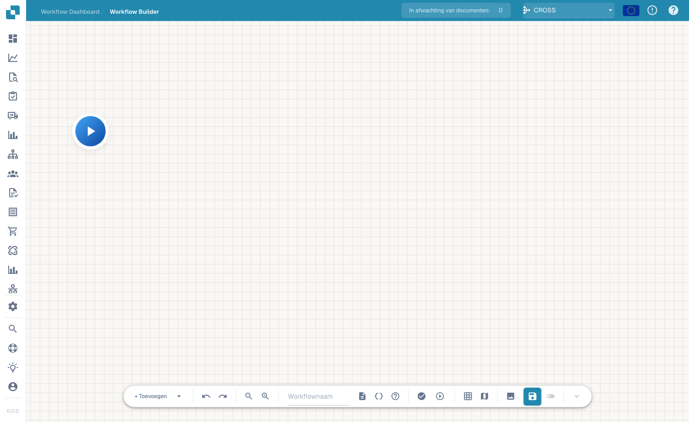
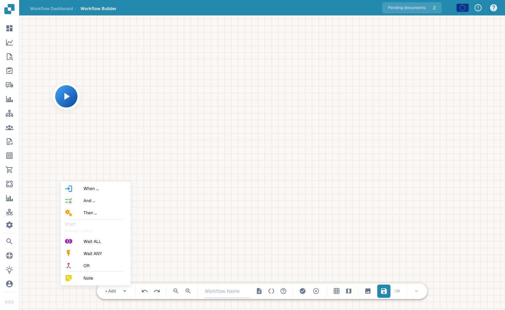

# Advanced Workflow

De **Advanced Workflow** builder is een node-grafiek-editor voor workflows die vertakkingen, parallelle paden en flow-besturing nodig hebben — verder dan de lineaire When/And/Then van de Standard builder. U plaatst nodes op een canvas en verbindt ze om de uitvoeringsstroom te definiëren.

## Video: factuurroutes in DocBits

Maak kennis met Jan en volg zijn uitleg in de echte Nederlandstalige DocBits-interface. Hij controleert het workflowdashboard, de workflowlijst en de licentie en opent daarna een niet-opgeslagen concept in de ontwerper. Stap voor stap geeft hij de workflow een naam, stelt hij de bedragcontrole en twee acties in, plaatst hij de kaarten en verbindt hij beide routes. Daarna laat hij zien hoe je tests voorbereidt met een document of eigen gegevens. Het demoaccount heeft geen Advanced Workflow-abonnement en blokkeert de validatie; het concept blijft niet opgeslagen en inactief.



[Video openen](https://docbits-videos.fra1.cdn.digitaloceanspaces.com/review/advanced_workflows_canvas-admin/20261019-small-monitor-b/nl.mp4) · [Ondertitels (WebVTT)](https://docbits-videos.fra1.cdn.digitaloceanspaces.com/review/advanced_workflows_canvas-admin/20261019-small-monitor-b/nl.vtt) · [Transcript (tekst)](https://docbits-videos.fra1.cdn.digitaloceanspaces.com/review/advanced_workflows_canvas-admin/20261019-small-monitor-b/nl.txt) · 4:54

| In deze video | Begin |
| --- | --- |
| Maak kennis met de beheerder | [0:00](https://docbits-videos.fra1.cdn.digitaloceanspaces.com/review/advanced_workflows_canvas-admin/20261019-small-monitor-b/nl.mp4#t=0) |
| Toegang controleren | [0:05](https://docbits-videos.fra1.cdn.digitaloceanspaces.com/review/advanced_workflows_canvas-admin/20261019-small-monitor-b/nl.mp4#t=5) |
| De workflow een naam geven | [0:37](https://docbits-videos.fra1.cdn.digitaloceanspaces.com/review/advanced_workflows_canvas-admin/20261019-small-monitor-b/nl.mp4#t=37) |
| De bedragcontrole instellen | [0:54](https://docbits-videos.fra1.cdn.digitaloceanspaces.com/review/advanced_workflows_canvas-admin/20261019-small-monitor-b/nl.mp4#t=54) |
| De actie Approval toevoegen | [1:28](https://docbits-videos.fra1.cdn.digitaloceanspaces.com/review/advanced_workflows_canvas-admin/20261019-small-monitor-b/nl.mp4#t=88) |
| De actie Standard toevoegen | [1:56](https://docbits-videos.fra1.cdn.digitaloceanspaces.com/review/advanced_workflows_canvas-admin/20261019-small-monitor-b/nl.mp4#t=116) |
| Kaarten ordenen | [2:24](https://docbits-videos.fra1.cdn.digitaloceanspaces.com/review/advanced_workflows_canvas-admin/20261019-small-monitor-b/nl.mp4#t=144) |
| Routes verbinden | [2:56](https://docbits-videos.fra1.cdn.digitaloceanspaces.com/review/advanced_workflows_canvas-admin/20261019-small-monitor-b/nl.mp4#t=176) |
| Tests voorbereiden | [3:41](https://docbits-videos.fra1.cdn.digitaloceanspaces.com/review/advanced_workflows_canvas-admin/20261019-small-monitor-b/nl.mp4#t=221) |
| Valideren, opslaan en activeren | [4:18](https://docbits-videos.fra1.cdn.digitaloceanspaces.com/review/advanced_workflows_canvas-admin/20261019-small-monitor-b/nl.mp4#t=258) |

Transcript

**Maak kennis met de beheerder**

Ik beheer DocBits. We maken een factuurcontrole.

**Toegang controleren**

Ik begin op het workflowdashboard en open de workflowlijst. Daarna controleer ik de licentie. Workflow en Advanced Workflow hebben allebei actieve toegang nodig. Als beide zijn ingeschakeld, biedt Nieuwe workflow ook Advanced Workflow aan. Dit documentatieaccount heeft geen actieve workflowlicentie. Daarom ga ik verder met een niet opgeslagen voorbeeld in de ontwerper.

**De workflow een naam geven**

Ik werk in de echte DocBits-ontwerper. Eerst geef ik het concept een duidelijke naam. We controleren een factuurbedrag en gebruiken twee eenvoudige acties om de mogelijke routes te tonen. Dit voorbeeld blijft onopgeslagen.

**De bedragcontrole instellen**

Ik open het menu om iets toe te voegen en kies een voorwaardekaart. Onder Documentveld kies ik de Docfield-voorwaarde. Als veld vul ik total_amount in. Dan kies ik de vergelijking groter dan. En voer ik duizend in. Gebruik de veldsleutel van uw eigen document. Precies duizend voldoet niet aan deze vergelijking.

**De actie Approval toevoegen**

Nu voeg ik een actiekaart uit de categorie Documentveld toe. Deze actie stelt een documentveld in. Ik gebruik de voorbeeldsleutel approval_route. En vul de waarde Approval in. Dit geeft de route een herkenbare waarde. Een echt goedkeuringsproces heeft eigen bedrijfsacties nodig.

**De actie Standard toevoegen**

Ik voeg een tweede kaart met dezelfde actie toe. Dit keer krijgt het voorbeeldveld de waarde Standard. Beide kaarten zijn ingesteld. Er zijn nog verbindingen nodig om te bepalen welke actie wordt uitgevoerd.

**Kaarten ordenen**

Ik sleep de kaarten naar een leesbare indeling. De twee acties komen rechts. De voorwaarde staat in het midden, met Start links. Verplaatsen verandert alleen de positie. Het maakt geen verbinding.

**Routes verbinden**

Ik sleep van de uitgang van Start naar de ingang van de voorwaarde. De succesroute loopt via een blauwe verbinding naar Approval. De oranje route voor een onjuiste voorwaarde loopt naar Standard. De rode foutuitgang is een aparte uitgang voor evaluatiefouten. Hier blijft die zonder verbinding. Bepaal voor een productieworkflow hoe u zulke fouten afhandelt.

**Tests voorbereiden**

De testknop in de werkbalk opent de keuze van een testdocument. Ik kan een voorbeelddocument kiezen of volledige aangepaste gegevens voorbereiden. Test bedragen boven, onder en precies op duizend. Controleer ook een ontbrekend bedrag. Dit account heeft geen Advanced Workflow-licentie. Ik toon de voorbereiding van een test, geen uitgevoerd resultaat.

**Valideren, opslaan en activeren**

Validatie controleert verbindingen en kaartinstellingen. Bij dit account blokkeert de ontbrekende licentie de validatie. Met een account dat toegang heeft, zou ik uitdrukkelijk op de server opslaan. Daarna controleer ik de activering apart. Vóór de eerste opslag is de schakelaar uitgeschakeld. De aanduiding voor het automatische concept verwijst naar een lokale browserkopie. Die betekent niet dat de workflow opgeslagen of ingeschakeld is.

## Toegang krijgen

Open de Advanced Workflow-ontwerper vanuit het workflow-gedeelte (het canvas van de advanced builder). U begint bij een **Start**-node en bouwt de flow uit door nodes toe te voegen.

<figure><figcaption>
Het Advanced Workflow-canvas — een node-grafiek met zoom-, run-, raster- en opslagbesturing. Geef de workflow een naam in de werkbalk.
</figcaption></figure>

## Nodes toevoegen

Klik op **+ Add** om het node-menu te openen. Naast de bekende **When**-, **And**- en **Then**-kaarten voegt de advanced builder flow-besturingsnodes toe:

<figure><figcaption>
Het <strong>+ Add</strong>-node-menu: When / And / Then plus Wait ALL, Wait ANY, OR en Note.
</figcaption></figure>

- **When / And / Then** — dezelfde voorwaarde- en actiekaarten als de Standard builder.
- **Wait ALL** — wacht tot *alle* binnenkomende vertakkingen zijn voltooid voordat er wordt verdergegaan.
- **Wait ANY** — ga verder zodra *een* van de binnenkomende vertakkingen is voltooid.
- **OR** — vertak de flow langs alternatieve paden.
- **Note** — een vrije-tekstaantekening op het canvas (heeft geen invloed op de uitvoering).

Voer de flow uit met de afspeelknop, valideer hem en sla op met de opslagknop in de werkbalk.

## Volgende stappen

- Bekijk in het **Cards**-gedeelte wat elke kaart doet.
- Voor eenvoudige lineaire automatiseringen is de **Standard Workflow** builder sneller op te zetten.

[Bekijk alle vijf hoofdstukken](advanced-workflow-videos.md)
