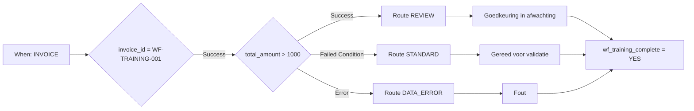

# Advanced-praktijkvoorbeeld: factuurrouting

Een oefenfactuur boven EUR 1000 vereist controle. Tot en met EUR 1000 volgt zij de standaardroute. Een ontbrekend of ongeldig numeriek bedrag volgt de gegevenscorrectieroute. De drie routes eindigen bij een gezamenlijke afsluitactie.

## Voorwaarden en opbouw

Gebruik een testorganisatie met actieve Advanced-toegang en het [oefenpakket](workflow-training-kit.md). Importeer `advanced-workflow.json` via **Import Workflow**, houd de regel uitgeschakeld en open de graaf. When controleert Factuur; de eerste And-kaart beperkt de oefening tot `invoice_id = WF-TRAINING-001`. Er zijn geen ontvangers of exports ingesteld.

De eerste controle gebruikt `invoice_id`, `eq` en `WF-TRAINING-001`; een ander nummer slaat alle volgende acties over. De bedragcontrole gebruikt **Docfield is**, versie 2, met `total_amount`, `gt`, `1000`. Tekstacties schrijven `wf_training_route`. Statuskaarten gebruiken versie 3 en **Trigger Workflows = false**.

**v2:** De statuskaart van de gekozen route verbindt rechtstreeks met de gezamenlijke Then-kaart `complete`, die `wf_training_complete = YES` schrijft. Hier wacht geen OR-knoop. V1 bewees alleen testgedrag: bij niet-bereikte voorgangers kan de planner een samenvoeging overslaan die de test toch beoordeelt. De [P0-handleiding](masterclass/control-nodes.md) verklaart dit. Een gezamenlijke directe Then is geen barrière voor meerdere gelijktijdige verplichte acties.

## Bouwen en controleren

1. Valideer de volledige graaf.
2. Bereid de bestanden voor uw organisatie voor volgens het oefenpakket.
3. Open **Test → Custom Data** en gebruik het volledige bestand per geval. Alleen `total_amount` in een object is onvoldoende.
4. Voer uit vanaf de volledige ingang. Controleer de uitgang van `amount`, de bereikte route, statusmelding en `complete`.
5. Vergelijk met de onafhankelijke verwachtingen. De opgeslagen testantwoorden tonen de werkelijk waargenomen knoopresultaten.

| Geval | Bedrag | Uitgang van amount | Route / status | Totaalresultaat |
| --- | --- | --- | --- | --- |
| above | 1785,00 | Success | REVIEW / validated_pending_approval | success |
| below | 999,00 | Failed Condition | STANDARD / ready_for_validation | success |
| boundary | 1000,00 | Failed Condition | STANDARD / ready_for_validation | success |
| just-above | 1000,01 | Success | REVIEW / validated_pending_approval | success |
| missing | ontbreekt | Error | DATA_ERROR / error | error |
| invalid-number | invalid | Error | DATA_ERROR / error | error |
| other-invoice | 1785,00 | niet uitgevoerd | ander nummer; geen actie | failed_condition |

Bij een fout kunnen `data_error` en `complete` slagen terwijl het totaalresultaat **error** blijft. Foutafhandeling wist de oorspronkelijke evaluatiefout niet.

## Het bedrijfsproces uitbreiden

De tests zijn op 21 oktober 2026 uitgevoerd tegen de uitgerolde Dev-dienst DocFlow **2.10.38**. Het pakket bevat echte testantwoorden; veld- en statuswijzigingen waren gesimuleerd. Het bevat geen opgeslagen document-Workflow Logs en bewijst geen persoonlijke goedkeuring of werkelijke exportontvangst.

Vervang routemarkeringen door geconfigureerde toewijzings- en goedkeuringsacties. Verbind export uitsluitend met een expliciet gecontroleerde goedkeuringsvoorwaarde. Bevestig een echte uitvoering op het document en ontvangst bij de ontvanger, met uw eigen oefendocument en een aangewezen testbestemming. Zie de [diagnosehandleiding](workflow-troubleshooting.md).

## WF-02: Oefening en acceptatie

Voer de zeven gevallen uit en noteer amount-uitgang, route, status, complete en totaalresultaat. Accepteer test en echte uitvoering apart. Een afgehandelde fout is geen foutloze uitvoering doordat complete slaagt.

[Leerpad](workflow-learning-path.md)
