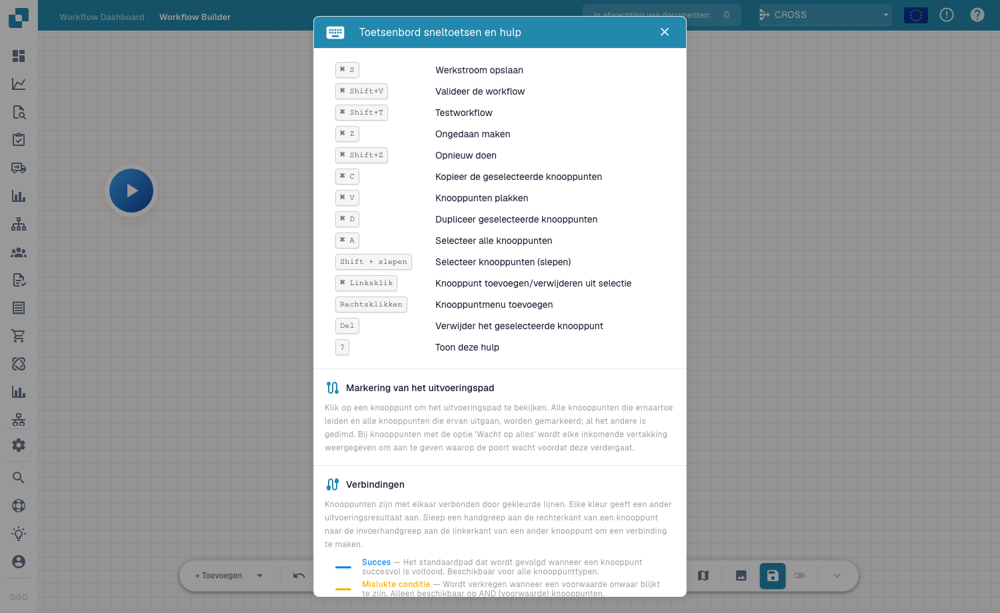

# Toolbar & Canvas

## Video: Bouwer en canvas

Maak kennis met Jan en volg zijn uitleg in de echte Nederlandstalige DocBits-interface. Hij controleert het workflowdashboard, de workflowlijst en de licentie en opent daarna een niet-opgeslagen concept in de ontwerper. Stap voor stap geeft hij de workflow een naam, stelt hij de bedragcontrole en twee acties in, plaatst hij de kaarten en verbindt hij beide routes. Daarna laat hij zien hoe je tests voorbereidt met een document of eigen gegevens. Het demoaccount heeft geen Advanced Workflow-abonnement en blokkeert de validatie; het concept blijft niet opgeslagen en inactief.



[Video openen](https://docbits-videos.fra1.cdn.digitaloceanspaces.com/review/advanced_workflows_canvas-admin/20261019-paced-e/nl.mp4) · [Ondertitels (WebVTT)](https://docbits-videos.fra1.cdn.digitaloceanspaces.com/review/advanced_workflows_canvas-admin/20261019-paced-e/nl.vtt) · [Transcript (tekst)](https://docbits-videos.fra1.cdn.digitaloceanspaces.com/review/advanced_workflows_canvas-admin/20261019-paced-e/nl.txt) · 3:21

| In deze video | Begin |
| --- | --- |
| Maak kennis met de beheerder | [0:00](https://docbits-videos.fra1.cdn.digitaloceanspaces.com/review/advanced_workflows_canvas-admin/20261019-paced-e/nl.mp4#t=0) |
| Toegang controleren | [0:03](https://docbits-videos.fra1.cdn.digitaloceanspaces.com/review/advanced_workflows_canvas-admin/20261019-paced-e/nl.mp4#t=3) |
| De workflow een naam geven | [0:27](https://docbits-videos.fra1.cdn.digitaloceanspaces.com/review/advanced_workflows_canvas-admin/20261019-paced-e/nl.mp4#t=27) |
| De bedragcontrole instellen | [0:41](https://docbits-videos.fra1.cdn.digitaloceanspaces.com/review/advanced_workflows_canvas-admin/20261019-paced-e/nl.mp4#t=41) |
| De actie Approval toevoegen | [1:06](https://docbits-videos.fra1.cdn.digitaloceanspaces.com/review/advanced_workflows_canvas-admin/20261019-paced-e/nl.mp4#t=66) |
| De actie Standard toevoegen | [1:26](https://docbits-videos.fra1.cdn.digitaloceanspaces.com/review/advanced_workflows_canvas-admin/20261019-paced-e/nl.mp4#t=86) |
| Kaarten ordenen | [1:47](https://docbits-videos.fra1.cdn.digitaloceanspaces.com/review/advanced_workflows_canvas-admin/20261019-paced-e/nl.mp4#t=107) |
| Routes verbinden | [2:01](https://docbits-videos.fra1.cdn.digitaloceanspaces.com/review/advanced_workflows_canvas-admin/20261019-paced-e/nl.mp4#t=121) |
| Tests voorbereiden | [2:26](https://docbits-videos.fra1.cdn.digitaloceanspaces.com/review/advanced_workflows_canvas-admin/20261019-paced-e/nl.mp4#t=146) |
| Valideren, opslaan en activeren | [2:51](https://docbits-videos.fra1.cdn.digitaloceanspaces.com/review/advanced_workflows_canvas-admin/20261019-paced-e/nl.mp4#t=171) |

Transcript

**Maak kennis met de beheerder**

Ik beheer DocBits. We maken een factuurcontrole.

**Toegang controleren**

Ik begin op het workflowdashboard en open de workflowlijst. Daarna controleer ik de licentie. Workflow en Advanced Workflow hebben allebei actieve toegang nodig. Als beide zijn ingeschakeld, biedt Nieuwe workflow ook Advanced Workflow aan. Dit documentatieaccount heeft geen actieve workflowlicentie. Daarom ga ik verder met een niet opgeslagen voorbeeld in de ontwerper.

**De workflow een naam geven**

Ik werk in de echte DocBits-ontwerper. Eerst geef ik het concept een duidelijke naam. We controleren een factuurbedrag en gebruiken twee eenvoudige acties om de mogelijke routes te tonen. Dit voorbeeld blijft onopgeslagen.

**De bedragcontrole instellen**

Ik open het menu om iets toe te voegen en kies een voorwaardekaart. Onder Documentveld kies ik de Docfield-voorwaarde. Als veld vul ik total_amount in. Dan kies ik de vergelijking groter dan. En voer ik duizend in. Gebruik de veldsleutel van uw eigen document. Precies duizend voldoet niet aan deze vergelijking.

**De actie Approval toevoegen**

Nu voeg ik een actiekaart uit de categorie Documentveld toe. Deze actie stelt een documentveld in. Ik gebruik de voorbeeldsleutel approval_route. En vul de waarde Approval in. Dit geeft de route een herkenbare waarde. Een echt goedkeuringsproces heeft eigen bedrijfsacties nodig.

**De actie Standard toevoegen**

Ik voeg een tweede kaart met dezelfde actie toe. Deze actie stelt een documentveld in. Ik gebruik de voorbeeldsleutel approval_route. Dit keer krijgt het voorbeeldveld de waarde Standard. Beide kaarten zijn ingesteld. Er zijn nog verbindingen nodig om te bepalen welke actie wordt uitgevoerd.

**Kaarten ordenen**

Ik sleep de kaarten naar een leesbare indeling. De twee acties komen rechts. De voorwaarde staat in het midden, met Start links. Verplaatsen verandert alleen de positie. Het maakt geen verbinding.

**Routes verbinden**

Ik sleep van de uitgang van Start naar de ingang van de voorwaarde. De succesroute loopt via een blauwe verbinding naar Approval. De oranje route voor een onjuiste voorwaarde loopt naar Standard. De rode foutuitgang is een aparte uitgang voor evaluatiefouten. Hier blijft die zonder verbinding. Bepaal voor een productieworkflow hoe u zulke fouten afhandelt.

**Tests voorbereiden**

De testknop in de werkbalk opent de keuze van een testdocument. Ik kan een voorbeelddocument kiezen of volledige aangepaste gegevens voorbereiden. Test bedragen boven, onder en precies op duizend. Controleer ook een ontbrekend bedrag. Dit account heeft geen Advanced Workflow-licentie. Ik toon de voorbereiding van een test, geen uitgevoerd resultaat.

**Valideren, opslaan en activeren**

Validatie controleert verbindingen en kaartinstellingen. Bij dit account blokkeert de ontbrekende licentie de validatie. Met een account dat toegang heeft, zou ik uitdrukkelijk op de server opslaan. Daarna controleer ik de activering apart. Vóór de eerste opslag is de schakelaar uitgeschakeld. De aanduiding voor het automatische concept verwijst naar een lokale browserkopie. Die betekent niet dat de workflow opgeslagen of ingeschakeld is.

[Bekijk alle vijf hoofdstukken](../advanced-workflow-videos.md)

De Advanced Workflow-werkbalk loopt langs de onderkant van het canvas en geeft je alles wat je nodig hebt om de stroom te bouwen, te navigeren en te beheren.

## Werkbalkbedieningen

- **+ Add** — open het nodemenu om een node toe te voegen (zie [Nodes](nodes.md)).
- **Undo / Redo** — stap achteruit of vooruit door je wijzigingen.
- **Zoom in / Zoom out** — wijzig het zoomniveau van het canvas.
- **Workflow name** — geef de workflow inline een naam.
- **Edit description** — voeg een beschrijving voor de workflow toe.
- **Variables** — open het [Variables](variables.md)-paneel.
- **Help** — open het dialoogvenster met sneltoetsen en hulp.
- **Validate / Test** — controleer en voer de stroom uit (zie [Validation & Testing](validation-and-testing.md)).
- **Snap to grid** — schakel het uitlijnen van nodes op het raster in of uit voor nette indelingen.
- **Mini-map** — schakel een klein overzichtskaartje in of uit om door grote grafen te navigeren.
- **Save** — sla de workflow op. Een **auto-save**-indicator toont wanneer de stroom voor het laatst automatisch is opgeslagen.

## Sneltoetsen

Druk op <kbd>?</kbd> op het canvas om op elk moment het dialoogvenster met sneltoetsen en hulp te openen.

<figure><figcaption>
Het dialoogvenster met sneltoetsen en hulp — sneltoetsen, markeren van het uitvoeringspad en verbindingskleuren.
</figcaption></figure>

| Sneltoets | Actie |
|---|---|
| <kbd>Cmd/Ctrl</kbd> + <kbd>S</kbd> | Workflow opslaan |
| <kbd>Cmd/Ctrl</kbd> + <kbd>Shift</kbd> + <kbd>V</kbd> | Workflow valideren |
| <kbd>Cmd/Ctrl</kbd> + <kbd>Shift</kbd> + <kbd>T</kbd> | Workflow testen |
| <kbd>Cmd/Ctrl</kbd> + <kbd>Z</kbd> / <kbd>Shift</kbd> + <kbd>Z</kbd> | Ongedaan maken / Opnieuw |
| <kbd>Cmd/Ctrl</kbd> + <kbd>C</kbd> / <kbd>V</kbd> / <kbd>D</kbd> | Geselecteerde nodes kopiëren / plakken / dupliceren |
| <kbd>Cmd/Ctrl</kbd> + <kbd>A</kbd> | Alle nodes selecteren |
| <kbd>Shift</kbd> + Slepen | Nodes selecteren (slepen) |
| <kbd>Cmd/Ctrl</kbd> + Linkerklik | Node toevoegen aan/verwijderen uit selectie |
| Rechterklik | Menu Node toevoegen |
| <kbd>Del</kbd> | Geselecteerde node verwijderen |
| <kbd>?</kbd> | Deze hulp tonen |

## Volgende stappen

- Bouw de stroom met [Nodes](nodes.md) en [Variables](variables.md).
