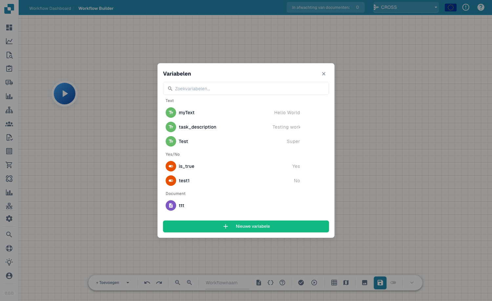

# Variabelen

## Video: Variabelen, testen en activering



[Video openen](https://docbits-videos.fra1.cdn.digitaloceanspaces.com/settings-assistant/advanced_workflows_testing/v3/nl.mp4) · [Ondertiteling (WebVTT)](https://docbits-videos.fra1.cdn.digitaloceanspaces.com/settings-assistant/advanced_workflows_testing/v3/nl.vtt) · 2:00

Transcriptie

**Kies het variabeletype**

Open Variabelen met het accoladesymbool. Kies tekst, getal, ja of nee, of document. Zoek op naam. Een Document-variabele bevat een verwijzing die een specifieke workflowactie instelt; dit formulier accepteert geen documentwaarden.

**Variabelen van de organisatie**

Kies een unieke naam, type en beginwaarde. Aanmaken, wijzigen en verwijderen wordt direct voor de organisatie opgeslagen. Andere workflows kunnen deze waarden delen. Het canvas opslaan of verwerpen maakt variabelewijzigingen niet ongedaan.

**Valideer eerst de structuur**

Selecteer Valideren. Bekijk fouten en waarschuwingen boven het canvas. Klik op een melding om het knooppunt te vinden. Controleer acties, ingangen, uitgangen, cycli en samenvoegingen. Structurele validatie garandeert geen juiste uitvoeringsgegevens.

**Kies de testcontext**

Afspelen op de werkbalk opent de documentkeuze. Kies een document, aangepaste gegevens of een test zonder document voor onafhankelijke kaarten. Afspelen op Start begint direct. Tests gebruiken het huidige canvas, inclusief niet opgeslagen wijzigingen, en simuleren destructieve acties.

**Testscenario’s voorbereiden en controleren**

Maak aparte tests boven, onder en precies op duizend, plus ontbrekende gegevens. Controleer na uitvoering berichten en looptijden: groen betekent geslaagd, oranje onwaar, rood fout en grijs overgeslagen. Test correcties opnieuw. Gebruik Testbeheer voor herhaalbare scenario’s.

**Sla op vóór activering**

Automatisch opslaan bewaart ongeveer elke dertig seconden na wijzigingen een lokale browserversie. Sla expliciet op de server op. Activering vereist de eerste opslag. Controleer de ingeschakelde status in de workflowlijst voordat u automatische uitvoering verwacht.

[Bekijk alle vijf hoofdstukken](../advanced-workflow-videos.md)

Met **Variables** kun je waarden één keer opslaan en hergebruiken in de nodes van een Advanced Workflow — bijvoorbeeld een drempelwaarde, een vaste ontvanger of een waarde die je uit het document leest en doorgeeft aan een latere node. Open het variabelenpaneel via de **variables**-knop (het `{ }`-pictogram) in de werkbalk.

<figure><figcaption>
Het Variabelenpaneel — variabelen gegroepeerd per type, met zoekfunctie en <strong>New Variable</strong>.
</figcaption></figure>

## Variabeletypes

Variabelen worden gegroepeerd op hun type:

- **Text** — een tekstwaarde (bijv. een beschrijving of een vast label).
- **Yes/No** — een booleaanse vlag (Yes / No).
- **Document** — een verwijzing naar een document of documentveld.

Gebruik het zoekvak om snel een variabele te vinden wanneer de lijst groeit.

## Een variabele aanmaken

Klik op **New Variable**, geef deze een naam en een type, en stel de waarde in. De variabele is daarna beschikbaar om naar te verwijzen vanuit de kaarten op je nodes, zodat je configuratie op één plek kunt bewaren en wijzigen zonder elke node aan te passen.

## Volgende stappen

- Bekijk hoe nodes deze waarden gebruiken in [Nodes](nodes.md).
- Valideer en voer de workflow uit in [Validation & Testing](validation-and-testing.md).

## Numerieke variabelen

**Number (Getal)** is een afzonderlijk variabeletype, naast Text, Yes/No en Document. Voer een getal zonder valutasymbool in. Organisatievariabelen worden door meerdere workflows gedeeld; aanmaken, wijzigen en verwijderen worden direct opgeslagen, onafhankelijk van het opslaan of verwerpen van het canvas. Controleer vóór een wijziging de betrokken workflows en test waarden onder, op en boven de drempel.
