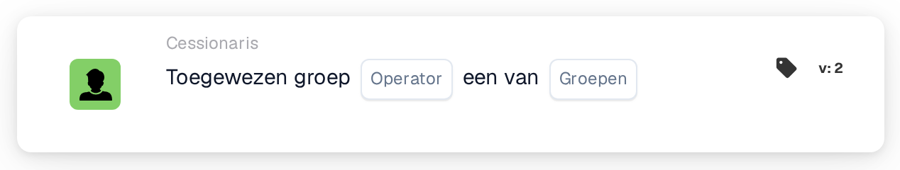

# Toegewezen groepsvoorwaarde

<figure><figcaption>
Versie 2
</figcaption></figure>

**Doel:**

Deze workflow-kaart voert bewerkingen uit op basis van de vraag of een taak of document is toegewezen aan een bepaalde groep of set groepen. Hij gebruikt voorwaardelijke logica om specifieke acties te triggeren of te voorkomen, afhankelijk van de groepstoewijzing, waardoor hij ideaal is voor workflows die een groepsspecifieke afhandeling vereisen.

**Onderdelen van de kaart:**

1. **Exploitant**
   * **Beschrijving:** Definieert de logische voorwaarde die op de groepstoewijzing wordt toegepast.
   * **Opties:**
     * **IS:** Triggert de bewerking als de toegewezen groep van het document of de taak overeenkomt met een van de groepen in de opgegeven lijst.
     * **IS NIET:** Triggert de bewerking als de toegewezen groep van het document of de taak met geen van de groepen in de opgegeven lijst overeenkomt.
2. **Groepenlijst**
   * **Beschrijving:** Een lijst of selectie van groepen om mee te vergelijken met de toegewezen groep.
   * **Details:** Deze lijst kan een of meerdere groepen bevatten, waardoor de kaart zowel enkelvoudige als meervoudige groepsvoorwaarden effectief kan verwerken.

**Functionaliteit:**

* **Identificatie van groepstoewijzing:** Identificeert automatisch de groep of groepen die aan een bepaalde taak of document binnen het systeem zijn toegewezen.
* **Voorwaarde-evaluatie:**
  * Met de **IS**-operator controleert de kaart of de toegewezen groep een van de groepen in de Groups List is.
  * Met de **IS NIET**-operator zorgt de kaart ervoor dat de toegewezen groep geen deel uitmaakt van de vermelde groepen.
* **Actie-uitvoering:**
  * **True-voorwaarde:** Als de groepstoewijzing aan de voorwaarde voldoet (**IS** of **IS NIET**), worden relevante acties getriggerd, zoals meldingen, het starten van taken, goedkeuringen of andere workflow-stappen.
  * **False-voorwaarde:** Als niet aan de voorwaarde wordt voldaan, gaat de workflow niet verder.

**Gebruikersinteracties:**

* **Opzet en configuratie:** Gebruikers configureren de kaart door een operator te kiezen en de relevante groepen uit de Groups List op te geven. De opzet moet gebruiksvriendelijk en intuïtief zijn om selecties uit potentieel grote groepsbestanden mogelijk te maken.
* **Monitoring en rapportage:**\
  Het systeem moet functionaliteit bieden om de door deze kaart getriggerde bewerkingen te monitoren en erover te rapporteren, met inzicht in de nauwkeurigheid van toewijzingen en de procesefficiëntie.
* **Foutafhandeling en meldingen:**\
  Gebruikers moeten opties hebben om waarschuwingen of meldingen te ontvangen als er problemen zijn met de toewijzingen, zoals niet-toegewezen taken of fouten in de groepsselectie.

**Conclusie:**\
De workflow-kaart "Assigned Group Condition" is essentieel voor het beheren van document- en taakworkflows die afhankelijk zijn van groepstoewijzingen. Door voorwaarden toe te staan op basis van de vraag of een taak of document aan specifieke groepen is toegewezen, zorgt hij ervoor dat workflows alleen worden getriggerd door de juiste groepsinteracties, wat de verantwoording en het taakbeheer tussen teams verbetert.

<!-- workflow-card-practical-example-20261021 -->

## Praktisch voorbeeld

**Wanneer gebruiken:** Pas dezelfde regel toe op twee beoordelingsteams.

**Configuratie:** Selecteer is-een-van en de geconfigureerde groepen `Demo Finance` en `Demo Procurement`.

**Verwacht resultaat en tegenvoorbeeld:** Een document dat aan een van de geselecteerde groepen is toegewezen, wordt goedgekeurd. Een document dat alleen aan `Demo Support` is toegewezen, mislukt.

Dit is een illustratieve configuratie en een verwacht resultaat. Gebruik velden, gebruikers en groepen die in uw testorganisatie zijn geconfigureerd; het is geen bewering dat dit voorbeeld is uitgevoerd.
