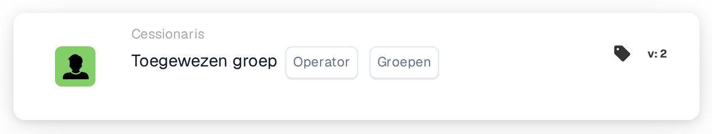

# Voorwaarde voor één toegewezen groep

<figure><figcaption>
Versie 2
</figcaption></figure>

**Doel:**\
Deze workflow-kaart voert bewerkingen uit op basis van de vraag of een taak of document is toegewezen aan een bepaalde groep. Hij gebruikt een eenvoudige voorwaarde om acties te triggeren of te voorkomen op basis van de groepstoewijzing.

**Onderdelen van de kaart:**

1. **Exploitant**
   * **Beschrijving:** Definieert de logische voorwaarde die op de groepstoewijzing wordt toegepast.
   * **Opties:**
     * **IS:** Triggert de bewerking als de toegewezen groep van het document of de taak overeenkomt met de opgegeven groep.
     * **IS NIET:** Triggert de bewerking als de toegewezen groep van het document of de taak niet overeenkomt met de opgegeven groep.
2. **Groep**
   * **Beschrijving:** Geeft de groep op om mee te vergelijken met de toegewezen groep.
   * **Details:** Met dit veld kunt u één enkele groep selecteren om de toewijzing mee te vergelijken.

**Functionaliteit:**

* **Identificatie van groepstoewijzing:** Identificeert automatisch de groep die aan een bepaalde taak of document is toegewezen.
* **Voorwaarde-evaluatie:**
  * Met de **IS**-operator controleert de kaart of de toegewezen groep overeenkomt met de opgegeven groep.
  * Met de **IS NIET**-operator zorgt de kaart ervoor dat de toegewezen groep niet overeenkomt met de opgegeven groep.
* **Actie-uitvoering:**
  * **True-voorwaarde:** Als de groepstoewijzing aan de voorwaarde voldoet (**IS** of **IS NIET**), worden relevante acties getriggerd, zoals meldingen, het starten van taken, goedkeuringen of andere workflow-stappen.
  * **False-voorwaarde:** Als niet aan de voorwaarde wordt voldaan, kan het document of de taak via een andere routing verlopen, of kunnen alternatieve acties worden opgegeven.

**Gebruikersinteracties:**

* **Opzet en configuratie:**\
  Gebruikers configureren de kaart door een operator te kiezen en de relevante groep op te geven. De opzet moet eenvoudig en intuïtief zijn.
* **Monitoring en rapportage:**\
  Het systeem moet functionaliteit bieden om de door deze kaart getriggerde bewerkingen te monitoren en erover te rapporteren, met inzicht in de nauwkeurigheid van toewijzingen en de procesefficiëntie.
* **Foutafhandeling en meldingen:**\
  Gebruikers moeten opties hebben om waarschuwingen of meldingen te ontvangen als er problemen zijn met de toewijzingen, zoals niet-toegewezen taken of fouten in de groepsselectie.

**Conclusie:**\
De workflow-kaart "Assigned Group Condition" is essentieel voor het beheren van document- en taakworkflows op basis van groepstoewijzingen. Door voorwaarden toe te staan op basis van de vraag of een taak of document aan een specifieke groep is toegewezen, zorgt hij ervoor dat workflows alleen worden getriggerd door de juiste groepsinteracties, wat het taakbeheer en de workflow-efficiëntie verbetert.

<!-- workflow-card-practical-example-20261021 -->

## Praktisch voorbeeld

**Wanneer gebruiken:** Pas een regel toe op de wachtrij voor financiële beoordelingen.

**Configuratie:** Selecteer de gelijk-operator en groep `Demo Finance`.

**Verwacht resultaat en tegenvoorbeeld:** Een document toegewezen aan `Demo Finance` is geslaagd. Toewijzing aan een individuele gebruiker alleen betekent niet dat u lid bent van deze geselecteerde documenttoewijzingsgroep.

Dit is een illustratieve configuratie en een verwacht resultaat. Gebruik velden, gebruikers en groepen die in uw testorganisatie zijn geconfigureerd; het is geen bewering dat dit voorbeeld is uitgevoerd.
