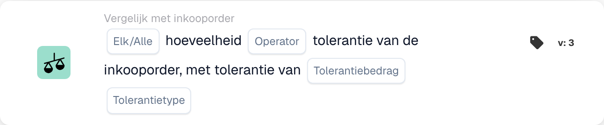
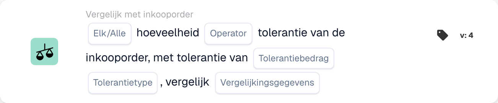

# Elke/alle hoeveelheid

<figure><figcaption>
Kaartvelden in de getoonde versie. De velden zijn nog niet ingevuld.
</figcaption></figure>

<figure><figcaption>
Kaartvelden in de getoonde versie. De velden zijn nog niet ingevuld.
</figcaption></figure>

## **Doel:**

Deze workflowkaart is ontworpen om de hoeveelheid in een document te vergelijken met de tolerantie die in de inkooporder is gedefinieerd. Hiermee kunnen gebruikers evalueren of de hoeveelheid aan bepaalde voorwaarden voldoet, zoals gelijkheid of overschrijding van de opgegeven tolerantie. In Versie 4 breidt de kaart de functionaliteit uit door de mogelijkheid toe te voegen om meerdere entiteiten te vergelijken, inclusief de inkooporder, ontvangen hoeveelheden en documenthoeveelheden, wat een grotere flexibiliteit biedt bij het omgaan met verschillende scenario's.

## **Componenten van de kaart:**

1. **Elk / Alles:**
   * **Beschrijving**: specificeert hoe de vergelijking moet worden toegepast op meerdere items of voorwaarden.
   * **Opties**:
     * **Any**: Ten minste één van de voorwaarden moet waar zijn voordat de actie wordt geactiveerd.
     * **All**: Alle voorwaarden moeten waar zijn om de actie te laten doorgaan.
2. **Exploitant:**
   * **Beschrijving**: Definieert de voorwaarde die wordt toegepast om de documenthoeveelheid te vergelijken met de opgegeven tolerantie.
   * **Opties**:
     * **Is gelijk aan (=)**: Controleert of de hoeveelheid overeenkomt met de opgegeven tolerantiewaarde.
     * **Niet gelijk aan (≠)**: Zorgt ervoor dat de hoeveelheid afwijkt van de opgegeven tolerantiewaarde.
     * **Groter dan (>)**: Controleert of de hoeveelheid groter is dan de opgegeven tolerantie.
     * **Groter of gelijk aan (≥)**: Controleert of de hoeveelheid groter is dan of gelijk is aan de opgegeven tolerantie.
     * **Kleiner dan (<)**: Controleert of de hoeveelheid kleiner is dan de opgegeven tolerantie.
     * **Kleiner of gelijk aan (≤)**: Controleert of de hoeveelheid kleiner is dan of gelijk is aan de opgegeven tolerantie.
3. **Tolerantiebedrag:**
   * **Beschrijving**: Specificeert de tolerantiewaarde waarmee de documenthoeveelheid wordt vergeleken.
   * **Details**: deze waarde is numeriek en vertegenwoordigt de drempelwaarde voor toegestane variantie in de hoeveelheid
4. **Tolerantietype:**
   * **Beschrijving**: Definieert het type tolerantie dat wordt toegepast.
   * **Opties**:
     * **Percentage**: Tolerantie wordt berekend als een percentage van de inkooporderhoeveelheid.
     * **Waarde**: Tolerantie wordt opgegeven als een vaste numerieke waarde.

## **Extra componenten in versie 4:**

* **Vergelijkingstype**: Selecteert de entiteiten die moeten worden vergeleken, waardoor er meer flexibiliteit ontstaat bij de manier waarop de hoeveelheden worden geëvalueerd in Versie 4.
  * **Inkooporder met document**: vergelijkt de hoeveelheid in de inkooporder met de hoeveelheid in het gerelateerde document.
  * **Ontvangen in document**: vergelijkt de ontvangen hoeveelheid met de hoeveelheid in het document.
  * **Inkooporder met ontvangen**: vergelijkt de inkooporderhoeveelheid met de ontvangen hoeveelheid.

## **Functionaliteit:**

* **Conditie-evaluatie:** Het systeem vergelijkt de hoeveelheid in het document met de tolerantie in de inkooporder op basis van de geselecteerde operator en het tolerantiebedrag/-type. In Versie 4 maakt het **Vergelijkingstype** het mogelijk om verschillende hoeveelheden te vergelijken, zoals inkooporder met ontvangen, of inkooporder met document, waardoor een meer dynamische vergelijking ontstaat.
* **Actie-uitvoering:**
  * **Ware toestand**: Als de vergelijking True oplevert (de documenthoeveelheid ligt bijvoorbeeld binnen het acceptabele tolerantiebereik), gaat de workflow verder.
  * **Valse toestand**: Als de vergelijking false oplevert (de hoeveelheid voldoet bijvoorbeeld niet aan de tolerantie), gaat de workflow niet verder.

## **Installatie en configuratie:**

**Versie 3:**

* Gebruikers configureren de kaart door het documentaantal te selecteren, het tolerantiebedrag en het tolerantietype te definiëren en de juiste operator te kiezen om het aantal met de tolerantie te vergelijken. De kaart evalueert of de hoeveelheid binnen de tolerantiedrempel ligt en gaat op basis van het resultaat verder met de actie "Wanneer" of "Niet waar".

**Versie 4:**

* Naast de configuratie in versie 3 kunnen gebruikers het **Vergelijkingstype** selecteren, waardoor vergelijkingen tussen verschillende entiteiten mogelijk zijn, zoals:
  * **Inkooporder naar document**
  * **Ontvangen op document**
  * **Inkooporder naar ontvangen**

## **Voorbeeldscenario:**

Op een factuur staat dat er 100 stuks zijn geleverd, maar op de inkooporder zijn slechts 90 stuks geautoriseerd. Het tolerantiebedrag is ingesteld op 10 eenheden en het tolerantietype is absoluut.

* **Versie 3**: De kaart vergelijkt de 100 eenheden in het document met de tolerantie van de inkooporder van 90 eenheden. Als de hoeveelheid de tolerantie overschrijdt, markeert de kaart het verschil voor verdere beoordeling.
* **Versie 4**: De kaart kan de **aankooporderhoeveelheid** (90 eenheden) vergelijken met de **ontvangen hoeveelheid** (100 eenheden) of de **documenthoeveelheid** (100 eenheden). Afhankelijk van het geselecteerde **Vergelijkingstype** wordt gecontroleerd of het verschil tussen de twee entiteiten de tolerantie overschrijdt en wordt de bijbehorende actie geactiveerd.

## **Conclusie:**

* **Versie 3**: Deze workflowkaart vergelijkt de documenthoeveelheid met de inkoopordertolerantie, waardoor ervoor wordt gezorgd dat afwijkingen in de hoeveelheid worden gemarkeerd en op de juiste manier worden afgehandeld.
* **Versie 4**: breidt deze functionaliteit uit door gebruikers in staat te stellen verschillende entiteiten te vergelijken, zoals inkooporder met ontvangen of inkooporder met document, waardoor meer flexibiliteit wordt geboden bij het omgaan met complexere scenario's. Versie 4 zorgt voor een strakkere controle over inkoop- en ontvangstworkflows en biedt meer dynamische vergelijkingen en acties op basis van het gekozen vergelijkingstype.

Zie [vergelijkingsrichting, tolerantiebasis en versies van opgeslagen kaarten](../../cards-overview/po-comparison-versions-guide.md) voordat u de vergelijkingszijden wijzigt.
