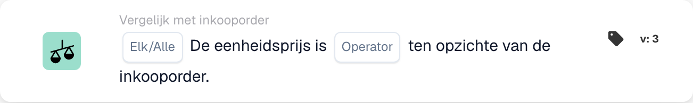
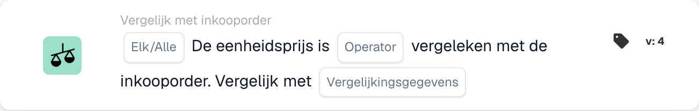

# Elke/alle eenheidsprijs is

<figure><figcaption>
Kaartvelden in de getoonde versie. De velden zijn nog niet ingevuld.
</figcaption></figure>

<figure><figcaption>
Kaartvelden in de getoonde versie. De velden zijn nog niet ingevuld.
</figcaption></figure>

## **Doel:**

Deze workflowkaart wordt gebruikt om de eenheidsprijs in een document te vergelijken met de eenheidsprijs in een inkooporder, zodat de prijzen binnen de gedefinieerde tolerantieniveaus vallen. De vergelijking kan acties uitlokken als de eenheidsprijs niet aan de verwachtingen voldoet. **Versie 4** voegt meer flexibiliteit toe doordat gebruikers verschillende entiteiten kunnen kiezen om te vergelijken, waardoor een dieper niveau van controle over prijs- en inkoopprocessen wordt geboden.

## **Componenten van de kaart:**

1. **Elk / Alles:**
   * **Beschrijving**: definieert of de voorwaarde van toepassing is op een of alle gevallen waarin de eenheidsprijs wordt vergeleken.
   * **Opties**:
     * **Any**: Aan de voorwaarde wordt voldaan als een eenheidsprijs voldoet aan de opgegeven vergelijkingsvoorwaarde.
     * **All**: Aan de voorwaarde wordt alleen voldaan als alle eenheidsprijzen voldoen aan de opgegeven vergelijkingsvoorwaarde.
2. **Exploitant:**
   * **Beschrijving**: Definieert de voorwaarde voor het vergelijken van de eenheidsprijs met de opgegeven waarde.
   * **Opties**:
     * **Is gelijk aan (=)**: Controleert of de eenheidsprijs overeenkomt met de opgegeven waarde.
     * **Niet gelijk aan (≠)**: Zorgt ervoor dat de eenheidsprijs afwijkt van de opgegeven waarde.
     * **Groter dan (>)**: Controleert of de eenheidsprijs groter is dan de opgegeven waarde.
     * **Groter of gelijk aan (≥)**: Controleert of de eenheidsprijs groter is dan of gelijk is aan de opgegeven waarde.
     * **Kleiner dan (<)**: Controleert of de eenheidsprijs lager is dan de opgegeven waarde.
     * **Kleiner of gelijk aan (≤)**: Controleert of de eenheidsprijs lager is dan of gelijk is aan de opgegeven waarde.

## **Extra componenten in versie 4:**

**Vergelijkingstype:**

* **Beschrijving**: Hiermee kunnen gebruikers kiezen welke entiteiten naast de eenheidsprijs worden vergeleken.
* **Opties**:
  * **Inkooporder naar document**: Vergelijkt de eenheidsprijs in de inkooporder met de eenheidsprijs in het document.
  * **Ontvangen op document**: vergelijkt het bedrag aan de ontvangen zijde dat is afgeleid van de gekoppelde inkooporder met het bedrag aan de documentzijde.
  * **Inkooporder naar ontvangen**: vergelijkt de inkooporderzijde met het afgeleide bedrag aan de ontvangen zijde.

## **Functionaliteit:**

* **Conditie-evaluatie:** Het systeem vergelijkt de eenheidsprijs in het document met de eenheidsprijs in de inkooporder (of een andere geselecteerde entiteit, in versie 4) op basis van de geselecteerde operator. Als de vergelijking waar is, verloopt de workflow volgens de volgende stappen, waarbij goedkeuring wordt geactiveerd of het proces wordt gestopt.
* **Actie-uitvoering:**
  * **Ware toestand**: Als de voorwaarde waar is (bijvoorbeeld de eenheidsprijs in het document is groter dan de opgegeven waarde), gaat de workflow verder met de actie True (bijvoorbeeld goedkeuring, documentverwerking).
  * **Valse toestand**: Als de voorwaarde onwaar wordt (de eenheidsprijs in het document voldoet bijvoorbeeld niet aan de vergelijking), gaat de workflow niet verder.

## **Installatie en configuratie:**

* **Instelling versie 3:** Gebruikers configureren de kaart door de eenheidsprijs in het document te selecteren, de juiste operator te kiezen om te definiëren hoe de eenheidsprijs wordt vergeleken met de opgegeven waarde, en de waarde in te stellen waarmee moet worden vergeleken. Bovendien selecteren gebruikers of de voorwaarde van toepassing is op een of alle exemplaren van de eenheidsprijsvergelijking.
* **Instelling versie 4:** In versie 4 hebben gebruikers de extra optie om het vergelijkingstype te selecteren. Hierdoor kunnen ze de entiteiten definiëren die moeten worden vergeleken, zoals Inkooporder met document, Ontvangen met document of Inkooporder met ontvangen. Dit vergroot de flexibiliteit van de kaart om eenheidsprijzen te vergelijken in complexere scenario's.

## **Voorbeeldscenario:**

*   **Versie 3 Voorbeeld:**

    Op een factuur staat een eenheidsprijs van $ 50. De gerelateerde inkooporder heeft een eenheidsprijs van $ 45. De kaart vergelijkt de twee eenheidsprijzen met behulp van de operator "Groter dan". Omdat de eenheidsprijs in het document ($50) groter is dan de eenheidsprijs in de inkooporder ($45), zal de workflow de werkelijke voorwaarde activeren (bijvoorbeeld het document ter beoordeling verzenden).
* **Versie 4 Voorbeeld:**\
  Op een factuur wordt een eenheidsprijs van $ 50 weergegeven, en de bijbehorende inkooporder autoriseert een eenheidsprijs van $ 45. Bovendien bedraagt ​​de ontvangen hoeveelheid 60 eenheden. De kaart vergelijkt de ontvangen hoeveelheid met de eenheidsprijs van het document met behulp van de operator 'Groter dan'. Omdat de ontvangen hoeveelheid (60) groter is dan de eenheidsprijs ($50), activeert de workflow de werkelijke toestand en wordt het document gemarkeerd voor verdere beoordeling.

## **Conclusie:**

Versie 3 van de werkstroomkaart "Eenheidsprijsvergelijking" is ontworpen om ervoor te zorgen dat de eenheidsprijzen in documenten overeenkomen met die in inkooporders, waardoor acties worden geactiveerd op basis van gedefinieerde voorwaarden. Versie 4 breidt deze functionaliteit uit door complexere vergelijkingsopties te introduceren, zoals het vergelijken van inkooporders met documenten, ontvangen hoeveelheden met documenten en inkooporders met ontvangen hoeveelheden. Deze extra flexibiliteit stelt organisaties in staat om met meer geavanceerde prijs- en inkoopscenario's om te gaan, waardoor de controle en nauwkeurigheid in hun workflows wordt verbeterd.

## Versie 5 en vergelijkingsrichting

Versie 5 bevat Alle/Alles, operator, tolerantiebedrag, tolerantietype en selectie aan de vergelijkingskant. Nieuwere releases bieden beide richtingen van het document, vergelijkingen van inkooporders en ontvangen gegevens. De referentiezijde bepaalt de basis van een procentuele tolerantie. Zie [PO-vergelijkingsversies](../../cards-overview/po-comparison-versions-guide.md) voor alle zes opties, migratie van opgeslagen kaarten en testvoorbeelden.
