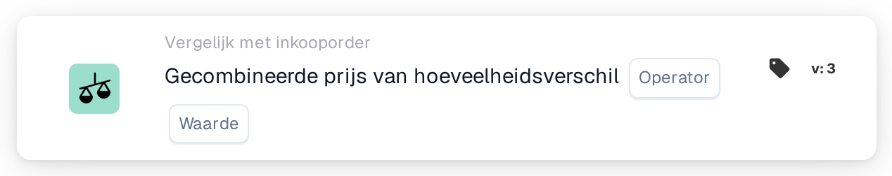
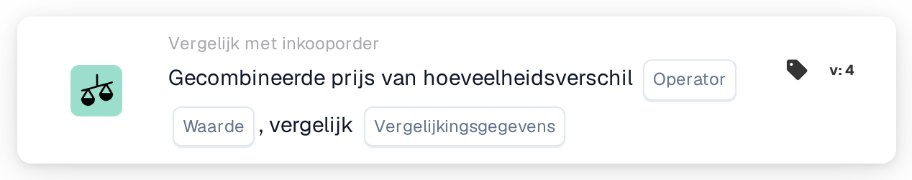

# Gecombineerde prijs van hoeveelheidsverschil

<figure><figcaption>
Versie 2
</figcaption></figure>

<figure><figcaption>
Versie 3
</figcaption></figure>

<figure><figcaption>
Versie 4
</figcaption></figure>

## **Doel**:

Deze workflowkaart evalueert de gecombineerde prijs van een hoeveelheidsverschil en vergelijkt deze met een opgegeven waarde. Het helpt bij het automatiseren van acties op basis van prijs- en hoeveelheidsverschillen in gerelateerde documenten, waardoor de inkoop- en ontvangstworkflows worden verbeterd. **Versie 4** breidt deze functionaliteit uit door vergelijkingen tussen verschillende entiteiten mogelijk te maken, zoals de inkooporder, ontvangen hoeveelheden en het document zelf, waardoor meer flexibiliteit en controle aan de workflow wordt toegevoegd.

## **Componenten van de kaart**:

1. **Exploitant**:
   * **Beschrijving:** De voorwaarde voor het vergelijken van de gecombineerde prijs met een opgegeven waarde.
   * **Opties:**
     * **Is gelijk aan (=)**: Controleert of de gecombineerde prijs overeenkomt met de opgegeven waarde.
     * **Niet gelijk aan (≠)**: Zorgt ervoor dat de gecombineerde prijs afwijkt van de opgegeven waarde.
     * **Groter dan (>)**: Controleert of de gecombineerde prijs groter is dan de opgegeven waarde.
     * **Groter of gelijk aan (≥)**: Controleert of de gecombineerde prijs groter is dan of gelijk is aan de opgegeven waarde.
     * **Kleiner dan (<)**: Controleert of de gecombineerde prijs lager is dan de opgegeven waarde.
     * **Kleiner of gelijk aan (≤)**: Controleert of de gecombineerde prijs kleiner is dan of gelijk is aan de opgegeven waarde
2. **Waarde**:
   * **Beschrijving:** Specificeert de waarde waarmee de gecombineerde prijs van de hoeveelheidswaarde wordt vergeleken.
   * **Details:** De waarde moet een numerieke waarde zijn.

## **Extra componenten in versie 4**:

* **Vergelijkingstype**: selecteert de entiteiten die moeten worden vergeleken. De opties omvatten:
  * **Inkooporder naar document**: Vergelijkt de hoeveelheden en prijzen tussen de inkooporder en het gerelateerde document.
  * **Ontvangen in document**: Vergelijkt de ontvangen hoeveelheden met de hoeveelheden in het document.
  * **Inkooporder met ontvangen**: vergelijkt de inkooporderaantallen met de ontvangen hoeveelheden.

## **Functionaliteit**:

* **Conditie-evaluatie**: Berekent de gecombineerde prijs door het hoeveelheidsverschil te vermenigvuldigen met de prijs per eenheid en vergelijkt deze met de opgegeven waarde met behulp van de geselecteerde operator.\
  **Versie 4** voegt de optie toe om aanvullende entiteiten te vergelijken op basis van de configuratie van de gebruiker, zoals inkooporder met ontvangen of inkooporder met document.
* **Uitvoering actie**: op basis van het feit of de gecombineerde prijs aan de opgegeven voorwaarde voldoet, gaat de workflow verder met waar of onwaar voorwaarden om acties te activeren of de workflow te stoppen. **Versie 4** maakt ook een meer dynamische actie-uitvoering mogelijk, waarbij het voorwaardetype (bijvoorbeeld inkooporder naar ontvangen) de volgende stap beïnvloedt.

## **Installatie en configuratie**:

* **Versie 3**: Gebruikers configureren de kaart door de documentvelden voor het hoeveelheidsverschil en de prijs per eenheid te selecteren. Vervolgens wordt de operator gekozen om te definiëren hoe de gecombineerde prijs wordt vergeleken met de opgegeven waarde. Ten slotte stellen gebruikers de voorwaarde voor doorgaan in (waar of onwaar), die de volgende stap in de workflow dicteert.
* **Versie 4**: Naast de configuratie in **Versie 3** hebben gebruikers een extra optie om het **Vergelijkingstype** te configureren. Dit definieert welke entiteiten worden vergeleken, zoals **Inkooporder met document**, **Ontvangen met document** of **Inkooporder met ontvangen**.

## **Voorbeeldscenario**:

* Op een factuur staan 50 eenheden van een product voor $ 100 per stuk, met een totaalbedrag van $ 5000. De bijbehorende inkooporder autoriseerde een aankoop van $ 4500 voor 45 eenheden. Het hoeveelheidsverschil is 5 eenheden en de gecombineerde prijs van het verschil is $ 500. De kaart vergelijkt de inkooporderhoeveelheid (45 eenheden) met de ontvangen hoeveelheid (50 eenheden) en controleert of de gecombineerde prijs hoger is dan $ 400 (de opgegeven waarde). Met behulp van de operator **Groter dan (>)** identificeert de kaart de discrepantie en markeert deze ter beoordeling door het financiële team.

## **Conclusie**:

**Versie 3** van de workflowkaart "Gecombineerde prijs-of-hoeveelheidsverschil" biedt een eenvoudige aanpak voor het vergelijken van hoeveelheidsverschillen en het activeren van acties op basis van prijsdrempels.\
**Versie 4** breidt deze functionaliteit uit door vergelijkingen tussen verschillende entiteiten (inkooporder, ontvangen, document) mogelijk te maken, waardoor meer flexibiliteit en controle over de workflow wordt geboden. Organisaties kunnen nu complexere scenario's automatiseren en een strakkere controle over hun inkoop- en ontvangstprocessen afdwingen.

Zie [vergelijkingsrichting, tolerantiebasis en versies van opgeslagen kaarten](../../cards-overview/po-comparison-versions-guide.md) voordat u de vergelijkingszijden wijzigt.
