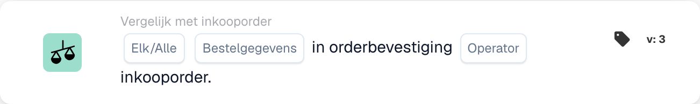

# Vergelijk Orderbevestiging met Inkooporder

<figure><figcaption>
Kaartvelden in de getoonde versie. De velden zijn nog niet ingevuld.
</figcaption></figure>

<figure><figcaption>
Kaartvelden in de getoonde versie. De velden zijn nog niet ingevuld.
</figcaption></figure>

## Doel:

Deze DocBits-kaart is ontworpen om een specifiek ordergegevensveld, zoals hoeveelheid, korting of eenheidsprijs, te vergelijken tussen een orderbevestiging en een inkooporder. Door een gerichte vergelijking van één veld tegelijk mogelijk te maken, wordt nauwkeurigheid bij het valideren van belangrijke gegevenspunten gegarandeerd, waardoor de nauwkeurigheid van de bestellingen behouden blijft. **Versie 4** breidt deze functionaliteit uit door vergelijkingen tussen verschillende entiteiten mogelijk te maken, zoals de inkooporder, ontvangen hoeveelheden en het document zelf, waardoor meer flexibiliteit en controle aan de workflow wordt toegevoegd.

## Onderdelen van de kaart:

1. **Elke/Alle**
   * **Beschrijving:** Bepaalt of de voorwaarde van toepassing is op één of alle regels in de orderbevestiging.\
     **Opties:**
     * **Any**: De vergelijking wordt geactiveerd als de geselecteerde veldwaarde in een regel van de orderbevestiging overeenkomt met de overeenkomstige waarde in de inkooporder.
     * **All**: De vergelijking wordt alleen geactiveerd als de geselecteerde veldwaarde in alle regels van de orderbevestiging overeenkomt met de overeenkomstige waarde in de inkooporder.
2. **Bestelgegevensveld**
   * **Beschrijving**: Specificeert het gegevensveld dat moet worden vergeleken tussen de orderbevestiging en de inkooporder.
   * **Details**: gebruikers kunnen een van de volgende velden selecteren ter vergelijking:
     * **Aantal**: Vergelijkt het bestelde aantal met het bevestigde aantal.
     * **Korting**: Valideert dat de korting in de bevestiging overeenkomt met de inkooporder.
     * **Eenheidsprijs**: Zorgt ervoor dat de eenheidsprijs in de bevestiging overeenkomt met de inkooporder.
3. **Exploitant**
   * **Beschrijving**: Definieert de voorwaarde die wordt toegepast op de vergelijking van het geselecteerde gegevensveld.
   * **Opties**:
     * **Is gelijk aan (=)**: Bevestigt dat de waarde overeenkomt met de inkooporder.
     * **Niet gelijk aan (≠)**: Zorgt ervoor dat de waarde afwijkt van de inkooporder.
     * **Groter dan (>)**: Controleert of de waarde hoger is dan de waarde van de inkooporder.
     * **Groter of gelijk aan (≥)**: Bevestigt dat de waarde gelijk is aan of groter is dan de waarde van de inkooporder.
     * **Less Than (<)**: Controleert of de waarde lager is dan de waarde van de inkooporder.
     * **Minder of gelijk aan (≤)**: Bevestigt dat de waarde lager is dan of gelijk is aan de waarde van de inkooporder.

## **Extra componenten in versie 4**:

* **Vergelijkingstype**: selecteert de entiteiten die moeten worden vergeleken. De opties omvatten:
  * **Inkooporder naar document**: Vergelijkt de inkoopordergegevens met het gerelateerde document.
  * **Ontvangen naar document**: vergelijkt de ontvangen gegevens (bijvoorbeeld ontvangen hoeveelheden) met het document.
  * **Inkooporder naar ontvangen**: Vergelijkt de inkoopordergegevens met de ontvangen hoeveelheden.

## Functionaliteit:

* **Veldvergelijking**: het systeem vergelijkt het geselecteerde ordergegevensveld (Eenheidsprijs, Korting of Aantal) uit de orderbevestiging met de overeenkomstige waarde in de inkooporder.
* **Uitvoering actie**: op basis van het vergelijkingsresultaat en de conditie van de operator kan de kaart vervolgacties activeren, zoals meldingen of waarschuwingen.

## Voorbeeldscenario:

* Een orderbevestiging specificeert een **eenheidsprijs** van €50, terwijl de inkooporder €45 vermeldt. Met behulp van de operator 'Groter dan' markeert de kaart het verschil, zodat het inkoopteam dit kan oplossen voordat het wordt verwerkt.

## Conclusie:

Deze kaart vereenvoudigt de validatie van individuele bestelgegevensvelden en zorgt ervoor dat de voorwaarden van de inkooporder worden nageleefd. Door één veld tegelijk te isoleren ter vergelijking, ondersteunt het gerichte beoordelingen en foutpreventie bij de orderverwerking.

Zie [vergelijkingsrichting, tolerantiebasis en versies van opgeslagen kaarten](../../cards-overview/po-comparison-versions-guide.md) voordat u de vergelijkingszijden wijzigt.
