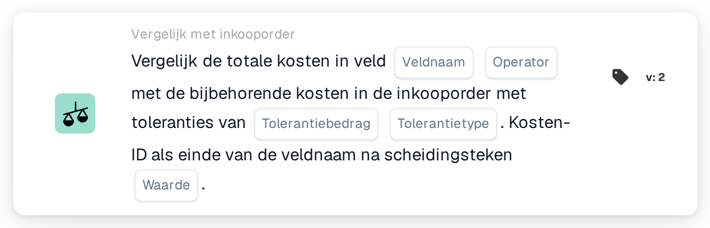

# Vergelijk totale kosten

<figure><figcaption>
Versie 2
</figcaption></figure>

## **Doel:**

Deze workflow-kaart vergelijkt de totale kosten in een documentveld met de bijbehorende kosten in een inkooporder. De kaart helpt ervoor te zorgen dat de kosten in het document overeenkomen met die in de inkooporder, rekening houdend met opgegeven tolerantieniveaus. De vergelijking kan acties triggeren als er afwijkingen worden gevonden, zoals het markeren van afwijkingen voor beoordeling of het dienovereenkomstig aanpassen van kosten.

## **Onderdelen van de kaart:**

1. **Veldnaam:**
   * **Beschrijving**: Geeft het documentveld op dat de totale kostenwaarden bevat die met de kosten in de inkooporder worden vergeleken.
   * **Details**: De waarde in dit veld vertegenwoordigt de totale kosten die in het document (bijv. factuur) zijn toegepast en wordt vergeleken met de inkooporderkosten.
2. **Exploitant:**
   * **Beschrijving**: Definieert de voorwaarde die wordt toegepast op de vergelijking tussen de totale kosten in het document en de kosten in de inkooporder.
   * **Opties**:
     * **Is gelijk aan (=)**: Verifieert of de totale kosten in het document overeenkomen met de kosten in de inkooporder.
     * **Niet gelijk aan (≠)**: Zorgt ervoor dat de totale kosten in het document verschillen van de kosten in de inkooporder.
     * **Groter dan (>)**: Verifieert of de totale kosten in het document groter zijn dan de kosten in de inkooporder.
     * **Groter of gelijk aan (≥)**: Verifieert of de totale kosten in het document groter dan of gelijk zijn aan de kosten in de inkooporder.
     * **Kleiner dan (<)**: Verifieert of de totale kosten in het document kleiner zijn dan de kosten in de inkooporder.
     * **Kleiner of gelijk aan (≤)**: Verifieert of de totale kosten in het document kleiner dan of gelijk zijn aan de kosten in de inkooporder.
3. **Tolerantiebedrag**
   * **Beschrijving**: Geeft de tolerantiedrempel op voor het vergelijken van de totale kosten.
   * **Details**: Deze numerieke waarde vertegenwoordigt de toegestane afwijking in kosten tussen het document en de inkooporder.
4. **Tolerantietype:**
   * **Beschrijving**: Geeft het type tolerantie op dat wordt toegepast.
   * **Opties**:
     * **Percentage**: De tolerantie wordt toegepast als een percentage van de inkooporderkosten.
     * **Waarde**: De tolerantie wordt toegepast als een vast numeriek bedrag.
5. **Scheidingsteken:**
   * **Beschrijving**: Geeft het scheidingsteken op dat wordt gebruikt om de Charge ID aan het einde van de veldnaam te onderscheiden.
   * **Details**: Het scheidingsteken scheidt het kostenveld van de unieke Charge ID die wordt gebruikt om de documentkosten aan de bijbehorende kosten in de inkooporder te koppelen.

## **Functionaliteit:**

* **Voorwaarde-evaluatie:** Het systeem vergelijkt de totale kosten in het documentveld met de bijbehorende kosten in de inkooporder op basis van de operator en de tolerantie. De tolerantie wordt toegepast om te bepalen of het verschil tussen de twee kosten binnen een acceptabel bereik valt.
* **Actie-uitvoering:**
  * **True-voorwaarde**: Als de kosten overeenkomen (rekening houdend met de tolerantie) en de voorwaarde true is, gaat de workflow verder met de gedefinieerde actie, zoals documentgoedkeuring of verdere verwerking.
  * **False-voorwaarde**: Als de voorwaarde false is (d.w.z. de kosten komen niet overeen binnen de tolerantie), gaat de workflow niet verder.

## **Opzet en configuratie:**

* Gebruikers beginnen met het selecteren van het documentveld dat de totale kostenwaarde bevat. Vervolgens selecteren ze de operator om te definiëren hoe de kosten met de inkooporderkosten worden vergeleken. Daarna stellen gebruikers het tolerantiebedrag en tolerantietype (percentage of absoluut) in. Ten slotte geven ze het scheidingsteken en de Charge ID op die voor de vergelijking worden gebruikt.

## **Voorbeeldscenario:**

Een factuur vermeldt kosten van $500 in het veld "total charges". De bijbehorende inkooporderkosten zijn $480 en de tolerantie is ingesteld op $20 (absolute tolerantie). De kaart vergelijkt de documentkosten met de inkooporderkosten:

* De totale kosten in het document vallen binnen de $20-tolerantie van de inkooporder en de workflow gaat zonder problemen verder.
* Als de kosten de tolerantie overschrijden, markeert de workflow de afwijking voor beoordeling.

## **Conclusie:**

De workflow-kaart "Compare Total Charges" zorgt ervoor dat de kosten in documenten overeenkomen met die in inkooporders, rekening houdend met opgegeven tolerantieniveaus. Dit helpt organisaties het verificatieproces te automatiseren, afwijkingen vroegtijdig te identificeren en betere controle over kostengerelateerde processen te behouden.
