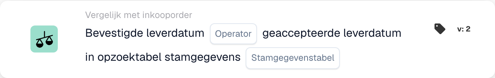

# Bevestigde leverdatum

<figure><figcaption>
Kaartvelden in de getoonde versie. De velden zijn nog niet ingevuld.
</figcaption></figure>

## **Doel**

Deze workflow-kaart is ontworpen om te verifiëren dat bevestigde leverdata op facturen of verzenddocumenten overeenkomen met de geaccepteerde leverdata die in een master-data-opzoektabel zijn gedefinieerd. Door deze data te vergelijken, helpt hij de naleving van afgesproken leverschema's te waarborgen en de betrouwbaarheid van de toeleveringsketen te verbeteren.

## **Onderdelen van de kaart**

1. **Exploitant**
   * **Beschrijving:** Definieert de voorwaarde voor het vergelijken van de bevestigde leverdatum met de geaccepteerde leverdatum.
   * **Opties:**
     * **Is:** Bevestigt dat de leverdatum overeenkomt met de geaccepteerde leverdatum in de master data.
     * **Is niet:** Zorgt ervoor dat de leverdatum niet overeenkomt met de geaccepteerde leverdatum in de master data.
2. **Hoofdgegevenstabel opzoeken**
   * **Beschrijving:** Geeft de referentietabel op die de geaccepteerde leverdata voor vergelijking bevat.
   * **Details:** De tabel wordt gedefinieerd door de parameter **Stamgegevenstabel** en kan aanvullende metadata bevatten, zoals ordernummers of leverregio's.

## **Functionaliteit**

* **Datumvergelijking:** Het systeem vergelijkt de bevestigde leverdatum uit de factuur of het verzenddocument met de geaccepteerde leverdatum in de opgegeven master-data-opzoektabel.
* **Actie-uitvoering:** Op basis van het vergelijkingsresultaat kan de kaart vervolgacties zoals meldingen triggeren.

## **Opzet en configuratie**

* Om deze kaart te configureren, selecteren gebruikers het veld dat de bevestigde leverdatum in het document vertegenwoordigt en geven ze de master-data-opzoektabel op die de geaccepteerde leverdata bevat. Vervolgens wordt een operator gekozen om te definiëren hoe de twee data moeten worden vergeleken (bijv. **Is** of **Is niet**).

## **Voorbeeldscenario**

* Een factuur vermeldt een bevestigde leverdatum van 10 juni, terwijl de master-data-opzoektabel een geaccepteerde leverdatum van 15 juni opgeeft. Met de operator **Is niet** markeert de kaart de afwijking voor beoordeling, zodat het logistieke team de oorzaak kan onderzoeken en de schema's dienovereenkomstig kan aanpassen.

## **Conclusie**

De workflow-kaart **"Bevestigde leverdatum versus geaccepteerde leverdatum"** helpt organisaties zich te houden aan afgesproken leverschema's door de vergelijking van bevestigde en geaccepteerde leverdata te automatiseren. Deze proactieve benadering van leverbeheer verbetert de operationele efficiëntie, vermindert vertragingen en bevordert betere samenwerking in de toeleveringsketen.
