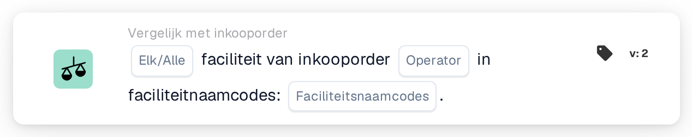

# Faciliteit van inkooporder

<figure><figcaption>
Versie 2
</figcaption></figure>

## Doel:

Deze workflowkaart controleert de faciliteit van de aan een document gematchte inkooporders tegen een lijst met faciliteitscodes. De kaart kan worden gebruikt om documenten verschillend te behandelen afhankelijk van de faciliteit (locatie) waarvoor de bestelling is geplaatst, bijvoorbeeld om ze door te sturen naar het team dat voor die faciliteit verantwoordelijk is.

De inkoopordermatching hoort vóór deze kaart te lopen. Zonder gematchte inkooporder meldt de kaart ontbrekende gegevens.

## Onderdelen van de kaart:

1. **Elk/Alle**
   * **Beschrijving:** Hoe de faciliteitscodes van de gematchte inkooporders tegen de lijst worden geëvalueerd.
   * **Opties:**
     * **Elk:** Minstens één gematchte inkooporder voldoet aan de operator.
     * **Alle:** Elke gematchte inkooporder met een faciliteit voldoet aan de operator. Is er geen waarde ingesteld, dan gebruikt de kaart **Alle**.
2. **Operator**
   * **Beschrijving:** Of de faciliteit wel of niet in de lijst hoort te staan.
   * **Opties:**
     * **Is**
     * **Is niet**
3. **Faciliteitsnaamcodes**
   * **Beschrijving:** De faciliteitscodes waarmee de faciliteit van de inkooporder wordt vergeleken.
   * **Detail:** Er kunnen meerdere codes worden ingevoerd, gescheiden door komma's.

## Functionaliteit:

* **Voorwaarde-evaluatie:** De kaart leest de aan het document gematchte inkoopordernummers, laadt deze inkooporders en verzamelt van elk daarvan de faciliteit (locatie). Inkooporders zonder faciliteit worden overgeslagen. De verzamelde faciliteitscodes worden vervolgens vergeleken met de **Faciliteitsnaamcodes** op de kaart.
  * Een faciliteitscode telt als vermeld wanneer die als geheel gelijk is aan een van de ingevoerde codes. Hoofd- en kleine letters en spaties rond de items worden genegeerd, dus `wh01` komt overeen met `WH01`, maar `WH` komt niet overeen met `WH01`.
  * Met **Is** voldoet een inkooporder aan de voorwaarde wanneer de faciliteitscode ervan vermeld is. Met **Is niet** voldoet die aan de voorwaarde wanneer de faciliteitscode niet vermeld is.
  * Met **Elk** is aan de voorwaarde voldaan als minstens één inkooporder eraan voldoet, met **Alle** als elke inkooporder met een faciliteit eraan voldoet.
  * Heeft geen van de gematchte inkooporders een faciliteit, dan is aan **Alle** voldaan en aan **Elk** niet.
* **Actie-uitvoering:**
  * **True-voorwaarde:**\
    Wordt aan de voorwaarde voldaan, dan gaat de workflow verder, bijvoorbeeld met een stap die specifiek is voor de vermelde faciliteiten.
  * **False-voorwaarde:**\
    Wordt niet aan de voorwaarde voldaan, dan stopt de workflow met een niet voldane voorwaarde.
* **Ontbrekende gegevens:** Zijn er op de kaart geen faciliteitscodes ingevoerd of heeft het document geen gematchte inkooporder, dan evalueert de kaart de voorwaarde niet en meldt ze de ontbrekende gegevens in het workflowlogboek.

## Opzet en configuratie:

* De kaart kan als And-voorwaarde na de inkoopordermatching worden toegevoegd vanuit de categorie **Vergelijk met inkooporder**. Daarna kunnen **Elk** of **Alle**, de operator en de faciliteitscodes, gescheiden door komma's, worden ingesteld. Hoofd- en kleine letters maken niet uit, maar elke code hoort volledig te worden ingevoerd, omdat delen van een code niet overeenkomen.
* Met **Testkaart** in het kaartmenu van de Workflow Builder kan de configuratie op een bestaand document worden uitgeprobeerd. Het kaartlogboek somt de gematchte inkooporders op, de daarop gevonden faciliteitscodes en de codes die niet zijn gematcht.

## Conclusie:

De workflowkaart "Facility of Purchase Order" maakt de faciliteit van de bestelde goederen beschikbaar als workflowvoorwaarde. Zo kan één workflow documenten voor verschillende faciliteiten verschillend behandelen, op basis van de inkoopordergegevens in plaats van wat er op het document staat.
