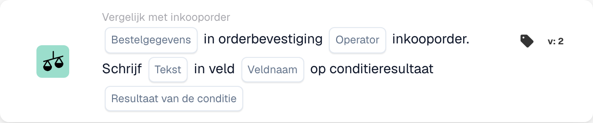
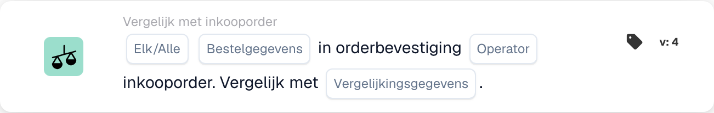

# Vergelijking tussen orderbevestiging en inkooporder

Gebruik **Vergelijk met inkooporder** in de Workflow Builder wanneer een orderbevestiging met de bijbehorende inkooporder gecontroleerd moet worden. Voeg de kaart toe onder **En....**, kies vervolgens de bestelgegevens, een operator en wat er met het resultaat moet gebeuren. De onderstaande afbeeldingen tonen twee beschikbare kaartversies in de Nederlandse interface. De velden zijn nog tijdelijke aanduidingen; stel ze in voor uw eigen workflow voordat u opslaat.

## Het resultaat in een veld schrijven

<figure><figcaption>
Kaartvelden in de getoonde versie. De velden zijn nog niet ingevuld.
</figcaption></figure>

Kies **Bestelgegevens** uit de orderbevestiging en een **Operator** voor de vergelijking met de inkooporder. Voer de **Tekst** in die u wilt schrijven, selecteer de **Veldnaam** en kies het **Resultaat van de conditie** dat het schrijven moet activeren.

## De gegevens vergelijken

<figure><figcaption>
Kaartvelden in de getoonde versie. De velden zijn nog niet ingevuld.
</figcaption></figure>

Kies **Elk/Alle** om te bepalen of een of alle geselecteerde voorwaarden moeten overeenkomen. Selecteer daarna de **Bestelgegevens**, de **Operator** en de **Vergelijkingsgegevens** voor de vergelijking met de inkooporder.

Zie [Workflow](../..) en [Vergelijk met inkooporder](.) voor de stappen ervoor en erna.

<!-- workflow-card-practical-example-20261021 -->

## Praktisch voorbeeld

**Wanneer gebruiken:** Controleer een orderbevestiging met de daaraan gekoppelde inkooporder.

**Configuratie:** Gebruik een demobestelling en -bevestiging bij dezelfde leverancier, artikelreferentie en vergeleken waarden. Selecteer de beoogde vergelijkingsrichting en de velden die deze versie biedt.

**Verwacht resultaat en tegenvoorbeeld:** De matchingvergelijking is geslaagd. Wijzig de waarde van één vergeleken item in een afzonderlijk testgeval en controleer of deze wordt gedetecteerd; een ontbrekende gekoppelde bestelling is een afzonderlijk dataprobleem.

Dit is een illustratieve configuratie en een verwacht resultaat. Gebruik velden, gebruikers en groepen die in uw testorganisatie zijn geconfigureerd; het is geen bewering dat dit voorbeeld is uitgevoerd.
