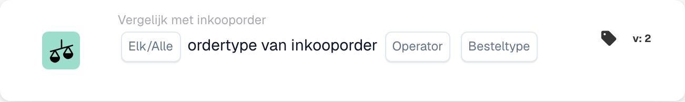

# Ordertype inkooporder

<figure><figcaption>
Kaartvelden in de getoonde versie. De velden zijn nog niet ingevuld.
</figcaption></figure>

## **Doel**:

Deze DocBits-kaart maakt verificatie van het ordertype op een inkooporder mogelijk en zorgt ervoor dat dit overeenkomt met opgegeven criteria.

## **Functionaliteit**:

* **Ordertypevergelijking**: Deze kaart vergelijkt het ordertype van de inkooporder met een opgegeven waarde, waardoor gebruikers kunnen verifiëren of het ordertype aan bepaalde voorwaarden voldoet.
* **Elke/Alle-selectie**: Gebruikers kunnen ervoor kiezen de vergelijking toe te passen op **any** (ten minste één geselecteerd ordertype komt overeen) of **all** (alle geselecteerde ordertypen komen overeen) opgegeven ordertypen.
* **Exploitant**: Gebruikers kunnen voorwaarden instellen voor het vergelijken van het ordertype in de inkooporder. Beschikbare operatoren zijn:
  * **Is gelijk aan (=)**: Bevestigt dat het ordertype in de inkooporder overeenkomt met het opgegeven type.
  * **Niet gelijk (≠)**: Zorgt ervoor dat het ordertype in de inkooporder niet overeenkomt met het opgegeven type.

## **Gebruik**:

Deze kaart is met name waardevol voor inkoopteams, voorraadplanners en operationeel managers die orders nauwkeurig moeten categoriseren en prioriteren. Door ervoor te zorgen dat ordertypen overeenkomen met de beoogde classificaties, kunnen gebruikers de orderafhandeling stroomlijnen, de toewijzing van middelen optimaliseren en zich houden aan serviceniveau-overeenkomsten.

## **Voorbeeldscenario**:

* Een inkooporder is gecategoriseerd als "IGR". Het systeem gebruikt de operator "Equals" om te verifiëren dat dit ordertype overeenkomt met de beoogde classificatie voor verwerking.

Door de kaart "Compare with Purchase Order: Order Type" te gebruiken, kunnen organisaties de validatie van ordertypen automatiseren, wat zorgt voor consistentie in verwerkingsprioriteiten en handmatige classificatiefouten vermindert.
