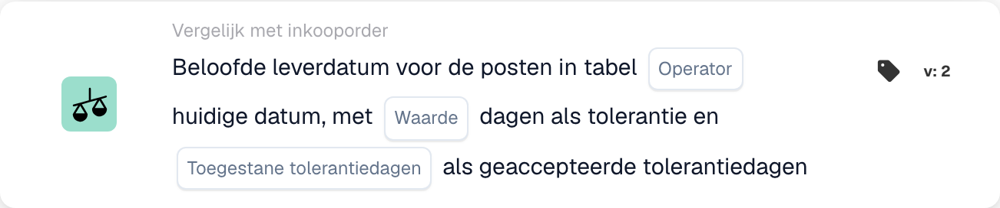
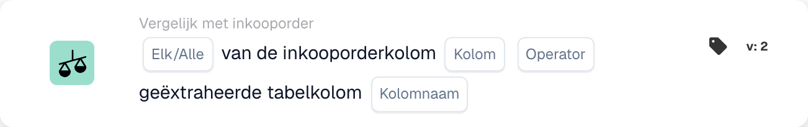
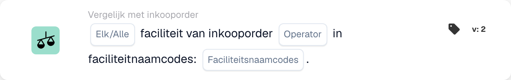
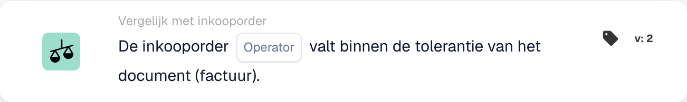
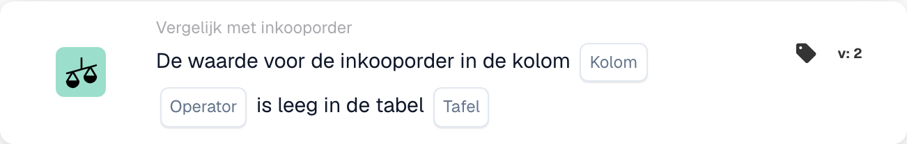
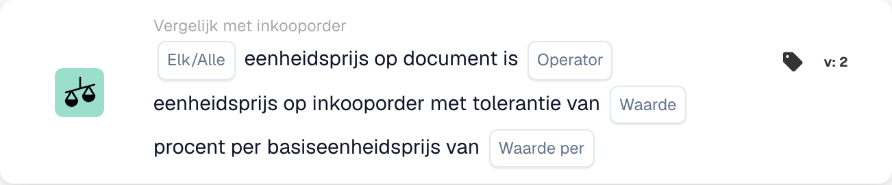
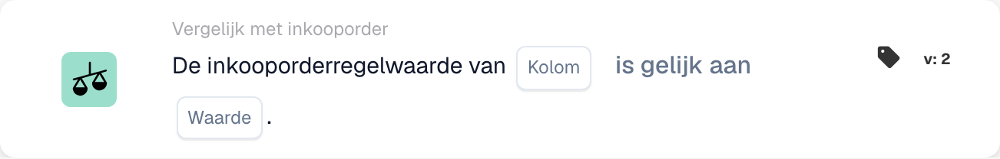

# PO-matchingkaarten - Volledige gids

## Matchingkaarten voor inkooporders (PO) - Volledige gids

**Status:** Omvat 15 PO-vergelijkingskaarten met gedetailleerde berekeningen

***

De PO-vergelijkingskaarten op deze pagina bevinden zich in de groep **En** van de Workflow Builder. Ze vergelijken factuurgegevens met de overeenkomende inkooporder voordat de acties Dan worden uitgevoerd:

<figure><figcaption><p>Niet-opgeslagen voorbeeld met Wanneer-, En- en Dan-kaarten. Vul alle velden in vóór uitvoering. Sommige labels van deze versie zijn in de interface nog niet of onjuist vertaald. De uitleg op deze pagina gebruikt de juiste termen; de afbeelding toont de werkelijke interface.</p></figcaption></figure>

***

### 📌 Versie-informatie

**Meest ontwikkelde kaart:** CONDITION\_DOC\_TO\_PO\_UNIT\_PRICE (5 versies, laatste v5) **Andere complexe kaarten:** CONDITION\_OC\_TO\_PO\_ITEMS (v4), CONDITION\_LESS\_THAN\_TOLERANCE\_AS\_VALUE\_OF\_ORDERED\_QUANTITY (v4)

**Belangrijkste patronen:**

* **v2 → v3+:** Toevoeging van tolerantieparameters voor flexibele matching
* **v3 → v4:** Toevoeging van parameters voor de vergelijkingsmodus
* **v4 → v5:** Verbeterde tolerantie met meerdere eenheden (%, EUR, $, etc.)

📖 [Volledige versiegeschiedenis](../../release.md) | [Kaartversies en gedrag](../../cards-overview/card-versions-guide.md)

***

### Inzicht in PO-matching

Wanneer u een factuur ontvangt, moet deze overeenkomen met de eerder geplaatste inkooporder (PO). PO-matchingskaarten controleren automatisch of de factuurgegevens overeenkomen met de PO-gegevens.

**Het grote plaatje:**

```
PO Placed     Invoice Arrives     PO Matching     Decision
(€100)    →   (€103)          →   (Check if       → Approve/Reject
Qty: 100      Qty: 100            within tolerance)
```

***

## 1. Volledige match van inkooporder

### Doel

Controleert of de gehele factuur perfect overeenkomt met de PO of binnen de tolerantie valt

### Wanneer te gebruiken

* Voordat u een factuur goedkeurt
* Als voorlopige kwaliteitscontrole
* Om problemen vroegtijdig te onderkennen

### Hoe het werkt

Systeem vergelijkt:

* Factuurhoeveelheden versus inkooporderhoeveelheden
* Factuurprijzen versus PO-prijzen
* Factuurartikelen versus PO-artikelen
* Factuurtotaal versus PO-totaal

### Resultaat

* **TRUE** (Volledige match): Alles komt overeen, ga verder
* **FALSE** (Mismatch): iets komt niet overeen, moet worden beoordeeld

### Voorbeeld

```
PO:
- Item ABC: Qty 100, Unit Price €50 = €5000
- Item XYZ: Qty 50, Unit Price €20 = €1000
- Total: €6000

Invoice:
- Item ABC: Qty 100, Unit Price €50 = €5000
- Item XYZ: Qty 50, Unit Price €20 = €1000
- Total: €6000

Result: ✅ FULL MATCH
```

***

## 2. Vergelijking van eenheidsprijzen (document versus inkooporder)

### Doel

Vergelijkt de eenheidsprijs op de factuur met de eenheidsprijs op de inkooporder

### Parameters

* **Eenheidsprijstolerantie**: Variatie tot dit bedrag toestaan
* **Tolerantietype**: Percentage (%) of Absoluut (€/$)
* **Exploitant**: is gelijk aan, is groter dan, is kleiner dan, enz.

### Hoe het werkt (percentage tolerantie)

**Formule:**

```
Variance % = |(Invoice Price - PO Price)| / PO Price × 100

Check: Is Variance % ≤ Tolerance %?
```

**Stapsgewijs voorbeeld:**

```
Step 1: Get prices
  PO Unit Price: €100.00
  Invoice Unit Price: €103.00

Step 2: Calculate difference
  Difference = |€103.00 - €100.00| = €3.00

Step 3: Calculate percentage
  Percentage = (€3.00 / €100.00) × 100 = 3%

Step 4: Check tolerance (5% allowed)
  Is 3% ≤ 5%? YES ✅

Result: PASS - Within tolerance
```

### Voorbeelden uit de echte wereld

#### Voorbeeld 1: Kleine verhoging (geaccepteerd)

```
PO Price: €50.00
Invoice Price: €51.50
Tolerance: ±3%

Calculation:
  Variance = |(€51.50 - €50.00)| / €50.00 × 100
  Variance = €1.50 / €50.00 × 100 = 3%

Is 3% ≤ 3%? YES ✅ ACCEPT
```

#### Voorbeeld 2: Grote verhoging (afgewezen)

```
PO Price: €50.00
Invoice Price: €55.00
Tolerance: ±3%

Calculation:
  Variance = |(€55.00 - €50.00)| / €50.00 × 100
  Variance = €5.00 / €50.00 × 100 = 10%

Is 10% ≤ 3%? NO ❌ REJECT - NEEDS REVIEW
```

#### Voorbeeld 3: Korting (ook aangevinkt)

```
PO Price: €100.00
Invoice Price: €97.00
Tolerance: ±5%

Calculation:
  Variance = |(€97.00 - €100.00)| / €100.00 × 100
  Variance = €3.00 / €100.00 × 100 = 3%

Is 3% ≤ 5%? YES ✅ ACCEPT (Discount is within tolerance)
```

#### Voorbeeld 4: Absolute waardetolerantie

```
PO Price: €10.00
Invoice Price: €10.50
Tolerance: ±€1.00 (absolute, not %)

Calculation:
  Variance = |€10.50 - €10.00| = €0.50

Is €0.50 ≤ €1.00? YES ✅ ACCEPT
```

### Wat te doen met resultaten

**Als PASS ✅:**

* Ga door naar de volgende controle
* Of keur de factuur goed
* Of ga verder met exporteren

**Indien FOUT ❌:**

* Markeer voor handmatige beoordeling
* Vraag leverancier om uitleg
* Neem contact op met het inkoopteam
* Indien aanvaardbaar, met nota goedkeuren

***

## 3. Hoeveelheidsvergelijking

### Doel

Controleert of het bestelde aantal overeenkomt met het gefactureerde aantal

### Parameters

* **Tolerantie**: Bedrag of % mag afwijken
* **Exploitant**: gelijk aan, groter dan, kleiner dan
* **Aantaltype**: Besteld, Ontvangen, Open

### Rekenvoorbeeld

**Percentagetolerantie:**

```
Formula:
  Quantity Variance % = |(Invoice Qty - PO Qty)| / PO Qty × 100

Example:
  PO Quantity: 100 units
  Invoice Quantity: 103 units
  Tolerance: ±5%

  Variance = |(103 - 100)| / 100 × 100
  Variance = 3 / 100 × 100 = 3%

  Is 3% ≤ 5%? YES ✅ ACCEPT
```

**Absolute tolerantie:**

```
Formula:
  Quantity Variance = |Invoice Qty - PO Qty|

Example:
  PO Quantity: 100 units
  Invoice Quantity: 102 units
  Tolerance: ±5 units

  Variance = |102 - 100| = 2 units

  Is 2 units ≤ 5 units? YES ✅ ACCEPT
```

### Scenario's uit de echte wereld

#### Overlevering (meer dan besteld)

```
Ordered: 100 units
Invoiced: 110 units
Tolerance: ±5%

Variance = |(110-100)|/100 × 100 = 10%

Is 10% ≤ 5%? NO ❌

Decision: Contact supplier - more delivered than ordered
Possible reason: Error by supplier, partial shipment already received
```

#### Onderlevering (minder dan besteld)

```
Ordered: 100 units
Invoiced: 95 units
Tolerance: ±5%

Variance = |(95-100)|/100 × 100 = 5%

Is 5% ≤ 5%? YES ✅

Decision: Accept - within tolerance
Possible reason: Partial shipment, rest to follow
```

***

## 4. Gecombineerd verschil in prijs en hoeveelheid

### Doel

Wanneer de hoeveelheid verschilt, wordt berekend of het totale prijsverschil acceptabel is

### Waarom dit ertoe doet

```
Scenario: You ordered 100 units but received 110
- Quantity is 10% over (bad)
- BUT: You're only charged for 10% extra
- Combined effect might be acceptable
```

### Berekening

**Formule:**

```
Combined Variance = Quantity Variance × Price Variance

If both are within tolerance, combined is usually acceptable
```

**Voorbeeld:**

```
PO:
- Unit Price: €100
- Quantity: 100
- Total: €10,000

Invoice:
- Unit Price: €102 (2% higher)
- Quantity: 105 (5% higher)
- Total: €10,710

Analysis:
- Price variance: 2% ✅
- Quantity variance: 5% ✅
- Combined effect: 1.02 × 1.05 = 1.071 = 7.1% total increase

Is combined variance acceptable? Usually YES ✅
```

***

## 5. Vergelijking artikel-ID/artikelnummer leverancier

### Doel

Controleert of de artikelen op de factuur overeenkomen met de artikelen op de inkooporder

### Hoe het werkt

**Exacte overeenkomst (eenvoudigste):**

```
PO Item ID: ABC-123
Invoice Item ID: ABC-123
Result: ✅ MATCH
```

**Artikelnummer leverancier (vaker):**

```
PO Item: ABC-123 (Our internal code)
Supplier Item: SUPP-456 (Their code for same item)
System matches these as same item
Result: ✅ MATCH
```

### Scenario: wat als het niet overeenkomt?

```
PO Item: ABC-123 (Copper Wire, 2mm)
Invoice Item: ABC-124 (Steel Wire, 2mm)

Result: ❌ NO MATCH

Actions:
1. Is this a substitution? Check with procurement
2. Is this an error? Contact supplier
3. Is the description similar? Verify manually
```

***

## 6. Verificatie van het ordertype

### Doel

Controleert of het type inkooporder correct is

### Besteltypen

* **Standaardbestelling**: reguliere aankoop
* **Spoedbestelling**: Dringend, mogelijk met premie
* **Raamovereenkomst**: Contract van lange duur
* **Blanket Order**: Contract van onbepaalde duur
* **Zending**: u betaalt pas als u het gebruikt

### Controleer voorbeeld

```
PO Order Type: Standard Order
Invoice Order Type: Standard Order
Result: ✅ MATCH

If mismatch: Could affect terms, payment, pricing
```

***

## 7. Verificatie van de leveringsdatum

### Doel

Controleert of de leverdatum overeenkomt met de beloofde datum op de inkooporder

### Berekening

**Late levering:**

```
Formula:
  Days Late = Invoice Delivery Date - PO Promised Date

Example:
  PO Promised: 2025-10-15
  Actual Delivery: 2025-10-22
  Days Late = 7 days

If tolerance is ±3 days:
  Is 7 ≤ 3? NO ❌ LATE
```

**Vroege levering:**

```
Formula:
  Days Early = PO Promised Date - Invoice Delivery Date

Example:
  PO Promised: 2025-10-15
  Actual Delivery: 2025-10-10
  Days Early = 5 days

Early delivery is usually OK ✅
Unless you need it at specific time
```

### Tolerantie-instellingen

```
±3 days: Allow 3 days late or early
±5 days: Allow up to 5 days variance
0 days: Must match exactly
```

***

## 8. Verificatie van kosten (belastingen, verzendkosten, enz.)

### Doel

Controleert of extra kosten (belasting, verzending, administratie) overeenkomen met de PO

### Gemeenschappelijke kosten

```
- Shipping: €50
- Handling: €10
- Packaging: €5
- Insurance: €15
- Taxes: €300
```

### Berekening

**Voorbeeld: controle van verzendkosten**

```
PO Shipping: €50.00
Invoice Shipping: €51.00
Tolerance: ±3%

Variance = |€51.00 - €50.00| / €50.00 × 100 = 2%

Is 2% ≤ 3%? YES ✅ ACCEPT
```

**Voorbeeld: meerdere kosten**

```
PO Total Charges:
  - Shipping: €50
  - Taxes: €300
  - Handling: €10
  Total: €360

Invoice Total Charges:
  - Shipping: €50
  - Taxes: €312 (11% tax)
  - Handling: €10
  Total: €372

Difference: €12
Check if within tolerance ✅ or ❌
```

***

## 9. Belastingverificatie

### Doel

Controleert of de belastingbedragen correct zijn berekend

### Berekening

**Formule:**

```
Tax Amount = Subtotal × Tax Rate

Example:
  Subtotal: €1000
  Tax Rate: 19%
  Expected Tax: €1000 × 0.19 = €190

Invoice Tax: €190
Match? YES ✅
```

**Veelvoorkomende problemen:**

```
1. Tax rate changed (region-based)
2. Tax applied to wrong amount (before/after discounts)
3. Multiple tax rates (some items 7%, others 19%)
4. Tax exempt items (0% tax)
```

**Voorbeeld: belasting met meerdere tarieven**

```
Item A: €100 @ 19% tax = €119
Item B: €100 @ 7% tax = €107
Item C: €100 @ 0% tax = €100
Total: €326

Invoice shows €325 (€1 error)

Check: Within tolerance or needs attention?
```

***

## 10. Matching faciliteit/kostenplaats

### Doel

Zorgt ervoor dat de factuur voor de juiste faciliteit/kostenplaats is

### Voorbeeld

```
PO is for:
- Facility: Berlin Plant
- Cost Center: CC-2025

Invoice should have:
- Facility: Berlin Plant ✅
- Cost Center: CC-2025 ✅

If different facility: May need different approval
```

***

## 11. Validatie van de leveranciersstatus

### Doel

Controleert of de leverancier nog goedgekeurd/actief is

### Statustypen

```
✅ ACTIVE: Approved, can do business
⚠️ ON HOLD: Temporarily blocked
❌ INACTIVE: No longer doing business
⚠️ CONDITIONAL: Only for specific items
```

### Controleer voorbeeld

```
Supplier: ABC Corp
Status in Database: ACTIVE
Status when creating PO: ACTIVE
Status when invoice arrives: INACTIVE

Alert: Supplier status changed! Investigate why.
```

***

## Welke tolerantie moet ik gebruiken?

### Strikte toleranties (lager risico, meer handmatig werk)

```
Use for:
- High-value items
- Items where exactness matters
- Regulated industries

Settings:
- Unit Price: ±1%
- Quantity: ±1%
- Delivery Date: ±1 day
- Charges: ±1%
```

### Gematigde toleranties (evenwichtig)

```
Use for:
- Most business transactions
- Standard items
- Normal purchasing

Settings:
- Unit Price: ±3-5%
- Quantity: ±3-5%
- Delivery Date: ±3 days
- Charges: ±5%
```

### Losse toleranties (hoger risico, minder handmatig werk)

```
Use for:
- Low-value items
- Bulk purchases
- Supplier agreements with flexibility

Settings:
- Unit Price: ±10%
- Quantity: ±10%
- Delivery Date: ±7 days
- Charges: ±10%
```

***

## Voorbeeld van workflow voor PO-matching

```
Invoice Arrives
    ↓
Condition: "Is amount > €5000?" → YES
    ↓
Check: Full Match? → NO (10% price difference)
    ↓
Check: Unit Price within 5%? → NO (12% difference)
    ↓
Check: Quantity within 5%? → YES (2% difference)
    ↓
Decision: FAIL - Price variance too high
    ↓
Flag for: Manual review / Buyer approval
    ↓
Wait for: Buyer comment
    ↓
If Approved: Continue to Export
If Rejected: Return to Supplier
```

***

## Problemen met PO-matching oplossen

### "PO niet gevonden"

```
Cause: Invoice PO number doesn't exist in system
Fix:
1. Verify PO number spelling
2. Check if PO was created
3. Verify PO is in correct organization
4. Ask supplier for PO reference
```

### "Items komen niet overeen"

```
Cause: Invoice items are different from PO items
Possible Reasons:
1. Substitution approved by procurement
2. Different item numbers for same item
3. Error by supplier
Fix: Contact procurement or supplier
```

### "Prijs hoger dan PO"

```
Cause: Invoice price > PO price
Possible Reasons:
1. Price increase approved
2. Supplier error
3. Currency difference
4. Additional services included
Fix: Verify with procurement
```

### "Bezorgdatum verkeerd"

```
Cause: Invoice dated after promised delivery
Possible Reasons:
1. Shipment was delayed
2. Receiving date different from invoice date
3. Partial shipment
Fix: Check shipping documents or contact supplier
```

***

## Overzichtstabel

| Kaart           | Wat het controleert        | Hoofdberekening     | Gemeenschappelijke tolerantie |
| -------------- | --------------------- | -------------------- | ---------------- |
| Volledige wedstrijd     | Alles            | Alle cheques           | Varieert           |
| Eenheidsprijs     | Prijs per eenheid        | % of € verschil    | ±3-5%            |
| Hoeveelheid       | Besteld bedrag        | % of eenheidsverschil | ±3-5%            |
| Gecombineerde prijs | Totaal met wijziging aantal | Aantal × prijs          | ±5-10%           |
| Artikel-ID        | Juiste artikelen           | String-match         | Exact            |
| Besteltype     | Soort aankoop      | String-match         | Exact            |
| Leveringsdatum  | Toen aangekomen          | Dag verschil       | ±3 dagen          |
| Kosten        | Extra kosten            | % of € verschil    | ±5%              |
| Belasting            | Belastingbedrag            | Belasting% berekening    | ±1%              |
| Faciliteit       | Kostenplaats           | String-match         | Exact            |
| Leverancier       | Goedgekeurd?             | Statuscontrole         | Alleen actief      |

***

## Gerelateerde documentatie

* Zie de handleiding 'Factuurvalidatie' voor de volledige workflow
* Zie "Tolerantie-instellingen" voor aanbevolen waarden per branche
* Zie "Afhandeling van uitzonderingen" voor wat u kunt doen met fouten
* Neem contact op met uw inkoopteam voor specifiek tolerantiebeleid

<!-- workflow-card-example-condition_promised_delivery_date_to_current-20261021 -->

### Beloofde leverdatum tegen de peildatum

<figure><figcaption><p>Kaartvelden in de getoonde versie. De velden zijn nog niet ingevuld.</p></figcaption></figure>

`CONDITION_PROMISED_DELIVERY_DATE_TO_CURRENT` · versie 2

Ga uit van een referentiedatum van `2026-10-21` en een beloofde lijnleveringsdatum van `2026-10-23`. Selecteer de later-dan-vergelijking en nul-dagentolerantie. De toekomstige datum voldoet aan die vergelijking; `2026-10-20` niet. Configureer de opties Alle/Alles en geaccepteerde tolerantiedagen bewust en test een ontbrekende datum afzonderlijk.

<!-- workflow-card-example-condition_po_extracted_table_column-20261021 -->

### Inkooporderkolom tegen een geëxtraheerde kolom

<figure><figcaption><p>Kaartvelden in de getoonde versie. De velden zijn nog niet ingevuld.</p></figcaption></figure>

`CONDITION_PO_EXTRACTED_TABLE_COLUMN` · versie 2

Vergelijk de overeenkomende inkooporderartikelkolom met de geëxtraheerde kolom `article_number`, met behulp van gelijkheid en Alles. Overeenkomende waarden `DEMO-A` geslaagd; een geëxtraheerde waarde `DEMO-B` mislukt. Selecteer alleen een opzoektabel als een gedocumenteerde vervanging van ID naar waarde nodig is; verifieer die mapping voordat u gaat vergelijken.

<!-- workflow-card-example-condition_check_facility_in_po-20261021 -->

### Toegestane inkooporderfaciliteiten

<figure><figcaption><p>Kaartvelden in de getoonde versie. De velden zijn nog niet ingevuld.</p></figcaption></figure>

`CONDITION_CHECK_FACILITY_IN_PO` · versie 2

Selecteer Alles, de is-in-vergelijking en de geconfigureerde faciliteitscode `DEMO-NORTH`. Overeenkomende PO-regels in die faciliteit passeren; een regel in `DEMO-SOUTH` mislukt. Gebruik faciliteitscodes uit de inkoopordergegevens in plaats van aan te nemen dat een displaylabel de code is.

<!-- workflow-card-example-condition_purchase_order_full_match-20261021 -->

### Volledige inkoopordermatch

<figure><figcaption><p>Kaartvelden in de getoonde versie. De velden zijn nog niet ingevuld.</p></figcaption></figure>

`CONDITION_PURCHASE_ORDER_FULL_MATCH` · versie 2

Gebruik een volledig overeenkomende demofactuur en inkooporder met hoeveelheid `2` en eenheidsprijs `100` aan beide zijden, en geconfigureerde hoeveelheids-/prijstoleranties. Selecteer de voorwaarde voor volledige overeenkomst: deze voldoet. Test vervolgens een prijs buiten de geconfigureerde tolerantie. Ontbrekende vergelijkingsgegevens of een afwezige PO zijn geen succesvolle volledige match. Op een leveringsbon wordt alleen een hoeveelheid vergeleken; Ga er niet van uit dat de factuurprijsregels daarop van toepassing zijn.

<!-- workflow-card-example-condition_po_update_empty_column_check-20261021 -->

### Lege databasekolom voor inkooporders

<figure><figcaption><p>Kaartvelden in de getoonde versie. De velden zijn nog niet ingevuld. Sommige labels van deze versie zijn in de interface nog niet of onjuist vertaald. De uitleg op deze pagina gebruikt de juiste termen; de afbeelding toont de werkelijke interface.</p></figcaption></figure>

`CONDITION_PO_UPDATE_EMPTY_COLUMN_CHECK` · versie 2

Selecteer een geldige PO-tabel en -kolom die wordt aangeboden door de kaart en de is-empty-operator. Voor een bestaand overeenkomend inkooporderrecord met een blanco waarde wordt aan de voorwaarde voldaan; een ingevulde waarde mislukt. Controleer eerst de inkooporderreferentie en de tabel-/kolomtoewijzing. Booleaanse waarde `false` is nog steeds een huidige Booleaanse waarde; een ontbrekend PO-record is een afzonderlijke datafout.

<!-- workflow-card-example-condition_compare_unit_price_percent_per-20261021 -->

### Percentage tolerantie per prijsbasis

<figure><figcaption><p>Kaartvelden in de getoonde versie. De velden zijn nog niet ingevuld.</p></figcaption></figure>

`CONDITION_COMPARE_UNIT_PRICE_PERCENT_PER` · versie 2

Voorbeeld: PO-eenheidsprijs `200`, basisprijs `100` en geconfigureerde tolerantie `1` resulteren in een effectief tarief van `(200 / 100) * (1 / 100) = 0.02` of `2%`. De vergelijkingsband is `196–204`. Gelijkheid binnen tolerantie accepteert een documentprijs van `203` en verwerpt `210`. Ga er niet van uit dat deze kaart hetzelfde is als een vaste tolerantie van 1%.

<!-- workflow-card-example-condition_compare_po_line_value-20261021 -->

### Waarde van de inkooporderregel ten opzichte van een referentie

<figure><figcaption><p>Kaartvelden in de getoonde versie. De velden zijn nog niet ingevuld.</p></figcaption></figure>

`CONDITION_COMPARE_PO_LINE_VALUE` · versie 2

Selecteer de overeenkomende PO-kolom `item_number`, gelijkheid en waarde `DEMO-A`. Er passeert een lijn met `DEMO-A`; `DEMO-B` mislukt. Gebruik alleen operators die worden ondersteund voor het geselecteerde gegevenstype, en test ontbrekende overeenkomende-regelgegevens afzonderlijk.
