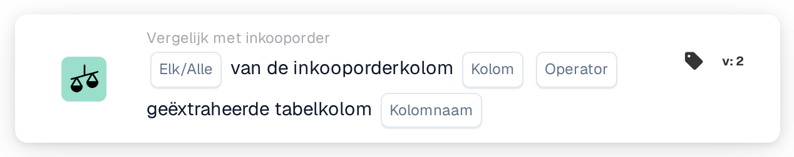
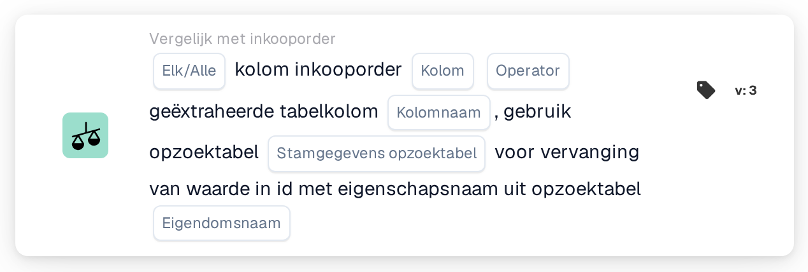

# Inkooporderkolom en geëxtraheerde tabelkolom

<figure><figcaption>
Versie 2
</figcaption></figure>

<figure><figcaption>
Versie 3
</figcaption></figure>

## Doel:

Deze workflowkaart vergelijkt een kolom van de gematchte inkooporderregels met een kolom van de geëxtraheerde tabel met regelitems op het document. Voor elke documentrij die de inkoopordermatching aan een inkooporderregel heeft gekoppeld, wordt de waarde in de geselecteerde inkooporderkolom vergeleken met de waarde in de geselecteerde tabelkolom van die rij. De afzonderlijke resultaten worden vervolgens met de instelling **Elk/Alle** samengevoegd tot het ene resultaat van de kaart.

Versie 3 kan de waarde van de inkooporder vóór de vergelijking bovendien via een opzoektabel met stamgegevens vertalen. Dat helpt wanneer inkooporder en document verschillende codes voor hetzelfde gebruiken, bijvoorbeeld verschillende eenheidscodes.

De inkoopordermatching hoort vóór deze kaart te lopen. Zonder gematchte inkooporder meldt de kaart ontbrekende gegevens.

## Onderdelen van de kaart:

1. **Elk/Alle**
   * **Beschrijving:** Hoe de vergelijkingen van de afzonderlijke rijen worden samengevoegd tot het resultaat van de kaart.
   * **Opties:**
     * **Elk:** Minstens één vergeleken rij voldoet aan de voorwaarde.
     * **Alle:** Elke vergeleken rij voldoet aan de voorwaarde. Is er geen waarde ingesteld, dan gebruikt de kaart **Alle**.
2. **Kolom**
   * **Beschrijving:** De kolom van de inkooporderregel waarvan de waarde wordt vergeleken.
   * **Detail:** De waarde wordt gelezen uit de inkooporderregel die aan de documentrij is gekoppeld.
3. **Operator**
   * **Beschrijving:** Hoe de waarde van de inkooporder wordt vergeleken met de waarde van het document. De waarde van de inkooporder staat aan de linkerkant van de vergelijking, dus **Groter dan** betekent dat de waarde van de inkooporder groter is dan de waarde van het document.
   * **Opties:**
     * **is gelijk aan**
     * **Niet gelijk**
     * **Groter dan**
     * **Groter of gelijk aan**
     * **Minder dan**
     * **Kleiner of gelijk aan**
4. **Kolomnaam**
   * **Beschrijving:** De kolom van de geëxtraheerde tabel op het document die met de inkooporderkolom wordt vergeleken.
   * **Detail:** De kaart gebruikt de eerste geëxtraheerde tabel van het document.
5. **Stamgegevens opzoektabel (alleen versie 3)**
   * **Beschrijving:** Een optionele opzoektabel waarmee de waarde van de inkooporder vóór de vergelijking wordt vertaald.
   * **Detail:** De waarde van de inkooporder wordt, omgezet naar hoofdletters, gezocht in de eigenschap **codevalue** van de opzoektabel. Wordt er een record gevonden dat een waarde heeft voor de geselecteerde **Eigendomsnaam**, dan wordt de waarde van de inkooporder vervangen door de opgeschoonde waarde van die eigenschap. Wordt er geen record of geen waarde gevonden, dan wordt de waarde van de inkooporder in hoofdletters gebruikt. De waarde van het document wordt niet vertaald.
6. **Eigendomsnaam (alleen versie 3)**
   * **Beschrijving:** De eigenschap van het record in de opzoektabel waarvan de waarde de waarde van de inkooporder vervangt.
   * **Detail:** **Stamgegevens opzoektabel** en **Eigendomsnaam** kunnen allebei leeg blijven; de kaart vergelijkt de waarden dan zonder vertaling. Is maar één van beide ingesteld, dan meldt de kaart ontbrekende gegevens.

## Functionaliteit:

* **Voorwaarde-evaluatie:** Voor elke gematchte inkooporderregel zoekt de kaart de daaraan gekoppelde rij (of, in versie 3, rijen) van de documenttabel en vergelijkt ze de twee waarden met de geselecteerde operator.
  * Zijn beide waarden getallen, dan worden ze als getallen vergeleken.
  * Anders worden ze als tekst vergeleken. Bij **is gelijk aan** tellen verschillen in hoofd- en kleine letters niet mee. In versie 3 worden beide waarden vóór de vergelijking naar hoofdletters omgezet; een waarde uit de opzoektabel wordt gebruikt zoals ze daar is opgeslagen. De operatoren voor groter en kleiner vergelijken tekst in eenvoudige tekenvolgorde en zijn daarom vooral nuttig voor numerieke kolommen.
* **Actie-uitvoering:**
  * **True-voorwaarde:**\
    Met **Alle** voldoet elke vergeleken rij aan de operator, met **Elk** minstens één. De workflow gaat verder.
  * **False-voorwaarde:**\
    Wordt aan het samengevoegde resultaat niet voldaan, dan stopt de workflow met een niet voldane voorwaarde.
* **Ontbrekende gegevens:** De kaart evalueert de voorwaarde niet en meldt ontbrekende gegevens in het workflowlogboek wanneer:
  * het document geen gematchte inkooporder heeft of de gegevens van een gematchte inkooporder niet beschikbaar zijn,
  * het document geen geëxtraheerde tabel heeft,
  * de inkooporderkolom van een vergeleken regel leeg is (een numerieke waarde van 0 geldt ook als leeg),
  * de tabelkolom van een vergeleken rij leeg is of ontbreekt,
  * er helemaal geen rij kon worden vergeleken,
  * een vereiste invoer niet is ingesteld (in versie 3 ook wanneer maar één van de twee opzoekinvoeren is ingesteld).

## Opzet en configuratie:

* De kaart kan als And-voorwaarde na de inkoopordermatching worden toegevoegd vanuit de categorie **Vergelijk met inkooporder**. Daarna kunnen **Elk/Alle**, de inkooporder-**Kolom**, de **Operator** en de **Kolomnaam** van de documenttabel worden geselecteerd. In versie 3 kunnen een **Stamgegevens opzoektabel** en een **Eigendomsnaam** worden toegevoegd wanneer de inkooporder andere codes gebruikt dan het document.
* Om een configuratie te controleren, kan **Testkaart** in het kaartmenu van de Workflow Builder op een bestaand document worden gebruikt. Het kaartlogboek somt elke vergelijking op met beide waarden en het resultaat.

## Conclusie:

De workflowkaart "Purchase Order Column and Extracted Table Column" controleert één kolom van de regelitems rij voor rij tegen de gematchte inkooporder. De kaart kan worden gebruikt voor elke kolom die aan beide zijden bestaat, en versie 3 dekt ook gevallen af waarin beide zijden verschillende codes voor dezelfde waarde gebruiken.
