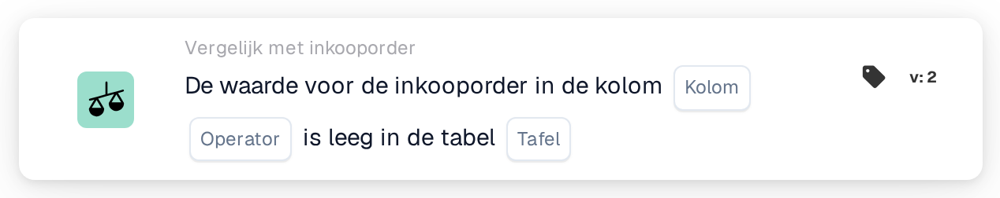

# Inkooporderkolom leeg

<figure><figcaption>
Versie 2
</figcaption></figure>

## Doel:

Deze workflowkaart controleert of een kolom van de inkoopordergegevens leeg is. De kaart kijkt rechtstreeks naar de opgeslagen inkooporder, de regels ervan of de gedistribueerde kosten, en kan bijvoorbeeld worden gebruikt om documenten tegen te houden waarvan de inkooporder informatie mist waarop latere stappen steunen.

## Onderdelen van de kaart:

1. **Kolom**
   * **Beschrijving:** De inkooporderkolom die wordt gecontroleerd.
   * **Detail:** De lijst bevat de kolommen van de inkooporderkop, de inkooporderregels en de gedistribueerde kosten, bijvoorbeeld **Leveranciers-ID**, **Eenheidsprijs**, **Aantal** of **Laadtype**. De kolom hoort deel uit te maken van de in **Tafel** geselecteerde tabel.
2. **Operator**
   * **Beschrijving:** Of de kolom wel of niet leeg hoort te zijn.
   * **Opties:**
     * **Is:** Aan de voorwaarde is voldaan als de kolom in minstens één gecontroleerd record leeg is.
     * **Is niet:** Aan de voorwaarde is voldaan als de kolom in elk gecontroleerd record een waarde heeft.
3. **Tafel**
   * **Beschrijving:** De inkoopordertabel waaruit de kolom wordt gelezen.
   * **Opties:**
     * **Inkooporder:** De inkooporderkop (één record).
     * **Inkooporderregel:** Alle regels van de inkooporder.
     * **Inkooporder gedistribueerde kosten:** Alle gedistribueerde kosten van de inkooporder.

## Functionaliteit:

* **Gebruikte inkooporder:** Heeft de workflowuitvoering een eigen inkooporder, dan wordt die inkooporder gecontroleerd. Anders gebruikt de kaart de inkooporder van de eerste gematchte documentregel of, als er geen regel is gematcht, de eerste inkooporder die voor het document is geladen.
* **Voorwaarde-evaluatie:** De kaart leest alle records van de geselecteerde tabel die bij de inkooporder horen en controleert in elk daarvan de geselecteerde kolom. Een kolom geldt als leeg als ze geen waarde, een lege tekst of een numerieke waarde van 0 heeft. Een ja/nee-waarde geldt altijd als gevuld, ook als ze "nee" is.
* **Kolom niet in de tabel:** Bestaat de geselecteerde kolom niet in de geselecteerde tabel, dan meldt de kaart geen fout. Met **Is** wordt de voorwaarde als voldaan behandeld, met **Is niet** als niet voldaan.
* **Actie-uitvoering:**
  * **True-voorwaarde:**\
    Met **Is** is de kolom in minstens één record leeg, met **Is niet** heeft ze in elk record een waarde. De workflow gaat verder.
  * **False-voorwaarde:**\
    Anders stopt de workflow met een niet voldane voorwaarde.
* **Ontbrekende gegevens:** De kaart evalueert de voorwaarde niet en meldt ontbrekende gegevens in het workflowlogboek wanneer er geen inkooporder beschikbaar is (noch uit de workflowuitvoering, noch aan het document gematcht), wanneer **Kolom** of **Tafel** niet is ingesteld, of wanneer er voor de inkooporder geen record van de geselecteerde tabel bestaat.

## Opzet en configuratie:

* De kaart kan als And-voorwaarde worden toegevoegd vanuit de categorie **Vergelijk met inkooporder**. Daarna kunnen de **Kolom**, de operator en de **Tafel** worden geselecteerd. Door een kolom te kiezen die bij de geselecteerde tabel hoort, wordt het hierboven beschreven stille resultaat vermeden.
* Met **Testkaart** in het kaartmenu van de Workflow Builder kan de kaart op een bestaand document worden uitgeprobeerd.

## Conclusie:

De workflowkaart "Purchase Order Column Empty" controleert de volledigheid van de inkoopordergegevens zelf. Ze helpt om documenten vroeg tegen te houden wanneer de inkooporder een waarde mist waarvan goedkeuring, export of andere workflowstappen afhangen.
